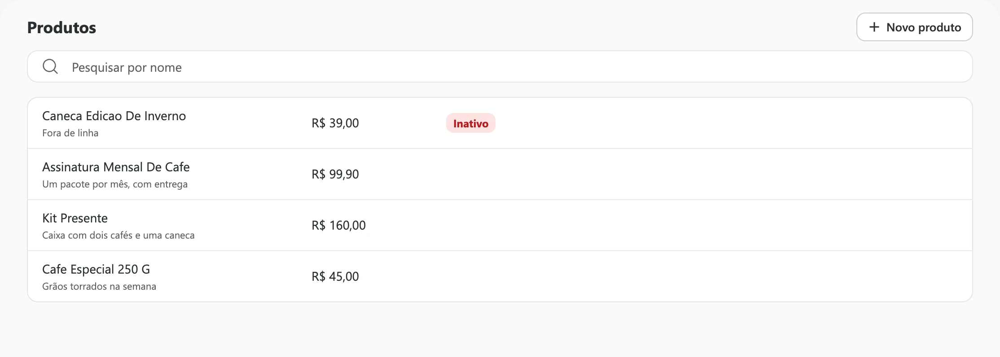
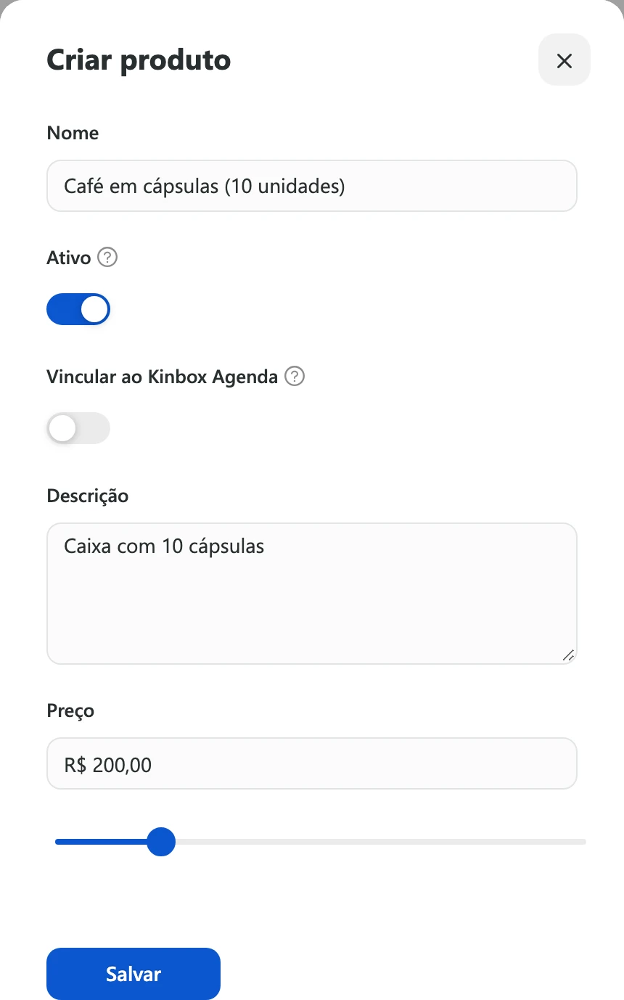

Cadastre os produtos ou serviços da sua empresa na Kinbox para incluí-los nas negociações, filtrar o funil, acompanhar metas por produto e vinculá-los ao Kinbox Agenda.

<Note>
  Quem pode: membros com a permissão **Produtos** (na seção **Gerenciamento do Ambiente**) ou o proprietário do workspace (na tela, **ambiente**). Quem tem apenas **Produtos** (sem a permissão **Funis**) vê o item **Produtos** nas configurações mesmo sem o título da seção **CRM**. Veja [Referência de permissões](/docs/administracao/referencia-de-permissoes).
</Note>

## A lista de produtos

Vá em **Configurações** → **CRM** → **Produtos**. Use **Pesquisar por nome** para localizar um item. A lista exibe nome, preço em reais (`R$`) e o selo **Inativo** nos produtos desativados. No layout atual da Kinbox, a lista também mostra a descrição, e o nome de cada produto aparece com iniciais maiúsculas e sem acento; o nome salvo não muda.

<Frame caption="Lista de produtos com nome, descrição, preço em reais e selo Inativo">
  
</Frame>

## Passo a passo para criar um produto

<Steps>
  <Step title="Abra o painel Criar produto">
    Em **Configurações** → **CRM** → **Produtos**, clique em **Novo produto**.
  </Step>

  <Step title="Preencha os dados do produto">
    No painel **Criar produto**:

    1. **Nome** (obrigatório): digite o nome do produto ou serviço (por exemplo, `Kit presente` ou `Café especial 250 g`).
    2. **Ativo:** vem ligado por padrão.
    3. **Vincular ao Kinbox Agenda:** ligue se esse produto também for vinculado a serviços do [Kinbox Agenda](/docs/agenda/kinbox-agenda). Quando um produto já está vinculado a um serviço do Agenda, a chave fica travada e o desvínculo deve ser feito em **Agenda** → **Serviços**.
    4. **Descrição:** texto opcional sobre o item.
    5. **Preço:** mostrado sempre em `R$`. Atenção: em um produto novo, o campo já começa preenchido com **R$ 200,00** — substitua pelo valor real. A barra deslizante vai até R$ 1.000,00, mas você pode digitar valores maiores diretamente na caixa.
    6. **Campos personalizados:** se o workspace tiver [campos personalizados](/docs/configuracoes-no-workspace/campos-personalizados-no-kinbox) do tipo **Produto**, preencha os que precisar.

    <Frame caption="Painel Criar produto preenchido com nome, chaves Ativo e Vincular ao Kinbox Agenda, descrição e preço">
      
    </Frame>
  </Step>

  <Step title="Salve o cadastro">
    Clique em **Salvar**. A Kinbox exibe a confirmação "Produto criado.".
  </Step>
</Steps>

## Ativo e inativo

Desligar a chave **Ativo** marca o produto com o selo **Inativo** na lista. Produtos inativos deixam de aparecer para seleção em novas negociações, mas continuam visíveis (com a marcação `(Inativo)`) nas negociações em que já estavam incluídos.

## Editar, clonar e excluir

Clique na linha do produto para editar ou passe o mouse sobre a linha e abra o menu **⋯**:

- **Editar:** abre **Editar produto** para alterar qualquer campo e salvar.
- **Clonar:** abre um produto novo já preenchido com os mesmos dados e o nome `"Cópia de ..."` para você ajustar e salvar.
- **Excluir:** pede confirmação e remove o produto do cadastro. Se o produto estiver vinculado ao Kinbox Agenda, a Kinbox abre **Desativar produto** e desativa o item em vez de excluí-lo, para não perder o histórico dos agendamentos.

<Warning>
  Excluir um produto que não está vinculado ao Kinbox Agenda é definitivo e não pode ser desfeito. Se quiser apenas parar de usá-lo em novas negociações, desligue a chave **Ativo**.
</Warning>

## Onde o produto aparece

- **Negociações:** ao clicar em **Adicionar produtos** ou **Add produto** em um **Funil Comercial**, a Kinbox lista apenas produtos ativos e preenche o preço cadastrado. O preço do cadastro vale para novas inclusões: alterar o preço depois não muda negociações que já têm o produto. Veja [Trabalhar com negociações no funil](/docs/crm/gerenciando-funil-de-vendas).
- **Filtro do funil:** no filtro **Produto** do quadro do funil.
- **Metas e Kinbox Agenda:** nas metas por produto (veja [Criar metas para a equipe](/docs/metas/criando-metas-no-kinbox)) e como serviço vinculado no Kinbox Agenda (veja [Cadastrar serviços e locais](/docs/agenda/servicos-e-locais)).
