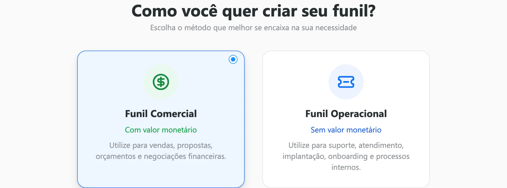
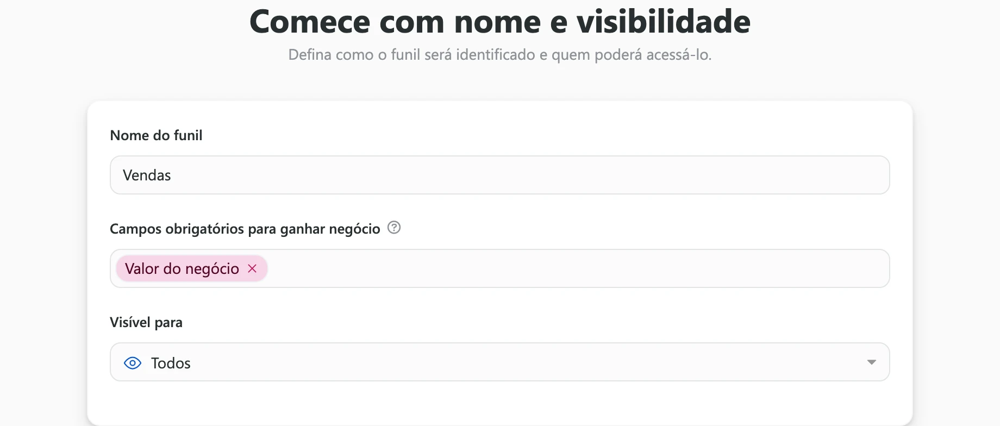
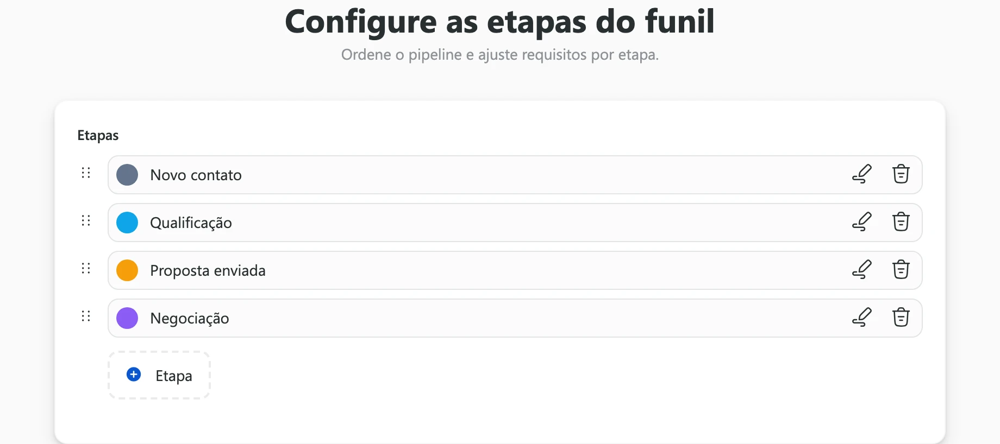

Crie funis comerciais ou operacionais na Kinbox para definir as etapas do seu processo, quem pode visualizar cada funil e quais campos são obrigatórios.

<Note>
  Quem pode: membros com a permissão **Funis** (na seção **Gerenciamento do Ambiente**) ou o proprietário do workspace (na tela, **ambiente**). Se **Configurações** → **CRM** não aparecer, peça ao proprietário a permissão **Funis**. O último passo do assistente (importar negociações) aparece apenas na criação e exige também a permissão **Gerenciar negociações**.
</Note>

## A lista de funis

Vá em **Configurações** → **CRM** → **Funis** (ou clique no botão **+** ao passar o mouse sobre **Funis** na barra lateral do quadro).

A lista mostra apenas os funis visíveis para você (o proprietário vê todos). Use **Pesquisar por nome** ou os filtros **Tudo** e **Visível somente para mim** para filtrar a listagem. Cada linha traz o nome do funil, o indicador de visibilidade (nome do autor em funil privado, **Grupos** em funil por grupos, ou vazio quando é visível para todos) e, ao passar o mouse, o menu **⋯** com **Editar** e **Excluir** (não existe opção de clonar funil).

## Passo a passo para criar um funil

<Steps>
  <Step title="Escolha o tipo do funil">
    Clique em **Novo funil**. No passo **Como você quer criar seu funil?**, escolha o tipo e clique em **Continuar**:

    - **Funil Comercial** ("Com valor monetário", já marcado por padrão): para vendas, propostas, orçamentos e negociações financeiras.
    - **Funil Operacional** ("Sem valor monetário"): para suporte, atendimento, implantação, onboarding e processos internos, onde cada item é um ticket.

    Escolha com atenção: o tipo do funil não pode ser alterado depois de criado.

    <Frame caption="Passo 1 do assistente: escolha entre Funil Comercial e Funil Operacional">
      
    </Frame>
  </Step>

  <Step title="Defina o nome, os campos obrigatórios e a visibilidade">
    No passo **Comece com nome e visibilidade**:

    1. Preencha **Nome do funil** (obrigatório; por exemplo, `Vendas` ou `Pós-venda`).
    2. Em **Campos obrigatórios para ganhar negócio** (no operacional, **Campos obrigatórios para encerrar atendimento**), selecione os campos exigidos para concluir o encerramento. No **Funil Comercial**, **Valor do negócio** já vem marcado por padrão. Veja os detalhes em [Motivos de perda, campos obrigatórios e regras do funil](/docs/crm/motivos-de-perda-e-regras).
    3. Em **Visível para**, escolha **Todos**, **Grupos** ou **Apenas para mim** e clique em **Continuar**.

    <Frame caption="Passo Comece com nome e visibilidade com nome, campos obrigatórios e visibilidade do funil">
      
    </Frame>
  </Step>

  <Step title="Configure as etapas">
    No passo **Configure as etapas do funil** (no operacional, **Configure as etapas operacionais**), clique em **Etapa** para adicionar pelo menos uma etapa. A Kinbox sugere nomes iniciais conforme o tipo, e você pode ajustar tudo:

    - **Nome:** dê um nome a cada etapa (obrigatório).
    - **Cor:** clique na bolinha à esquerda do nome para escolher uma cor.
    - **Ordem:** arraste pela alça à esquerda. A ordem das colunas define a sequência no quadro e o que conta como etapa anterior para a restrição de voltar etapa.
    - **Campos obrigatórios:** clique no lápis para abrir **Campos obrigatórios** e selecionar os campos exigidos para **sair** daquela etapa.
    - **Remover:** clique na lixeira para retirar a etapa da lista (sem confirmação; a remoção só é gravada ao salvar o funil).

    Clique em **Continuar** quando terminar.

    <Frame caption="Passo Configure as etapas do funil com alça de ordem, cor, edição de campos obrigatórios e lixeira">
      
    </Frame>
  </Step>

  <Step title="Configure a cadência (opcional)">
    No passo **Cadência** (no operacional, **Cadência operacional**), você pode adicionar tarefas automáticas por etapa ou apenas clicar em **Continuar** — veja [Cadências: tarefas automáticas por etapa](/docs/crm/cadencias).
  </Step>

  <Step title="Configure motivos e regras">
    No passo **Motivos e regras** (no operacional, **Encerramento e regras**), ajuste os **Motivos de perda** (ou **Motivos de encerramento**) e abra **Configurar regras** se quiser ligar regras no funil — veja [Motivos de perda, campos obrigatórios e regras do funil](/docs/crm/motivos-de-perda-e-regras). Clique em **Continuar**.
  </Step>

  <Step title="Revise e salve o funil">
    No passo **Revise o funil antes de salvar**, confira o **Resumo** e a **Prévia** das etapas. Clicar em **Editar** em qualquer bloco leva ao passo correspondente, e **Continuar** traz de volta para a revisão.

    Clique em **Criar funil** — ou em **Salvar e continuar** quando o passo de importação estiver disponível. Nada é salvo antes deste passo: fechar o assistente com alterações abre o aviso **Fechar sem salvar?**.
  </Step>

  <Step title="Importe negociações (opcional)">
    Na criação, quem também tem **Gerenciar negociações** vê o passo **Importe suas negociações** (no operacional, **Importe seus tickets**). Como o funil já está salvo, você pode usar **Baixar modelo** e **Importar negociações**, ou clicar em **Concluir** para encerrar sem importar — veja [Importar negociações](/docs/crm/importar-negociacoes).
  </Step>
</Steps>

## Quem vê o funil

A opção **Visível para** define quem vê o funil tanto no menu **Funis** quanto em **Configurações** → **CRM** → **Funis**:

- **Todos** (padrão): todos os membros com acesso a funis.
- **Grupos**: apenas membros que pertencem a algum dos grupos selecionados em **Grupos** (veja [Criar grupos de atendimento](/docs/configuracoes-no-workspace/criar-e-gerenciar-grupos)).
- **Apenas para mim**: apenas quem criou o funil.

O proprietário sempre vê todos os funis. Quem não pode ver um funil também não vê as negociações dele.

## Editar um funil

Na lista **Funis**, clique na linha do funil ou em **⋯** → **Editar**. O assistente abre como **Editar funil**, começando em **Comece com nome e visibilidade**, e termina com **Salvar funil**.

- Você pode alterar nome, campos obrigatórios, visibilidade, etapas (nome, cor, ordem, campos obrigatórios, incluir e remover), cadência, motivos e regras.
- Renomear ou reordenar etapas é seguro e não perde as negociações existentes.
- Não é possível mudar o tipo do funil (**Funil Comercial** ou **Funil Operacional**) depois que ele foi criado, nem importar negociações pelo fluxo de edição. Para mudar o tipo, crie um novo funil.

## Excluir uma etapa

Ao remover uma etapa na edição do funil e clicar em **Salvar funil**, as negociações que estavam nela **não são apagadas**, mas deixam de aparecer nas colunas do quadro.

Antes de excluir uma etapa, mova as negociações dela para outra etapa usando **Mover todos os negócios** em [Ações em lote no funil](/docs/crm/acoes-em-lote).

## Excluir um funil

Na lista **Funis**, clique em **⋯** → **Excluir** e confirme. Excluir um funil é definitivo e não pode ser desfeito.

A Kinbox bloqueia a exclusão de qualquer funil que ainda tenha negociações (abertas, ganhas ou perdidas) e exibe a mensagem `"Não pode deletar funil enquanto tiver negociações associadas a ele."`. Para excluir o funil:

1. Abra o funil no quadro e verifique se não há filtros escondendo negociações (use **Fluxo geral**).
2. Mova todas as negociações para outro funil com **Mover todos os negócios** (ou exclua-as) — veja [Ações em lote no funil](/docs/crm/acoes-em-lote).
3. Volte em **Configurações** → **CRM** → **Funis** e exclua o funil.

## Problemas comuns

- **Aparece "Configure pelo menos uma etapa para salvar o funil.".** Adicione ao menos uma etapa no passo **Configure as etapas do funil** antes de avançar ou salvar.
- **Aparece "Não pode deletar funil enquanto tiver negociações associadas a ele.".** O funil ainda possui negociações (inclusive ganhas ou perdidas). Mova todas para outro funil ou exclua-as antes de repetir a exclusão.
- **Não consigo alterar o tipo do funil.** Depois de criado, um **Funil Comercial** não vira **Funil Operacional** (nem o contrário). Crie um funil novo do tipo desejado.
- **Um membro não encontra o funil no menu Funis.** Confirme se o funil está visível para **Todos** ou para um grupo do qual esse membro participa e se o papel dele tem **Gerenciar negociações**.
