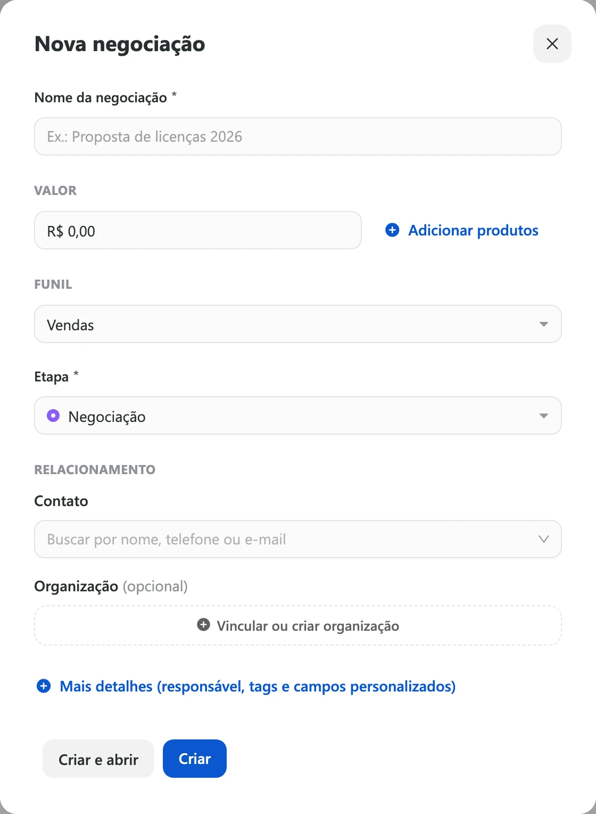
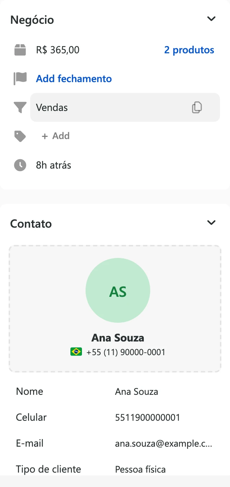
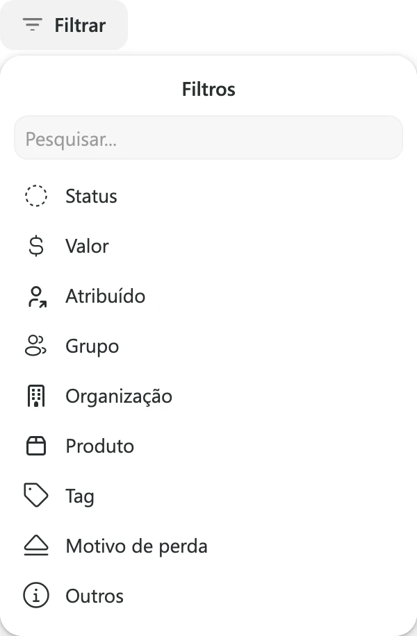

Use o quadro do funil para criar, acompanhar, filtrar, mover e encerrar negociações no dia a dia — e também para gerenciar negociações direto dentro de uma conversa.

<Note>
  Quem pode: membros com a permissão **Gerenciar negociações** ou o proprietário do workspace. Se o item **Funis** não aparecer no menu lateral, peça ao proprietário a permissão **Gerenciar negociações**. O que você vê no quadro depende das restrições de visibilidade do seu papel e da visibilidade de cada funil; excluir, exportar e voltar etapa exigem não ter as restrições correspondentes (o proprietário nunca tem restrições). Veja [Referência de permissões](/docs/administracao/referencia-de-permissoes) e [Criar papéis e permissões](/docs/configuracoes-no-workspace/configurar-permissoes-dos-usuarios).
</Note>

## Abrir um funil

Clique no ícone **Funis** no menu lateral (o nome aparece ao passar o mouse) e escolha um funil na lista **Funis** à esquerda. O botão ao lado do nome do funil recolhe ou mostra essa lista.

Ao abrir **Funis**, a Kinbox carrega automaticamente o último funil que você usou neste navegador (ou o primeiro funil visível para você). Se nenhum funil estiver disponível, a tela exibe "Nenhum funil encontrado" e, para quem tem a permissão **Funis**, o botão **Criar Funil** — veja [Criar um funil e as etapas](/docs/crm/criar-funil-de-vendas).

## O quadro

Cada etapa do funil aparece como uma coluna na ordem configurada. No cabeçalho de cada coluna ficam a cor, o nome da etapa, a contagem de negociações e, no **Funil Comercial**, a soma dos valores. Esse número e essa soma consideram **todas** as negociações da etapa que passam pela pesquisa, pelos filtros e pelo período atuais — abertas, ganhas e perdidas.

- **Ações na coluna:** passe o mouse no cabeçalho da coluna para ver **+** (cria uma negociação já naquela etapa) e **Atualizar** (recarrega apenas aquela etapa). No fim de cada coluna há também um botão tracejado **+**.
- **Carregar mais:** role a coluna para baixo para carregar os demais cartões. A ordem dos cartões segue a ordenação escolhida no topo (não é possível reordenar cartões à mão dentro da mesma coluna).
- **O cartão:** exibe o nome da negociação, o contato (e a organização, se houver), o valor (no comercial), tarefas concluídas/total, número de comentários, ícone de conversa, grupo e foto do responsável. O ícone de conversa fica vermelho quando a conversa associada está pendente; clicar nele abre a conversa no painel lateral **Conversa** (com o botão **Abrir conversa**) sem sair do quadro.
- **Status visual:** cartões ganhos aparecem em verde com ✓ no canto superior direito; cartões perdidos aparecem em vermelho com ✕.

No **Funil Operacional**, a coluna não mostra soma de valor e o cartão exibe o ID do ticket e o prazo de SLA em vez de valor — veja as diferenças em [Funis e negociações: visão geral](/docs/crm/visao-geral).

<Frame caption="Quadro do funil Vendas com etapas, somas de valor e cartões aberto, ganho e perdido">
  
</Frame>

## Criar uma negociação

<Steps>
  <Step title="Abra o formulário de criação">
    No quadro do funil, clique no botão **+** no cabeçalho ou no pé da coluna da etapa desejada para abrir **Nova negociação** (no **Funil Operacional**, **Novo ticket**).
  </Step>
  <Step title="Preencha os campos da negociação">
    1. **Nome da negociação** (obrigatório; no operacional, **Título do ticket**): no funil comercial, enquanto você não digita um nome, a Kinbox sugere "Negócio de ..." com o nome do contato ou da organização escolhidos.
    2. **Valor** (só no comercial): informe o valor ou clique em **Adicionar produtos** para somar produtos cadastrados (com produtos, o valor passa a ser a soma deles). No operacional, preencha **Descrição** e **SLA** se desejar.
    3. **Funil** e **Etapa** (obrigatórios): já vêm preenchidos com o funil e a etapa da coluna onde você clicou.
    4. **Contato** (obrigatório): busque por nome, telefone ou e-mail. Se o contato já existe, selecione-o na busca em vez de criar outro. Para cadastrar um contato novo na hora, use **Criar contato** (exige a permissão **Gerenciar Contatos**). Veja [Contatos: encontrar, cadastrar, editar e excluir](/docs/conversas/clientes-contatos-e-organizacoes).
    5. **Organização (opcional):** clique em **Vincular ou criar organização** (ou **Vincular organização**). Se o contato já tiver uma organização principal, ela aparece sugerida; com **Gerenciar Organizações**, a opção **Vincular o contato a esta organização também** vem marcada. Veja [Agrupar contatos em organizações](/docs/clientes/organizacoes).
    6. **Mais detalhes (responsável, tags e campos personalizados):** clique para definir **Responsável** (se ficar vazio, a negociação fica atribuída a você), **Tags** e campos personalizados.

    <Frame caption="Janela Nova negociação com os campos de valor, funil, relacionamento e mais detalhes">
      
    </Frame>
  </Step>
  <Step title="Salve a negociação">
    Clique em **Criar** ou em **Criar e abrir**. Quando você cria pelo **+** de uma etapa no quadro, a Kinbox abre a negociação criada em seguida.
  </Step>
</Steps>

Se aparecer um aviso informando que o contato já possui uma negociação aberta ou atingiu o limite permitido, verifique se o seu papel tem uma restrição de criação (**Não pode criar negócio se já contato tiver um negócio aberto** ou **Não pode criar negócio se já contato tiver negócio aberto para outro agente**) ou se o funil usa a regra **Máximo de negócios abertos por contato** — veja [Motivos de perda, campos obrigatórios e regras do funil](/docs/crm/motivos-de-perda-e-regras).

## Abrir e editar uma negociação

Clique em qualquer cartão no quadro para abrir a negociação por cima do quadro.

### Cabeçalho e barra de etapas

No topo ficam o botão de voltar, o título editável, os botões de encerramento (✓ e ✕, ou **Retomar negociação**), o **Responsável**, o **Grupo** e o menu **⋯**, seguidos pela barra de etapas (passe o mouse sobre uma etapa para ver **Etapa** e **Tempo na etapa**).

- **Responsável:** clique para atribuir ou trocar o membro (exige a permissão **Atribuir**; com **Somente pode atribuir para quem pertence ao grupo do membro**, aparecem apenas membros dos seus grupos). Se houver tarefas abertas na negociação, a Kinbox pergunta **Transferir tarefas em aberto?** com as opções **Transferir tarefas** e **Não transferir tarefas**.
- **Grupo:** clique em **Mover para grupo** para escolher um grupo ou **Sem grupo** (respeita **Somente pode mover para grupo que pertence**).
- **Menu ⋯:**
  - **Ir para conversa:** abre a conversa associada na Caixa de entrada (fica desativado se não houver conversa vinculada).
  - **Associar uma conversa:** aparece quando ainda não existe conversa vinculada e permite ligar uma das conversas do contato pelo canal. Depois de associar, não é possível desassociar pela tela.
  - **Excluir:** apaga a negociação (veja abaixo).

<Frame caption="Cabeçalho da negociação com encerramento, responsável, grupo, menu de opções e barra de etapas">
  
</Frame>

### Painéis e histórico

No painel **Negócio** (na coluna da direita), você altera:

- **Valor e produtos:** clique em **Add valor** (ou no valor atual) para editar. Clique em **Add produto** (ou na contagem de produtos) para abrir **Adicionar produtos a negociação**, escolher produtos ativos em **Produtos**, definir **Preço**, **Quantidade** e **Desconto** (em `%` ou valor) e clicar em **Salvar** — o **Total** passa a ser o valor da negociação. Veja como cadastrar itens em [Cadastrar produtos](/docs/crm/criar-e-gerenciar-produtos).
- **Previsão de Fechamento:** clique em **Add fechamento** (ou na data) para definir a previsão.
- **Funil:** clique no nome do funil para abrir **Editar etapa e funil** e trocar a negociação de funil e etapa (mostra apenas funis visíveis para você). Levar uma negociação para um **Funil Operacional** zera valor e produtos e gera um número de ticket.
- **Tags e campos personalizados:** adicione ou remova [tags](/docs/configuracoes-no-workspace/criar-e-gerenciar-tags) e preencha os [campos personalizados](/docs/configuracoes-no-workspace/campos-personalizados-no-kinbox) de negociação (se o funil tiver a regra de exibir apenas campos selecionados, aparecem só esses).

No **Funil Operacional**, o painel chama-se **Ticket**, exibe **Ticket ID** e **SLA** (no lugar de valor, produtos e fechamento), e a **Descrição** fica em um cartão acima da caixa de comentário.

<Frame caption="Painéis Negócio e Contato na coluna da direita da negociação">
  
</Frame>

Os demais blocos da negociação reúnem:

- **Contato:** exibe e permite editar nome, telefone, e-mail e campos personalizados do contato, respeitando as permissões de contato do seu papel (o painel some para quem tem **Esconder informações do contato**).
- **Organização:** permite vincular uma organização do contato (ou buscar outra), trocar (**Trocar organização**) ou remover (**Remover da negociação**). Se o contato ainda não fizer parte da organização escolhida, aparece o botão **Vincular** (para quem tem **Gerenciar Organizações**).
- **Tarefas:** clique em **Tarefa** abaixo da caixa de comentário para criar uma tarefa já ligada à negociação, ou gerencie as tarefas existentes no painel **Tarefas** (concluir, abrir ou excluir). Tarefas obrigatórias exibem um indicador e travam a mudança de etapa.
- **Comentários e Destacado:** escreva comentários, mencione membros com `@` (o membro mencionado recebe notificação), insira emojis ou anexos, reaja, clique em **Responder** para abrir um fio, edite os seus comentários ou use **Destacar** para fixar o comentário na seção **Destacado**.
- **Histórico:** registra a criação, comentários e alterações da negociação, com filtro para ver **Tudo**, **Comentários** ou apenas o registro de alterações.

## Mudar de etapa

Você pode mudar uma negociação de etapa arrastando o cartão para outra coluna no quadro, clicando diretamente na etapa desejada na barra de etapas da negociação ou usando **Editar etapa e funil** no painel **Negócio**.

Ao mudar a etapa pelo quadro ou pela negociação, a Kinbox confere, nesta ordem:

1. Se o seu papel tem a restrição **Não pode voltar para etapa anterior** (bloqueia mover para uma etapa anterior).
2. Se existe alguma tarefa obrigatória pendente (não concluída e não cancelada) na negociação.
3. Se todos os campos obrigatórios **da etapa em que a negociação está** foram preenchidos (para sair dela).

Se alguma dessas verificações falhar, a Kinbox mostra o aviso e mantém a negociação na etapa atual. Negociações ganhas ou perdidas também podem mudar de etapa e continuam ganhas ou perdidas — para reabrir, use **Retomar negociação**.

Quando a negociação entra em uma etapa com cadência configurada, a Kinbox cria as tarefas automáticas daquela etapa — veja [Cadências: tarefas automáticas por etapa](/docs/crm/cadencias).

## Ganhar, perder e retomar

- **Ganhar (✓):** no **Funil Comercial**, a Kinbox verifica apenas os **Campos obrigatórios para ganhar negócio** configurados no funil. Se algum campo faltar, ela avisa e destaca o campo; se tudo estiver preenchido, a negociação é marcada como ganha na hora, sem pedir motivo. No **Funil Operacional**, **Marcar como resolvido** confere os campos obrigatórios de encerramento e abre **Ticket resolvido** para escolher **Motivo** e **Detalhes**.
- **Perder (✕):** abre **Perda de negócio** (no operacional, **Ticket não resolvido**) com **Motivo** (obrigatório; você pode marcar mais de um) e **Detalhes** (opcional). Se o funil tiver a regra **Usar motivo de perda por produto.** e a negociação tiver produtos, a janela pede motivo para cada produto.
- **Mover automaticamente:** se o funil tiver a regra de mover ao ganhar ou ao perder, a negociação vai para a etapa configurada junto com a mudança de status. Veja como configurar motivos, campos e regras em [Motivos de perda, campos obrigatórios e regras do funil](/docs/crm/motivos-de-perda-e-regras).
- **Retomar:** em uma negociação ganha ou perdida, clique em **Retomar negociação** (ou **Retomar ticket**) no cabeçalho para voltar o status para **Aberto** na mesma etapa.

<Frame caption="Janela Perda de negócio com seleção obrigatória de motivo e campo opcional de detalhes">
  
</Frame>

## Excluir uma negociação

Para excluir, abra a negociação, clique em **⋯** → **Excluir** e confirme.

<Warning>
  Excluir uma negociação é definitivo e não tem volta. Todos os comentários, o histórico e as tarefas ligadas a ela são apagados junto com a negociação. O contato, a organização e a conversa permanecem no workspace.
</Warning>

Membros com a restrição **Não pode excluir negociação** não conseguem excluir negociações (o proprietário nunca tem restrições).

## Na conversa

Você pode ver, criar e editar negociações sem sair da [Caixa de entrada: visão geral](/docs/conversas/caixa-de-entrada-do-kinbox). Abra a conversa e, no painel **Detalhes** à direita, clique em **Negociações** para abrir a seção (se o painel estiver fechado, clique em **Mostrar detalhes do contato**).

- A seção lista as negociações **do contato** da conversa, não só as associadas a ela. Se a seção **Negociações** não aparecer na conversa, falta a permissão **Pode gerenciar as negociações da conversa.** no seu papel; para criar ou editar a partir dali, seu papel também precisa de **Gerenciar negociações**.
- Para criar uma negociação dali, passe o mouse no título **Negociações** e clique em **+** (ou clique em **Negócio** se o contato ainda não tiver nenhuma). A janela já abre com o contato fixo, o nome do contato preenchido e esta conversa associada automaticamente; se você deixar **Responsável** vazio, a negociação fica atribuída a quem criou.
- Clicar em um cartão da lista abre a negociação em uma gaveta lateral por cima da conversa, com as mesmas ações do quadro.

<Frame caption="Seção Negociações na aba Detalhes de uma conversa, com o botão + para criar">
  
</Frame>

## Pesquisar, filtrar e ordenar

Na barra do topo do quadro, você encontra rapidamente as negociações do funil aberto:

- **Pesquisar:** digite no campo **Pesquisar** e pressione `Enter`. A pesquisa procura no nome da negociação, no nome do contato, no telefone do contato e, digitando `#` seguido do número (por exemplo, `#123`), no ID do contato.
- **Filtrar:** clique em **Filtrar** para abrir o menu **Filtros** e combinar critérios:
  - **Status** (**Ganho**, **Perdido** e **Em andamento**), **Valor**, **Atribuído**, **Grupo** (incluindo negociações sem grupo), **Organização**, **Produto**, **Tag**, **Motivo de perda** (do funil aberto) e **Etapa** (do funil aberto);
  - **Outros:** **Tem comentários**, **Associado a uma conversa**, **Conversa pendente**, **Criado por Meta Ads** e **Criado por Google Ads**;
  - **Datas:** **Criado em**, **Ganho/perdido em**, **Previsão de fechamento** e **Última mudança de etapa**;
  - **Campos customizados:** campos personalizados de negociação;
  - **Filtros salvos:** segmentos já salvos.
- Com dois ou mais filtros aplicados, clique em **todos** para alternar entre exigir **todos** ou **qualquer** dos filtros. Use **Salvar segmento** para guardar a combinação em **Filtros salvos** (visível para **Todos**, **Grupos** ou **Apenas para mim**) e **Limpar filtros** para remover todos.

<Frame caption="Menu Filtros aberto na barra superior do quadro do funil">
  
</Frame>

- **Período do fluxo:** o padrão é **Fluxo geral** (mostra todas as negociações). Nas outras opções (**Fluxo do mês**, **Fluxo do mês passado**, **Fluxo de 3 meses passados**, **Fluxo de 6 meses passados** e **Fluxo de 12 meses passados**), o quadro continua mostrando todas as negociações em aberto e filtra apenas as ganhas e perdidas pela data de fechamento.
- **Ordenação:** o padrão é **Mais recentes**; você também pode ordenar por **Mais antigos**, **Maior valor**, **Menor valor**, **Mensagem mais recente**, **Mensagem mais antiga**, **Pendência mais antiga** e **Pendência mais recente**. Atenção: ao escolher **Pendência mais antiga** ou **Pendência mais recente**, o quadro passa a exibir somente as negociações que têm conversa pendente.

Pesquisa e filtros são limpos ao recarregar a página; o último funil aberto, o período, a ordenação e os campos exibidos nos cartões ficam guardados no seu navegador.

## Menu do funil e Analítico

No computador, com um funil aberto, o botão **⋯** no canto superior direito oferece cinco opções:

- **Executar ação...:** aplica uma alteração em massa nas negociações filtradas — veja [Ações em lote no funil](/docs/crm/acoes-em-lote).
- **Atualizar a cada 30s:** liga a atualização automática de todas as colunas a cada 30 segundos (o item vira **Parar de atualizar a cada 30s** e volta a desligado ao recarregar a página).
- **Mostrar campos...:** permite exibir **ID do contato** e campos personalizados de negociação nos cartões do quadro. A escolha fica salva no navegador e vale para todos os funis.
- **Exportar:** baixa em **CSV** ou Excel (`.xlsx`) todas as negociações do funil aberto que passam pelos filtros, pesquisa e período atuais, com os dados da negociação, do contato, o link da conversa associada e os campos personalizados (no funil comercial, o status das ganhas sai como "Vendido"). Se **Exportar** estiver apagado, seu papel tem a restrição **Não pode exportar negociações** (o proprietário sempre pode exportar).
- **Importar:** cria negociações em massa por planilha — veja [Importar negociações](/docs/crm/importar-negociacoes).

<Frame caption="Menu de opções do funil aberto no canto superior direito do quadro">
  
</Frame>

Ao lado de **⋯**, o ícone **Analítico** abre um painel com **Total**, **Valor total**, **Ticket médio**, lista de negócios e gráficos para o funil aberto (usando os filtros, a pesquisa e o período do quadro). Nele você escolhe o período de criação, a **Métrica** (**Por quantidade**, **Por valor** ou **Tempo até ganhar ou perder o negócio**), o **Agrupamento** e a **Visualização** (**Linha**, **Pizza**, **Ranking** ou **Barra**).

## No celular

No navegador do celular, o quadro exibe as colunas e os cartões, mas **Pesquisar**, **Filtrar**, período, ordenação, **Analítico** e o menu **⋯** estão disponíveis apenas no computador.

## Problemas comuns

- **Não consigo mover a negociação de etapa.** Confira, nesta ordem: se o seu papel tem **Não pode voltar para etapa anterior**, se existe tarefa obrigatória pendente na negociação (conclua ou cancele) e se todos os campos obrigatórios da etapa **atual** estão preenchidos.
- **Não vejo um funil ou algumas negociações.** A Kinbox exibe apenas funis com visibilidade liberada para você e negociações permitidas pelas restrições do seu papel. Peça ao proprietário ou a quem configura funis para revisar a visibilidade e as permissões.
- **O item Exportar aparece apagado no menu ⋯.** Seu papel tem a restrição **Não pode exportar negociações**. Peça ao proprietário para alterar o papel se você precisar exportar.
- **Não consigo marcar a negociação como perdida.** Escolha pelo menos um **Motivo** na janela **Perda de negócio**. Se não houver opções cadastradas, peça a quem tem a permissão **Funis** para incluir motivos em [Motivos de perda, campos obrigatórios e regras do funil](/docs/crm/motivos-de-perda-e-regras).
- **Aparece "Você não tem permissão para acessar esse funil" ao abrir um link.** Você não tem acesso ao funil do link (ou ele não existe mais) e a Kinbox redireciona para o último funil disponível para você.
