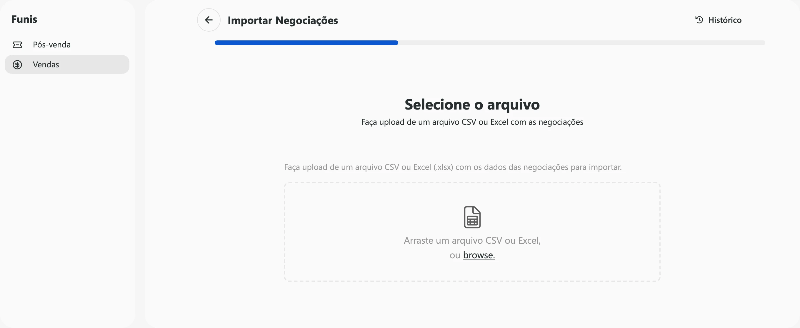

Importe uma planilha `.csv` ou `.xlsx` para criar várias negociações (ou tickets, em um **Funil Operacional**) de uma vez em um funil da Kinbox.

<Note>
  Quem pode: membros com a permissão **Gerenciar negociações** ou o proprietário do workspace. Se o item **Funis** não aparecer no menu lateral, peça ao proprietário a permissão **Gerenciar negociações**. O item **Importar** no menu **⋯** só aparece com um funil aberto, no computador e no layout atual da Kinbox — se **Importar** não aparecer em **⋯**, confirme que você abriu um funil no computador e está usando o layout atual.
</Note>

## Antes de começar: prepare a planilha

Monte a planilha antes de abrir a importação (pelo menu **⋯** → **Importar** não há planilha modelo para baixar; o modelo existe apenas ao criar um funil novo):

- **Formato e tamanho:** arquivo `.csv` (UTF-8, separado por vírgula ou ponto e vírgula) ou Excel `.xlsx`, com no máximo **10 MB**. No Excel, apenas a **primeira aba** é lida.
- **Cabeçalho:** use a primeira linha para os títulos das colunas. Colunas sem título e linhas vazias são ignoradas.
- **Coluna obrigatória:** inclua pelo menos **Nome da negociação** (no operacional, **Título do ticket**) **ou** **Nome do contato**.
- **Telefone e e-mail:** são usados para identificar contatos existentes (para importar só contatos, sem negociações, veja [Importar contatos de uma planilha](/docs/clientes/importar-contatos)). Sem telefone e sem e-mail, cada linha cria um contato novo. Formate a coluna de telefone como texto no CSV (ou envie em `.xlsx`) e comece números de outros países com `+` e o código do país.
- **Etapa:** informe o nome exato de uma etapa do funil; se ficar vazia, a negociação entra na primeira etapa.
- **Status:** escreva `aberto`, `ganho` ou `perdido` (no **Funil Operacional**, escreva `ganho` para resolvido e `perdido` para não resolvido). Células vazias ou outros textos entram como aberto.
- **Valor (só no Funil Comercial):** no CSV, escreva apenas números e ponto para os centavos (por exemplo, `1500.50`), sem `R$` e sem ponto de milhar; no Excel, use célula numérica.
- **Datas:** use `DD/MM/AAAA` (com dois dígitos para dia e mês). Datas inválidas fazem a linha dar erro.
- **Responsável:** se você não preencher, a negociação fica atribuída a quem fez a importação. Para distribuir as negociações depois de importar, use **Atribuir todos os negócios para um membro** em [Ações em lote no funil](/docs/crm/acoes-em-lote).

## Passo a passo

<Steps>
  <Step title="Abra a tela Importar Negociações">
    No menu lateral **Funis**, abra o funil de destino, clique no menu **⋯** no canto superior direito e selecione **Importar**.
  </Step>

  <Step title="Selecione o arquivo">
    No passo **Selecione o arquivo**, arraste a planilha `.csv` ou `.xlsx` para a área de envio (ou clique para escolher o arquivo no computador). Revise a prévia das primeiras linhas e clique em **Próximo**.

    <Frame caption="Tela Importar Negociações no passo Selecione o arquivo, com acesso ao Histórico no topo">
      
    </Frame>
  </Step>

  <Step title="Mapeie as colunas e as tags">
    No passo **Mapeie as colunas**, associe cada coluna do arquivo ao campo correspondente em **Campo da negociação** (os campos personalizados de negociação aparecem no grupo **Campos Personalizados**).

    A Kinbox sugere o campo de cada coluna automaticamente. Confira todas as associações antes de avançar — principalmente **Nome do contato**, **Telefone do contato** e **E-mail do contato**.

    Se você mapear **Tags (separadas por vírgula)**, aparece a seção **Mapeamento de Tags** para ligar cada valor a uma tag existente, criar uma nova tag ou ignorar. A caixa **Criar automaticamente tags não mapeadas** vem marcada por padrão (veja [Criar e usar tags](/docs/configuracoes-no-workspace/criar-e-gerenciar-tags)). Clique em **Próximo**.
  </Step>

  <Step title="Confirme a importação">
    No passo **Confirme a importação**, revise **Resumo da Importação** e **Colunas não mapeadas** (que serão ignoradas).

    Se quiser pular contatos que já possuem uma negociação aberta nesse funil, marque **Não criar negociação se já existir contato com negociação** (desmarcada por padrão). Clique em **Finalizar**.
  </Step>

  <Step title="Acompanhe o progresso">
    A janela **Importando Negociações** exibe a barra de andamento e os contadores **Criados**, **Ignorados**, **Erros** e **Pendentes**. Se precisar interromper, clique em **Cancelar Importação** (as negociações já criadas permanecem no funil).

    Mesmo que você saia da página, a importação continua em andamento e pode ser acompanhada em **Histórico**.
  </Step>
</Steps>

## O que acontece com cada linha

- **Sempre cria negociações novas:** cada linha gera uma nova negociação no funil escolhido; a importação nunca atualiza negociações existentes.
- **Contato novo ou existente:** se já existir um contato com o mesmo telefone ou e-mail, a negociação é ligada a ele sem substituir os dados cadastrados (e sem alterar telefone ou e-mail). Se não existir correspondência — ou se a linha não tiver telefone nem e-mail — um novo contato é criado.
- **Tags e campos personalizados:** as tags vão para a negociação; os campos personalizados gravam o texto exatamente como está na célula.
- **Cadência, regras e tickets:** as negociações importadas disparam a [cadência](/docs/crm/cadencias) da etapa em que entram e respeitam a regra **Máximo de negócios abertos por contato** (veja [Motivos de perda, campos obrigatórios e regras do funil](/docs/crm/motivos-de-perda-e-regras)). No **Funil Operacional**, cada linha recebe um número de ticket.
- **Conversas:** as negociações importadas nascem sem conversa associada. Para vincular depois, use **Associar conversas** em [Ações em lote no funil](/docs/crm/acoes-em-lote).

## Histórico e erros

Na tela **Importar Negociações**, clique em **Histórico** no topo para abrir **Histórico de Importações** (lista importações com status **Concluído**, **Processando**, **Pendente**, **Falhou**, **Cancelado** ou **Revertido**).

Clique em qualquer importação para abrir **Detalhes da Importação**:

- **Resumo:** exibe datas, contadores (**Total de linhas**, **Processados**, **Criados com sucesso**, **Ignorados**, **Erros**) e o **Mapeamento** usado.
- **Erros:** mostra o número aproximado da linha na planilha e o motivo da falha. Quando uma linha dá erro, ela não é criada e as demais continuam sendo processadas.
- **Ver … negociações:** em importações concluídas com itens criados, abre a lista das negociações criadas por aquela importação.

## Reverter uma importação

Para desfazer uma importação concluída, abra **Histórico**, clique na importação desejada, clique em **Reverter importação** e confirme em **Reverter**.

O botão **Reverter importação** aparece apenas para importações com status **Concluído** e pelo menos uma negociação criada — ele não aparece para importações canceladas ou que falharam. Reverter exige a permissão **Gerenciar negociações** (ou ser o proprietário) e não tem limite de prazo.

<Warning>
  Reverter uma importação não pode ser desfeito e exclui definitivamente todas as negociações criadas por ela — inclusive negociações que já foram editadas, movidas de etapa ou de funil, ganhas ou perdidas. Contatos criados, dados preenchidos em contatos existentes e tags criadas pela importação não são apagados.
</Warning>

## Importar ao criar um funil

Ao criar um funil novo em **Configurações** → **CRM** → **Funis**, quem tem as permissões **Funis** e **Gerenciar negociações** encontra o passo **Importe suas negociações** (no operacional, **Importe seus tickets**) ao final do assistente, onde também fica o botão **Baixar modelo** em **CSV** ou **XLSX** — veja [Criar um funil e as etapas](/docs/crm/criar-funil-de-vendas).
