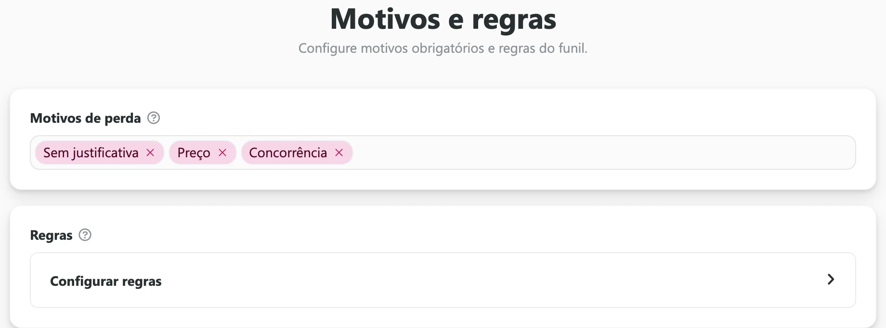

Os motivos de encerramento, os campos obrigatórios e as regras valem para o funil inteiro e são configurados no assistente do funil em **Configurações** → **CRM** → **Funis** (exige a permissão **Funis** ou ser o proprietário do workspace, chamado na tela de **ambiente**). Veja o passo a passo completo em [Criar um funil e as etapas](/docs/crm/criar-funil-de-vendas).

<Frame caption="Passo Motivos e regras do assistente com Motivos de perda e a seção Configurar regras">
  
</Frame>

## Motivos de perda e de encerramento

Configurados no passo **Motivos e regras** (no **Funil Operacional**, **Encerramento e regras**). Para adicionar um motivo, digite o nome no campo e pressione `Enter`; para remover, clique no **x** da etiqueta. A lista sugere os motivos padrão do tipo e motivos já usados em outros funis do workspace.

| Tipo de funil | Nome do campo | Motivos padrão ao criar |
| --- | --- | --- |
| **Funil Comercial** | **Motivos de perda** | **Sem justificativa**, **Preço**, **Desconto**, **Concorrência**, **Não atendeu as expectativas** |
| **Funil Operacional** | **Motivos de encerramento** | **Resolvido**, **Encaminhado**, **Aguardando cliente**, **Sem resposta**, **Cancelado** |

- **Funil Comercial:** ao clicar em **Marcar como perdido** na negociação, abre **Perda de negócio** com **Motivo** (obrigatório; aceita marcar mais de um) e **Detalhes** (opcional). **Marcar como ganho** não pede motivo. Mantenha pelo menos um motivo cadastrado no funil.
- **Funil Operacional:** a mesma lista de **Motivos de encerramento** aparece em **Ticket resolvido** (com **Resolvido** já marcado se estiver na lista) e em **Ticket não resolvido**.
- **Onde aparecem depois:** no painel da negociação (**Motivo da perda**, **Motivo de resolução** ou **Motivo de não resolução**), no filtro **Motivo de perda** do quadro, na exportação do funil e no agrupamento **Motivo da perda** dos relatórios.
- **Alterar a lista:** remover um motivo não altera as negociações já encerradas com ele, mas o retira das novas escolhas e do filtro.

## Campos obrigatórios para ganhar negócio

Configurados no passo **Comece com nome e visibilidade**.

| Tipo de funil | Nome do campo | Opções disponíveis | Quando é conferido |
| --- | --- | --- | --- |
| **Funil Comercial** | **Campos obrigatórios para ganhar negócio** | **Valor do negócio** (marcado por padrão no funil novo; exige valor maior que zero), **Produto** (pelo menos um produto) e campos personalizados de negociação | Ao marcar a negociação como ganha (não é conferido ao marcar como perdida) |
| **Funil Operacional** | **Campos obrigatórios para encerrar atendimento** | Campos personalizados de negociação | Ao marcar o ticket como resolvido (não é conferido ao marcar como não resolvido) |

Se algum campo obrigatório estiver vazio, a Kinbox impede o encerramento, avisa qual campo falta e destaca o campo na tela. Esses campos valem só para encerrar a negociação: mudar de etapa não os confere (para isso existem os campos obrigatórios da etapa, abaixo). Crie os campos personalizados antes em **Configurações** → **Ambiente** → **Campos personalizados** para a entidade **Negociação** (veja [Criar campos personalizados](/docs/configuracoes-no-workspace/campos-personalizados-no-kinbox)).

## Campos obrigatórios da etapa

Configurados no passo **Configure as etapas do funil**, clicando no ícone de lápis de cada etapa (**Campos obrigatórios**).

- **Opções:** **Valor do negócio**, **Produto** (apenas no **Funil Comercial**) e campos personalizados de negociação.
- **Quando valem:** são exigidos para **sair da etapa em que a negociação está** (em qualquer direção, para a frente ou para trás). Por exemplo: se a etapa **Proposta enviada** exige **Valor do negócio**, a negociação só sai de **Proposta enviada** quando o valor estiver preenchido.
- **Ao ganhar ou perder:** não são conferidos; ao marcar como ganha, valem apenas os **Campos obrigatórios para ganhar negócio** (acima).

O que mais pode impedir a mudança de etapa está em [Trabalhar com negociações no funil](/docs/crm/gerenciando-funil-de-vendas#mudar-de-etapa).

## Regras

No passo **Motivos e regras**, abra **Configurar regras**, clique em **Regra** e selecione a opção desejada. Um funil novo começa sem regras ligadas.

| Regra | O que faz |
| --- | --- |
| **Mover negócio para estágio específico ao ganhar** *(operacional: **Mover ticket para etapa específica ao resolver**)* | Pede uma **Etapa**. Quando a negociação é marcada como ganha (ou o ticket como resolvido), ela vai automaticamente para a etapa escolhida. |
| **Somente mostrar campos personalizados selecionados** | Pede os campos personalizados na ordem desejada. Na tela da negociação, exibe apenas os campos selecionados, na ordem escolhida. Inclua na seleção qualquer campo obrigatório para ganhar ou sair de etapa, para que o membro consiga preenchê-lo. |
| **Mover negócio para estágio específico ao perder** *(operacional: **Mover ticket para etapa específica ao marcar como não resolvido**)* | Pede uma **Etapa**. Quando a perda (ou não resolução) é confirmada, ela vai automaticamente para a etapa escolhida. |
| **Máximo de negócios abertos por contato** *(operacional: **Máximo de tickets abertos por contato**)* | Pede um número (mínimo 1). Ao criar uma negociação para um contato existente, conta as negociações abertas desse contato **neste funil** e bloqueia se o limite já foi atingido (ganhas, perdidas e de outros funis não contam). |
| **Não executar tarefas anteriores ao horário de mudança de etapa no mesmo dia.** | Na [cadência](/docs/crm/cadencias), impede a criação de tarefas do mesmo dia cujo horário fixo já passou quando a negociação entra na etapa. |
| **Criar tarefas de cadência mesmo após negócio ganho ou perdido.** *(operacional: **Criar tarefas de cadência mesmo após ticket resolvido ou não resolvido.**)* | Na [cadência](/docs/crm/cadencias), continua criando tarefas agendadas e mensais mesmo depois de a negociação ser encerrada. |
| **Ao criar negócio também mover para algum grupo do responsável.** *(operacional: **Ao criar ticket também mover para algum grupo do responsável.**)* | Ao criar uma negociação sem grupo escolhido, se houver responsável, atribui um dos grupos desse membro (se o responsável não tiver grupo, fica sem grupo). |
| **Usar motivo de perda por produto.** | No **Funil Comercial**, quando uma negociação **com produtos** é marcada como perdida, a janela **Perda de negócio** pede **Motivo** (obrigatório) e **Detalhes** para cada produto; negociações sem produto usam a janela normal. |

### Regra de máximo por contato × restrições do papel

A regra **Máximo de negócios abertos por contato** conta apenas negociações abertas do contato **neste funil** e vale para todos os membros. Já as restrições do papel (**Não pode criar negócio se já contato tiver um negócio aberto** e **Não pode criar negócio se já contato tiver negócio aberto para outro agente**) contam negociações abertas do contato em **todos os funis** e se aplicam apenas aos membros com aquele papel — veja [Referência de permissões](/docs/administracao/referencia-de-permissoes).
