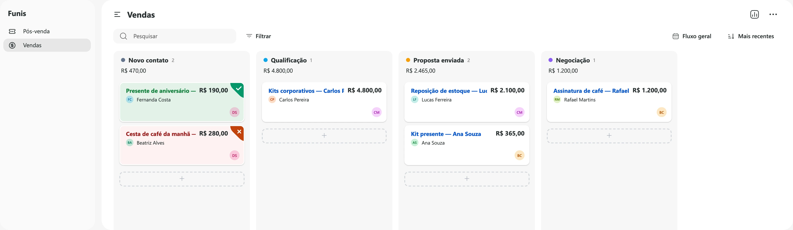
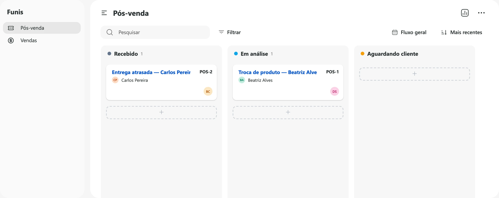

A área **Funis** é onde sua equipe organiza vendas e processos em etapas, acompanha negociações e tickets em um quadro por colunas e automatiza tarefas por etapa. Para entender como contatos, organizações, negociações, funis, etapas e tickets se relacionam, veja [Contatos, organizações e negociações](/docs/conceitos/contatos-e-negocios). Os contatos e as organizações ficam no menu **Clientes** (veja [Contatos: encontrar, cadastrar, editar e excluir](/docs/conversas/clientes-contatos-e-organizacoes) e [Agrupar contatos em organizações](/docs/clientes/organizacoes)).

## Onde fica

- **Quadro do funil:** clique no menu lateral **Funis** (aparece como ícone de funil; o nome aparece ao passar o mouse) e selecione um funil na lista **Funis** à esquerda. Se o item **Funis** não aparecer no menu lateral, peça ao proprietário a permissão **Gerenciar negociações**.
- **Criar e configurar funis:** vá em **Configurações** → **CRM** → **Funis** (ou clique no botão **+** ao passar o mouse sobre o título **Funis** na lista à esquerda; se nenhum funil estiver visível, aparece o item **Criar Funil**). Se **Configurações** → **CRM** não aparecer, falta a permissão **Funis**.
- **Produtos:** vá em **Configurações** → **CRM** → **Produtos**. Quem tem apenas a permissão **Produtos** (sem **Funis**) vê o item **Produtos** mesmo sem o título da seção **CRM**.

<Frame caption="Tela Funis com a lista de funis à esquerda e o quadro do funil Vendas com suas etapas">
  
</Frame>

## Funil comercial e funil operacional

Ao criar um funil, você escolhe entre **Funil Comercial** e **Funil Operacional** (funis criados sem tipo definido funcionam como comerciais). O tipo muda os campos, os rótulos e o encerramento na tela:

| Na tela | Funil Comercial | Funil Operacional |
| --- | --- | --- |
| Item acompanhado | **Nome da negociação** (painel **Negócio**) | **Título do ticket** (painel **Ticket**) |
| Valor e produtos | Tem valor, produtos e soma no cabeçalho da etapa | Sem valor, sem produtos e sem soma na etapa; tem **Ticket ID**, **Descrição** e **SLA** |
| Encerramento | **Ganho** e **Perdido** | **Resolvido** e **Não resolvido** |
| Motivo ao encerrar | Pede **Motivo da perda** em **Perda de negócio** (ganhar não pede motivo) | Pede **Motivo de resolução** em **Ticket resolvido** e **Motivo de não resolução** em **Ticket não resolvido** |
| Reabrir encerrada | **Retomar negociação** | **Retomar ticket** |

Ao trocar uma negociação de um **Funil Comercial** para um **Funil Operacional**, o valor e os produtos são zerados e ela recebe um número de ticket formado pelas três primeiras letras do funil e um número sequencial (por exemplo, `POS-2`).

<Frame caption="Quadro de um Funil Operacional sem soma de valor nas etapas e com número do ticket nos cartões">
  
</Frame>

## Quem pode usar

As permissões são configuradas nos papéis do workspace (na tela, **ambiente**), em **Configurações** → **Ambiente** → **Permissões**. O proprietário do workspace tem todas as permissões e não sofre restrições.

| O que você quer fazer | Permissão necessária no papel |
| --- | --- |
| Ver **Funis**, criar, importar e editar negociações | **Gerenciar negociações** (seção **Negociações**) |
| Excluir uma negociação | **Gerenciar negociações** e não ter **Não pode excluir negociação** |
| Exportar negociações do funil | **Gerenciar negociações** e não ter **Não pode exportar negociações** |
| Mover negociação para uma etapa anterior | **Gerenciar negociações** e não ter **Não pode voltar para etapa anterior** |
| Ver a seção **Negociações** na conversa | **Pode gerenciar as negociações da conversa.** (criar e editar dali exige também **Gerenciar negociações**) |
| Criar, editar e excluir funis, etapas, cadências, motivos e regras | **Funis** (seção **Gerenciamento do Ambiente**) |
| Cadastrar, editar e excluir produtos | **Produtos** (seção **Gerenciamento do Ambiente**) |

Além disso, o papel pode restringir quais negociações cada membro vê (atribuídas a outros, sem atribuição, de grupos dos quais não participa ou sem grupo — a negociação atribuída ao próprio membro sempre aparece para ele) e restringir a criação de novas negociações quando o contato já tem uma negociação aberta. Veja a lista completa em [Referência de permissões](/docs/administracao/referencia-de-permissoes) e como ajustar papéis em [Criar papéis e permissões](/docs/configuracoes-no-workspace/configurar-permissoes-dos-usuarios).

Cada funil também tem sua própria visibilidade (**Todos**, **Grupos** específicos ou **Apenas para mim**). Quem não pode ver um funil também não vê as negociações dele (o proprietário vê todos os funis).

## O que você pode fazer

<CardGroup cols={2}>
  <Card title="Trabalhar com negociações no funil" href="/docs/crm/gerenciando-funil-de-vendas">
    Criar, abrir, editar, filtrar, mover entre etapas, ganhar, perder, excluir e exportar negociações.
  </Card>
  <Card title="Criar um funil e as etapas" href="/docs/crm/criar-funil-de-vendas">
    Configurar funis comerciais ou operacionais, definir quem vê o funil, montar etapas e gerenciar exclusões.
  </Card>
  <Card title="Cadências: tarefas automáticas por etapa" href="/docs/crm/cadencias">
    Criar tarefas automáticas, definir tarefas obrigatórias e rodar bots quando uma negociação entra numa etapa.
  </Card>
  <Card title="Importar negociações" href="/docs/crm/importar-negociacoes">
    Subir negociações em massa por planilha CSV ou Excel, mapear colunas, acompanhar o histórico e reverter importações.
  </Card>
  <Card title="Ações em lote no funil" href="/docs/crm/acoes-em-lote">
    Mover, atribuir, mudar status, excluir, iniciar bots, associar conversas e gerar relatórios para várias negociações de uma vez.
  </Card>
  <Card title="Cadastrar produtos" href="/docs/crm/criar-e-gerenciar-produtos">
    Criar e gerenciar produtos e serviços usados nas negociações, nos filtros, nas metas e no Kinbox Agenda.
  </Card>
  <Card title="Motivos de perda, campos obrigatórios e regras do funil" href="/docs/crm/motivos-de-perda-e-regras">
    Consultar todos os motivos, campos obrigatórios para ganhar ou sair de etapa e as regras disponíveis no funil.
  </Card>
</CardGroup>

Para acompanhar as negociações abertas, os ganhos e os itens parados de um funil comercial em tempo real, use o **Vendas ao vivo** — veja [Atendimento e vendas ao vivo](/docs/relatorios/ao-vivo).
