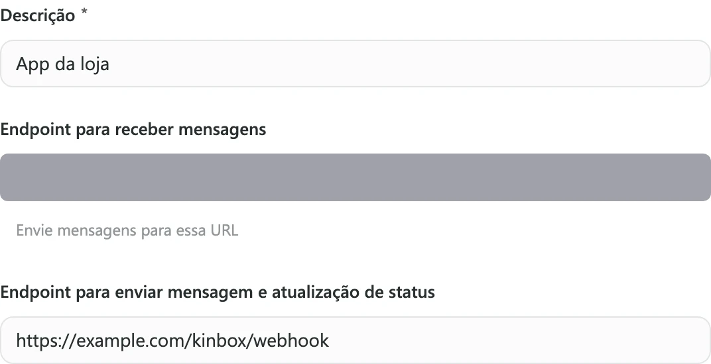

O canal customizado liga um chat seu (app, site ou sistema próprio) à [Caixa de entrada](/docs/conversas/caixa-de-entrada-do-kinbox) pela API: o seu sistema envia as mensagens do cliente para a Kinbox e a Kinbox envia para o seu sistema as respostas dos membros.

<Note>
  Quem pode: criar e editar o canal exige a permissão **Gerenciar Canais** ou ser proprietário do workspace (veja [Referência de permissões](/docs/administracao/referencia-de-permissoes)). Para autenticar as chamadas, o canal customizado usa o **Token v0** (em **Configurações** → **Integrações** → **API Tokens** → **Mostrar tokens legados**, que exige a permissão **Integrações**), e **não** o token de API `kb_live_`. Veja [Criar um token de API](/docs/desenvolvedor/tokens-de-api).
</Note>

## Criar o canal

<Steps>
  <Step title="Abra a tela de novo canal">
    Vá em **Configurações** → **Chat** → **Canais**, clique em **Novo canal** e, na tela **Conectar novo canal**, escolha **Customizado** (o que muda para quem administra e atende está em [Criar um canal customizado](/docs/canais/canal-customizado)).
  </Step>

  <Step title="Preencha os dados e os endereços">
    No painel **Conectar Canal Customizado**:

    - Envie uma imagem opcional (`JPEG/PNG - Min. 100x100px`).
    - Preencha **Descrição** (obrigatório, por exemplo "App da loja").
    - Copie o **Endpoint para receber mensagens** (`https://api.kinbox.com.br/api/v1/channels/<identificador>/messages`), que já vem gerado. É para essa URL que o seu sistema enviará as mensagens do cliente.
    - Preencha **Endpoint para enviar mensagem e atualização de status** com a URL do seu sistema que recebe as mensagens de saída (respostas dos membros) e o evento de resolução da conversa.

    <Frame caption="Painel Conectar Canal Customizado com Descrição e os endpoints de entrada e saída">
      
    </Frame>
  </Step>

  <Step title="Conclua a criação">
    Clique em **Conectar canal**. Quando aparecer o aviso "Canal customizado criado.", o canal já estará pronto para uso.
  </Step>
</Steps>

Depois de criado, ao abrir o canal para edição, o painel **Canal customizado** mostra **Status**, **Imagem**, **Descrição**, **Endpoint para o Kinbox receber mensagens** e **Endpoint para o Kinbox enviar mensagem e atualização de status**.

## Mandar mensagens do cliente para a Kinbox

Envie um `POST` para o **Endpoint para receber mensagens** com o cabeçalho `x-api-token` contendo o **Token v0** do workspace (obtido em **Configurações** → **Integrações** → **API Tokens** → **Mostrar tokens legados**). O token de API `kb_live_` não serve aqui.

| Campo | Obrigatório | O que é |
| --- | --- | --- |
| `sender` | Sim | Identificador único do cliente no seu sistema (por exemplo, telefone ou ID). Cada `sender` vira uma conversa no canal. |
| `content` | Sim | Texto da mensagem, ou a URL do arquivo quando `type` não é `text`. |
| `type` | Não (padrão: `text`) | `text`, `image`, `video`, `audio` ou `file`. |
| `contactInfo` | Não | Dados do contato: `name`, `email`, `avatar` (URL) e `cpf`. |
| `assignment` | Não | `{ "email": "<e-mail de um membro>" }` para atribuir a conversa a esse membro, se ele estiver no workspace. |

Exemplo de requisição:

```bash
curl -X POST "https://api.kinbox.com.br/api/v1/channels/<identificador>/messages" \
  -H "Content-Type: application/json" \
  -H "x-api-token: SEU_TOKEN_V0" \
  -d '{
    "sender": "5511900000001",
    "content": "Olá, preciso de ajuda com meu pedido.",
    "type": "text",
    "contactInfo": {
      "name": "Cliente Exemplo",
      "email": "cliente@example.com"
    }
  }'
```

Para enviar um arquivo, informe o tipo e a URL do arquivo em `content`:

```json
{
  "sender": "5511900000001",
  "type": "image",
  "content": "https://exemplo.com/foto.png"
}
```

Mensagens de erro retornadas pela API quando há algum problema:

- `Identifier é obrigatório` — identificador ausente na URL.
- `Sender é obrigatório` — campo `sender` não enviado.
- `Content é obrigatório` — campo `content` não enviado.
- `Identificador inválido` — o canal não existe ou foi desativado.
- `Workspace inválido` — o workspace do canal não está ativo.
- `api_token inválido` — cabeçalho `x-api-token` ausente ou incorreto.

## Receber as respostas dos membros

Quando um membro envia uma resposta (texto ou arquivo) em uma conversa desse canal, a Kinbox envia um `POST` para o endereço configurado em **Endpoint para enviar mensagem e atualização de status**. Notas internas e mensagens de sistema não são enviadas.

| Campo | O que é |
| --- | --- |
| `type` | `call_message` |
| `sender` | Identificador do canal (o mesmo presente na URL de recebimento). |
| `recipient` | O `sender` do cliente. |
| `content` | Texto da mensagem; arquivos são enviados como URL no campo de texto. |
| `operator` | Objeto `{ id, name, avatar, email }` do membro que respondeu. |
| `timestamp` | Data em milissegundos. |

Exemplo de `call_message`:

```json
{
  "type": "call_message",
  "sender": "<identificador>",
  "recipient": "5511900000001",
  "content": "Olá! Já estou verificando seu pedido.",
  "operator": {
    "id": 12,
    "name": "Membro Exemplo",
    "avatar": "https://exemplo.com/avatar.png",
    "email": "membro@example.com"
  },
  "timestamp": 1700000000000
}
```

Quando a conversa é resolvida, a Kinbox envia o evento `call_end`:

```json
{
  "type": "call_end",
  "recipient": "5511900000001",
  "timestamp": 1700000060000
}
```

Responda rápido com status HTTP de sucesso (2xx) no seu endereço: se o `POST` falhar, a Kinbox não tenta reenviar a mensagem.

## Problemas comuns

- **A resposta do membro não chega ao seu sistema.** Confira o **Endpoint para o Kinbox enviar mensagem e atualização de status** no canal e se o seu endereço responde com sucesso. Se o envio falhar, a Kinbox não tenta de novo.
- **A API responde `Identificador inválido`.** O canal foi desativado ou o endereço usado não é o **Endpoint para receber mensagens** desse canal.
- **A API responde `api_token inválido`.** Envie no cabeçalho `x-api-token` o **Token v0** (em **API Tokens** → **Mostrar tokens legados**), não o token de API `kb_live_`.
