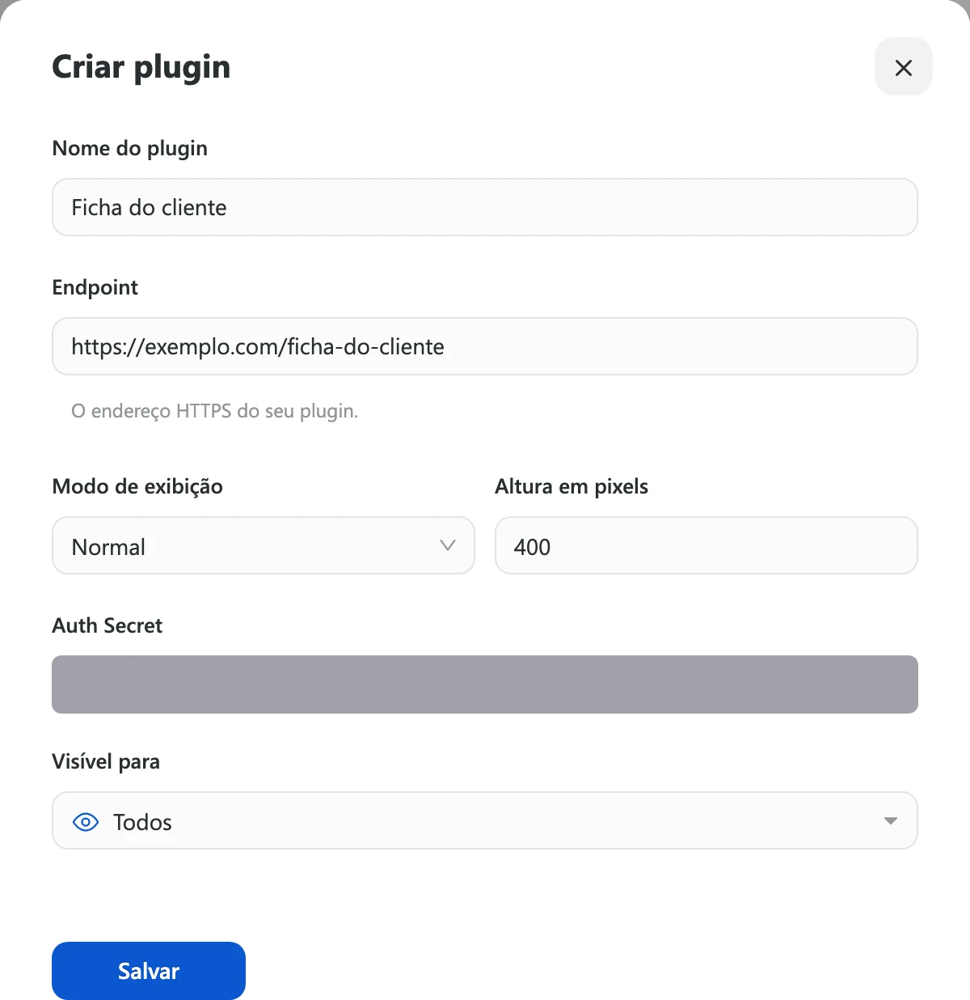

Um plugin é uma página sua (em um endereço HTTPS) que abre dentro da Kinbox, no contexto da conversa aberta, para mostrar dados do seu sistema ou executar ações no atendimento. Diferente dos **Apps** (integrações prontas em **Configurações** → **Integrações** → **Apps**), o plugin é criado e hospedado por você.

<Note>
  Quem pode: membros com a permissão **Integrações** ou o proprietário do workspace (veja [Referência de permissões](/docs/administracao/referencia-de-permissoes)).
</Note>

## Passo a passo

<Steps>
  <Step title="Abra a tela Plugins">
    Vá em **Configurações** → **Integrações** → **Plugins** e clique em **Novo plugin**.
  </Step>

  <Step title="Preencha os dados do plugin">
    No painel **Criar plugin**, configure os campos abaixo:

    | Campo | O que preencher |
    | --- | --- |
    | **Nome do plugin** | Obrigatório. Nome exibido no painel da conversa. |
    | **Endpoint** | Obrigatório. Endereço da sua página (use um endereço `https://`, por exemplo `https://exemplo.com/ficha-do-cliente`). |
    | **Modo de exibição** | Como o plugin abre (padrão: **Normal**). Veja os modos na seção abaixo. |
    | **Altura em pixels** ou **Largura em pixels** | Altura (de 200 a 800, padrão 400) nos modos **Normal** e **Modal**; largura (de 200 a 1600, padrão 400) nos modos **Painel lateral** e **Página lateral**. Não aparece em **Nova página**, **Popup** e **Tela inteira**. |
    | **Auth Secret** | Preenchido pela Kinbox; você não edita. Não use esse campo para autenticação. |
    | **Visível para** | **Todos** (padrão), **Grupos** (com o campo **Grupos**) ou **Apenas para mim**. |

    <Frame caption="Painel Criar plugin com Nome do plugin, Endpoint, Modo de exibição, Altura em pixels, Auth Secret e Visível para">
      
    </Frame>
  </Step>

  <Step title="Defina a visibilidade e salve">
    Escolha quem poderá ver o plugin em **Visível para** e clique em **Salvar**.

    <Tip>
      Enquanto testa a sua página, deixe **Visível para** em **Apenas para mim** para que o plugin apareça só na sua conta.
    </Tip>
  </Step>

  <Step title="Abra o plugin na conversa">
    Entre na [Caixa de entrada](/docs/conversas/caixa-de-entrada-do-kinbox) e abra uma conversa. No painel **Detalhes** (à direita), os plugins liberados para você aparecem abaixo de **Contato**, **Negociações** e **Tarefas**. Clique no nome do plugin para abri-lo.
  </Step>
</Steps>

## Modos de exibição

| Modo | Como o plugin abre |
| --- | --- |
| **Normal** | Dentro do painel **Detalhes**, com a altura configurada. |
| **Modal** | Em uma janela no meio da tela, com o nome do plugin no título e a altura configurada. |
| **Painel lateral** | Em um painel à direita com título, na largura configurada. |
| **Página lateral** | Em um painel à direita sem título, na largura configurada. |
| **Nova página** | Em uma nova aba do navegador. |
| **Popup** | Em uma janela separada do navegador. |
| **Tela inteira** | Cobre a tela inteira, sem botão de fechar da Kinbox. |

<Warning>
  O modo **Tela inteira** cobre a tela inteira e não tem botão de fechar na interface da Kinbox. Garanta que a sua própria página tenha uma forma de fechar o plugin.
</Warning>

## Campos do contato no endereço

Você pode colocar `{{chave}}` de um campo personalizado do contato no **Endpoint** para preencher o endereço com o valor do contato da conversa (veja [Contatos, organizações e negociações](/docs/conceitos/contatos-e-negocios)). A substituição de `{{chave}}` no **Endpoint** funciona **apenas** nos modos **Nova página** e **Popup**; nos outros modos, o endereço abre sem troca. Campos sem valor viram texto vazio e chaves que não existem permanecem como estão.

## Criar a sua página

Para conversar com a Kinbox, carregue a biblioteca `kinboxjs.js` no `<head>` da sua página e escute o evento `conversation` com `Kinbox.on("conversation", ...)`:

```html
<!doctype html>
<html lang="pt-BR">
  <head>
    <meta charset="utf-8" />
    <script src="https://andrody.github.io/kinbox-lib/kinboxjs.js"></script>
  </head>
  <body>
    <p id="cliente">Abra uma conversa...</p>
    <script>
      Kinbox.on("conversation", function (data) {
        document.getElementById("cliente").textContent =
          "Contato: " + data.contact.name;
      });
    </script>
  </body>
</html>
```

## O que o plugin recebe

- **No endereço (query string):** `dark_mode` (`true` ou `false`, conforme o tema do membro) e `operator_id` (ID do membro logado).
- **No evento `conversation`:** os objetos `contact` (nome, e-mail, telefone, foto e `customFields`), `conversation` (ID, canal, responsável, grupo, tags e link), `session` (ID e `customFields`) e `user` (dados do membro logado). O evento chega de novo sempre que o membro troca de conversa.
- **Sem conversa aberta:** o plugin recebe o evento `no_conversation` com `user`.

## O que o plugin pode fazer

| Quero... | Use |
| --- | --- |
| Mostrar ou esconder o carregamento | `Kinbox.loading(true)` / `Kinbox.loading(false)` (chame `false` ao terminar, inclusive em erro) |
| Exibir um aviso na Kinbox | `Kinbox.toast(tipo, texto)` (`success`, `error`, `info` ou `warning`) |
| Pedir confirmação ao membro | `Kinbox.dialog("confirm", { title, description, okText, cancelText }, callback)` |
| Gravar campos personalizados do contato ou da sessão | `Kinbox.setProperty({ key, type, contactId, fields })` (ou `sessionId` no lugar de `contactId`) (retorno no evento `callback`) |
| Atribuir a conversa a um membro | `Kinbox.assignTo(idDoMembro)` |
| Mover a conversa para um grupo | `Kinbox.moveToGroup(idDoGrupo)` |
| Adicionar ou remover uma tag na conversa | `Kinbox.addTag(idDaTag)` / `Kinbox.removeTag(idDaTag)` |
| Abrir um formulário da Kinbox (modal ou gaveta) | `Kinbox.sendForm({ items, type, title }, callback)` (campos como `text`, `select`, `number` e `date`) |
| Ler canais, campos, membros, tags, grupos e papéis do workspace | `Kinbox.getWorkspaceInfo(callback)` |

## Editar ou excluir um plugin

Em **Configurações** → **Integrações** → **Plugins** (com busca **Pesquisar por nome** e filtros **Tudo** e **Visível somente para mim**), clique no plugin para editar ou exclua pelo menu da linha.

## Problemas comuns

- **Plugins não aparece no menu.** O seu papel não tem a permissão **Integrações**.
- **O plugin não aparece na conversa.** Confira se a opção **Visível para** inclui você ou um dos seus grupos.
- **O plugin abre em branco.** Teste o endereço em uma aba do navegador: a página precisa estar acessível na internet, usar `https://` e permitir ser aberta dentro de outra página.
- **`{{chave}}` no Endpoint não é trocado.** A troca de campos personalizados no endereço só funciona nos modos **Nova página** e **Popup**.
- **O plugin fica preso no carregando.** Confira se o seu código chama `Kinbox.loading(false)` ao terminar, inclusive quando ocorre um erro.
