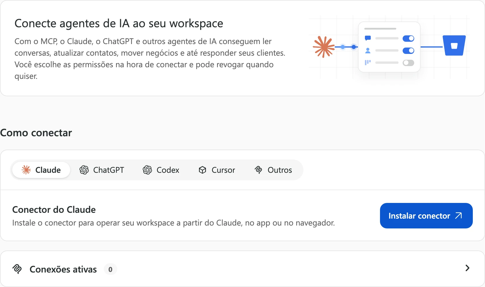
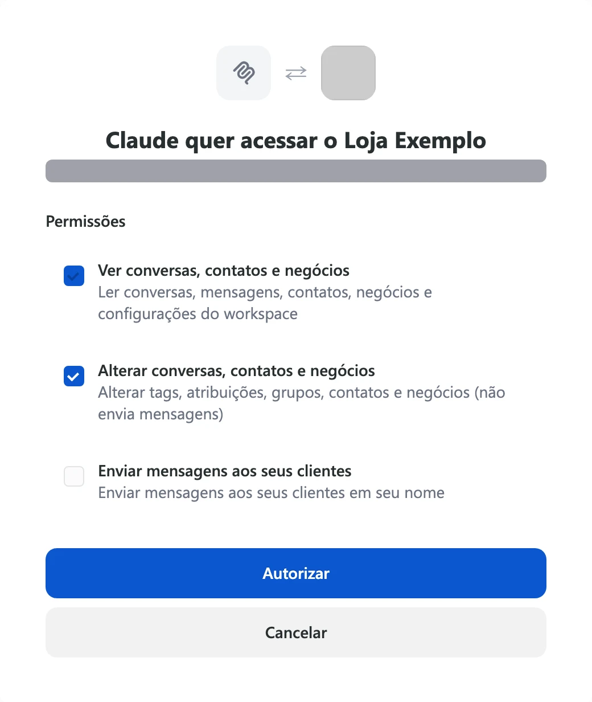

Com o MCP, você liga o Claude, o ChatGPT e outros assistentes de IA ao seu workspace. Você escolhe as permissões ao conectar e pode revogar quando quiser.

Não confunda o MCP com o [Agente de IA](/docs/agente-de-ia/visao-geral) da Kinbox: o Agente de IA atende seus contatos dentro da plataforma, enquanto o MCP conecta um assistente de IA seu, de fora, ao workspace.

<Note>
  Quem pode: para ver a tela **MCP** e a lista de conexões, você precisa da permissão **Integrações** ou ser o proprietário do workspace (veja [Referência de permissões](/docs/administracao/referencia-de-permissoes)). A IA age em nome de quem autorizou, com o papel dessa pessoa (veja [Workspace, membros e papéis](/docs/conceitos/workspace-membros-e-papeis)). A conexão vale para o workspace aberto no navegador na hora de autorizar. Nos workspaces clientes de um parceiro, a IA age como proprietário do cliente, dentro das permissões de parceiro.
</Note>

## Antes de começar

- Tenha uma conta em um aplicativo de IA que aceite conectores ou servidores MCP.
- Esteja logado na Kinbox, no navegador, no **workspace certo**. Se você participa de mais de um workspace, troque para o workspace desejado antes de autorizar (veja [Trocar de workspace ou criar outro](/docs/conta/trocar-de-workspace)).

## Onde fica

Vá em **Configurações** → **Integrações** → **MCP**. O cartão **Como conectar** traz as abas **Claude**, **ChatGPT**, **Codex**, **Cursor** e **Outros**, e logo abaixo fica o cartão **Conexões ativas**.

<Frame caption="Tela MCP em Configurações → Integrações → MCP com o cartão Como conectar e Conexões ativas">
  
</Frame>

## Passo a passo

<Steps>
  <Step title="Escolha o aplicativo na tela MCP">
    Em **Configurações** → **Integrações** → **MCP**, selecione a aba do aplicativo que você quer conectar (**Claude**, **ChatGPT**, **Codex**, **Cursor** ou **Outros**).
  </Step>

  <Step title="Instale o conector e siga o passo a passo">
    Nas abas **Claude**, **ChatGPT**, **Codex** e **Cursor**, clique em **Instalar conector** para abrir o **Passo a passo** daquele aplicativo. O endereço do servidor MCP é sempre `https://mcp.kinbox.com.br/mcp`.

    <Tabs>
      <Tab title="Claude">
        1. No Claude, abra **Configurações › Conectores** e clique em **Adicionar conector personalizado**.
        2. Cole a URL do servidor MCP (`https://mcp.kinbox.com.br/mcp`) e salve.
        3. Você será levado ao Kinbox para escolher as permissões e autorizar.

        Se preferir usar o terminal (**Claude Code**), execute:

        ```bash
        claude mcp add --transport http kinbox https://mcp.kinbox.com.br/mcp
        ```
      </Tab>

      <Tab title="ChatGPT">
        1. No ChatGPT, abra **Configurações › Conectores** e escolha **Criar conector**.
        2. Cole a URL do servidor MCP (`https://mcp.kinbox.com.br/mcp`). Mantenha a autenticação em OAuth e salve.
        3. Você será levado ao Kinbox para escolher as permissões e autorizar.
      </Tab>

      <Tab title="Codex">
        1. No Codex, abra **Configurações › Plugins › MCPs** e clique em **Add**.
        2. Escolha o tipo **Streamable HTTP**, cole a URL do servidor (`https://mcp.kinbox.com.br/mcp`) e salve. Deixe o token em branco.
        3. O navegador abrirá o Kinbox para escolher as permissões e autorizar.
      </Tab>

      <Tab title="Cursor">
        1. No Cursor, abra **Settings › MCP** e clique em **Add new global MCP server**.
        2. Cole a configuração abaixo e salve:

        ```json
        {
          "mcpServers": {
            "kinbox": {
              "url": "https://mcp.kinbox.com.br/mcp"
            }
          }
        }
        ```

        3. Clique em conectar. O navegador abrirá o Kinbox para autorizar.
      </Tab>

      <Tab title="Outros">
        Para conectar qualquer aplicativo de IA com suporte a servidores MCP via OAuth, adicione a configuração abaixo:

        ```json
        {
          "mcpServers": {
            "kinbox": {
              "url": "https://mcp.kinbox.com.br/mcp"
            }
          }
        }
        ```

        Se o aplicativo não tiver suporte a OAuth, crie um token em [Criar um token de API](/docs/desenvolvedor/tokens-de-api) e envie no cabeçalho `Authorization`:

        ```json
        {
          "mcpServers": {
            "kinbox": {
              "url": "https://mcp.kinbox.com.br/mcp",
              "headers": {
                "Authorization": "Bearer kb_live_<seu_token>"
              }
            }
          }
        }
        ```

        Com token, não há tela **Autorizar acesso**: os dois próximos passos não se aplicam. Confira no próprio aplicativo se a Kinbox aparece conectada. A conexão usa as permissões do token e não aparece em **Conexões ativas**; para desligá-la, revogue o token em **API Tokens**.
      </Tab>
    </Tabs>
  </Step>

  <Step title="Escolha as permissões e autorize o acesso (OAuth)">
    Depois de salvar o conector, o navegador abre a tela **Autorizar acesso** da Kinbox (se não estiver logado, faça login antes). Confira qual workspace aparece no título ("... quer acessar o ...") e a conta em "Conectado como": a conexão vale para o **workspace aberto no navegador** naquele momento.

    | Permissão | O que a tela diz | Padrão |
    | --- | --- | --- |
    | **Ver conversas, contatos e negócios** | "Ler conversas, mensagens, contatos, negócios e configurações do workspace" | Sempre marcada (obrigatória) |
    | **Alterar conversas, contatos e negócios** | "Alterar tags, atribuições, grupos, contatos e negócios (não envia mensagens)" | Marcada |
    | **Enviar mensagens aos seus clientes** | "Enviar mensagens aos seus clientes em seu nome" | Desmarcada |

    Em workspaces de parceiro, membros com a permissão **Pode inspecionar clientes** no papel também veem a opção **Acessar os ambientes clientes do parceiro** (desmarcada por padrão).

    <Frame caption="Tela Autorizar acesso com o workspace, as permissões e o botão Autorizar">
      
    </Frame>

    <Warning>
      Ao marcar **Enviar mensagens aos seus clientes**, o assistente de IA poderá mandar mensagens aos seus contatos em seu nome. Marque essa opção apenas se quiser liberar envios pela IA.
    </Warning>

    Clique em **Autorizar** para concluir (ou em **Cancelar** para recusar sem criar conexão).
  </Step>

  <Step title="Volte ao aplicativo (OAuth)">
    Depois de clicar em **Autorizar**, o navegador retorna ao aplicativo de IA, que passa a mostrar a Kinbox como conectada.
  </Step>
</Steps>

## O que a IA consegue fazer

A IA só enxerga as ferramentas das permissões que você marcou, e cada ação respeita o papel de quem autorizou no workspace da conexão:

- **Ver conversas, contatos e negócios:** consultar conversas, relatórios, contatos, negociações, tarefas, campanhas, equipe e configurações.
- **Alterar conversas, contatos e negócios:** organizar conversas (resolver, atribuir, tags, notas), cuidar de contatos, negociações e tarefas, pausar ou excluir campanhas e ajustar equipe e configurações.
- **Enviar mensagens aos seus clientes:** responder e iniciar conversas.
- **Alterar e Enviar juntas** (as duas permissões): iniciar bot numa conversa, agendar ou editar mensagens agendadas, criar campanhas (WhatsApp por QR Code ou SMS), editar a mensagem ou retomar campanhas, e criar, ligar ou editar bots, agentes, cenários ou automações que podem rodar. Rascunhos e desligar pedem só **Alterar**.

Ações que não têm volta (como excluir ou remover algo) só acontecem depois que a IA confirma com você. A IA não cancela nem troca o plano, não envia mensagens em conversas resolvidas há mais de 30 dias e, no WhatsApp oficial fora da [janela de 24 horas](/docs/canais/whatsapp/whatsapp-cloud-api/janela-de-24-horas), envia apenas templates aprovados. Há também limites de uso para chamadas e envios.

## Conexões ativas e revogar

Em **Configurações** → **Integrações** → **MCP**, abra o cartão **Conexões ativas** para ver as conexões OAuth de todo o workspace, com **Aplicativo**, **Permissões** (**Leitura**, **Escrita** e **Envio**), **Conectado em**, **Ultimo uso** e **Revogar**. Use **Atualizar** para recarregar a lista.

Para encerrar uma conexão, clique em **Revogar** e confirme a mensagem `Revogar a conexão "..."? O aplicativo perderá o acesso imediatamente.` Se o membro que autorizou for desativado ou sair do workspace, a conexão também para de funcionar. Para conectar de novo depois, refaça o passo a passo.

<Warning>
  Revogar uma conexão corta o acesso do aplicativo imediatamente.
</Warning>

## Quanto dura a conexão

A conexão OAuth se renova sozinha: o acesso vale 1 hora e é renovado automaticamente enquanto estiver em uso. Se ficar 30 dias sem renovar, ela expira e você precisa conectar o aplicativo novamente.

## Usar um token de API em vez de OAuth

Para aplicativos sem suporte a OAuth, use a aba **Outros** com um token criado em [Criar um token de API](/docs/desenvolvedor/tokens-de-api). Conexões feitas por token de API não aparecem em **Conexões ativas** — para desligá-las, revogue o token em **API Tokens**.

## Onde ver o que a IA fez

Cada chamada bem-sucedida da IA pelo MCP fica registrada em **Configurações** → **Auditoria** (exige a permissão **Auditoria**) em nome do membro que conectou, na entidade **MCP** (veja [Ver o histórico de alterações (Auditoria)](/docs/administracao/auditoria)).

## Problemas comuns

- **A opção MCP não aparece no menu.** Você precisa da permissão **Integrações** (ou ser o proprietário do workspace) para abrir a tela **MCP**.
- **Aparece "Autorização indisponível" ou pedido expirado.** O pedido de autorização vale 15 minutos e só pode ser respondido uma vez. Volte ao aplicativo de IA e inicie a conexão novamente.
- **A IA conectou no workspace errado.** A autorização usa sempre o workspace aberto no navegador naquele momento. Revogue a conexão em **Conexões ativas**, troque para o workspace certo na Kinbox e refaça a conexão.
- **A IA recusa executar ações por restrições do papel.** Se o seu papel tiver restrições de visualização ou de envio, o MCP pode recusar o uso e pedir que o proprietário do workspace use o MCP ou ajuste o seu papel.
