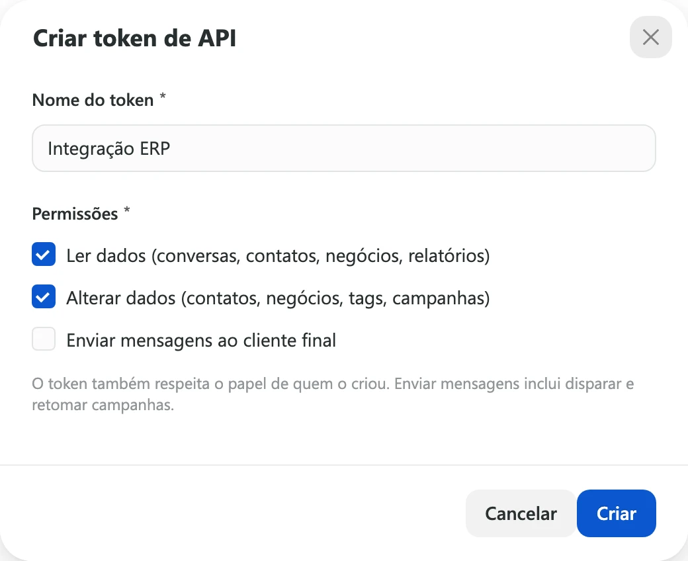
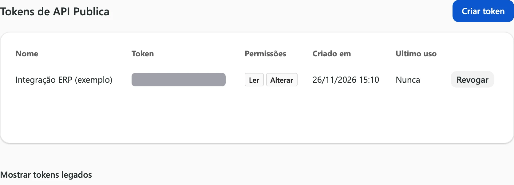

Crie um token de API (`kb_live_...`) em **Configurações** → **Integrações** → **API Tokens** para autenticar o seu sistema na API pública da Kinbox ou conectar um assistente de IA pelo MCP sem OAuth.

<Note>
  Quem pode: membros com a permissão **Integrações** ou o proprietário do workspace (veja [Referência de permissões](/docs/administracao/referencia-de-permissoes)). A lista mostra os tokens ativos de todo o workspace, não apenas os seus.
</Note>

## Passo a passo

<Steps>
  <Step title="Abra a tela API Tokens">
    Vá em **Configurações** → **Integrações** → **API Tokens** e clique em **Criar token**.
  </Step>

  <Step title="Dê um nome e escolha as permissões">
    Na janela **Criar token de API**, preencha **Nome do token** (obrigatório, máximo de 100 caracteres, como "Integração ERP") e marque ao menos uma opção em **Permissões**. Por padrão, **Ler dados** e **Alterar dados** vêm marcadas e **Enviar mensagens** vem desmarcada.

    | Permissão | O que libera |
    | --- | --- |
    | **Ler dados (conversas, contatos, negócios, relatórios)** | Lê dados do workspace pela API e pelo MCP. |
    | **Alterar dados (contatos, negócios, tags, campanhas)** | Cria, edita e altera dados do workspace. |
    | **Enviar mensagens ao cliente final** | Envia mensagens ao contato e dispara ou retoma campanhas. |

    Em workspaces de parceiro, quem pode inspecionar clientes também vê a opção **Acessar os ambientes clientes do parceiro pelo MCP (com as permissões acima)**, que só vale no MCP (veja [Inspecionar o workspace de um cliente](/docs/programa-de-parceiros/inspecionar-cliente)).

    A janela avisa: "O token também respeita o papel de quem o criou. Enviar mensagens inclui disparar e retomar campanhas."

    <Frame caption="Janela Criar token de API com Nome do token e Permissões">
      
    </Frame>
  </Step>

  <Step title="Crie e copie o token">
    Clique em **Criar**. Na janela **Token criado com sucesso**, aparece o aviso "Este token nao sera mostrado novamente. Copie e guarde em local seguro." Clique no botão de copiar (surge "Token copiado para area de transferencia"), salve o valor em um local seguro e clique em **Entendi**.
  </Step>
</Steps>

<Warning>
  O token completo só aparece uma vez, na janela de criação. Se você perder o valor, não há como vê-lo de novo: crie outro token e revogue o antigo.
</Warning>

## Usar o token

- **Na API pública:** envie o token no cabeçalho HTTP `Authorization: Bearer <token>`, por exemplo `Authorization: Bearer kb_live_<seu_token>`. Consulte os endpoints e exemplos em [Autenticação](/api-reference/authentication).
- **No MCP sem OAuth:** o mesmo token pode ser usado na aba **Outros** da tela **MCP** (veja [Conectar o Claude, o ChatGPT e outros agentes de IA (MCP)](/docs/desenvolvedor/mcp)).
- **Ligação com quem criou:** o token está ligado ao membro que o criou e age em nome dessa pessoa (veja [Workspace, membros e papéis](/docs/conceitos/workspace-membros-e-papeis)). Se quem criou o token sair do workspace ou for desativado, o token para de funcionar e será preciso criar outro.

## Acompanhar a lista de tokens

Em **Tokens de API Publica**, a tabela mostra os tokens ativos de todo o workspace, do mais novo para o mais antigo. **Ultimo uso** mostra o último uso registrado do token, ou **Nunca**.

<Frame caption="Lista Tokens de API Publica com um token ativo e o botão Mostrar tokens legados">
  
</Frame>

## Revogar um token

Para desligar um token, clique em **Revogar** na linha dele e confirme a mensagem `Tem certeza que deseja revogar o token "..."? Esta acao nao pode ser desfeita.` O aviso "Token revogado com sucesso" aparece e o token some da lista.

<Warning>
  Revogar um token não tem volta: toda integração que usar esse token deixa de funcionar.
</Warning>

## Envio legado

A etiqueta laranja **Envio legado** aparece em tokens criados antes de existir a permissão **Enviar**. Para tirar a etiqueta, clique nela e confirme em **Remover envio legado**. Se o token precisar enviar mensagens ou disparar campanhas, crie um token novo com a permissão **Enviar**. Tokens novos nunca nascem com a etiqueta.

## Tokens legados

Clique em **Mostrar tokens legados**, no fim da página **API Tokens**, para ver e copiar o **Token v0** do workspace (botão de copiar ao lado do campo). Ele não serve para a API pública atual; é o token usado em [Integrar seu sistema como canal customizado (API)](/docs/desenvolvedor/criando-canal-customizado) e em [Continuar o bot por webhook](/docs/desenvolvedor/webhook-continuar-bot).

## Problemas comuns

- **A API responde `Invalid API token format`.** O token enviado não começa com `kb_live_` (por exemplo, o **Token v0**). Use um token criado em **Criar token**.
- **A API responde `This API token lacks the "..." scope`.** O token não tem a permissão que a chamada exige (por exemplo, **Enviar mensagens ao cliente final**). Crie outro token com essa permissão.
- **O token parou de funcionar.** Quem criou o token saiu do workspace ou foi desativado, ou o token foi revogado. Crie um novo token.
- **A API responde HTTP 429.** Você passou do limite de chamadas da rota. Espere alguns segundos e tente de novo.
