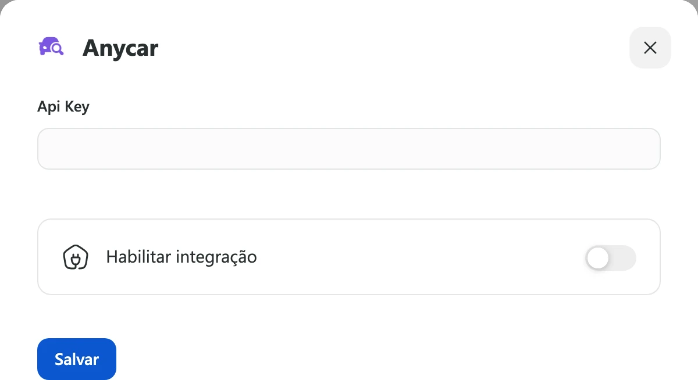

A integração liga a Anycar à Kinbox para consultar veículos pela placa direto no painel da conversa e usar a consulta **RENAJUD Plus** no bot. No quadro da conversa, o resultado aparece apenas em uma janela temporária e não é gravado no contato.

<Note>
  Quem pode configurar: proprietário do workspace ou membros com a permissão **Integrações** (veja [Referência de permissões](/docs/administracao/referencia-de-permissoes)). Para configurar, você precisa da chave de API da sua conta na Anycar.
</Note>

## Antes de começar

- Tenha em mãos a chave de API da Anycar.
- Se for usar a consulta no bot, crie um campo personalizado na entidade **Contato** com a **Chave reservada** `placa` (um campo chamado "Placa" gera essa chave; veja [Criar campos personalizados](/docs/configuracoes-no-workspace/campos-personalizados-no-kinbox)).

## Passo a passo

<Steps>
  <Step title="Abra o app Anycar">
    Vá em **Configurações** → **Integrações** → **Apps** e clique em **Anycar** (veja [Apps e integrações: instalar e usar](/docs/integracoes/visao-geral)).
  </Step>

  <Step title="Cole a chave de API">
    Preencha o campo **Api Key** com a chave de API da Anycar. A tela permite salvar o campo em branco, mas sem a chave as consultas falham.

    <Frame caption="Painel Anycar com o campo Api Key, interruptor Habilitar integração e botão Salvar">
      
    </Frame>
  </Step>

  <Step title="Habilite e salve">
    Ligue **Habilitar integração** e clique em **Salvar**. Aparece "Salvo".
  </Step>
</Steps>

## Usar na conversa

Com **Habilitar integração** ligado, abra uma conversa e localize o quadro **Anycar** no painel **Detalhes** (veja [Caixa de entrada: visão geral](/docs/conversas/caixa-de-entrada-do-kinbox)). O quadro não aparece para membros com a restrição **Esconder informações de integração** nem no modo de treino da Academia.

- Escolha o **Tipo de consulta** (o padrão é **RENAJUD Plus**, além de outros tipos listados no quadro), digite a **Placa** (por exemplo, `ABC1D23`; a placa não vem preenchida do contato) e clique em **Consultar**.
- O retorno abre na janela **Resultado** com os campos devolvidos pela Anycar (que podem incluir dados pessoais do proprietário e do veículo, conforme o tipo de consulta).
- Ao fechar a janela, o resultado some: nada é gravado no contato e nenhuma mensagem é enviada ao cliente pelo quadro. Apenas o último **Tipo de consulta** escolhido fica lembrado.

## No bot

No bloco **Integração** do bot, selecione **Consulta RENAJUD Plus na Anycar** em **Tipo de integração**, dentro do grupo **Outros** (veja [Chamar um sistema externo no bot](/docs/bot/integracoes-do-bot)). É a única ação pronta da Anycar no bot, não tem campos próprios na gaveta e é pulada no **Simular bot** — teste em uma conversa real.

Quando o fluxo passa pelo bloco, o bot lê a placa do campo personalizado `placa` do contato, consulta a **RENAJUD Plus** na Anycar e **envia o resultado formatado ao cliente na conversa**, como mensagem do bot. Se a placa estiver vazia ou inválida, a integração estiver desligada ou sem chave, ou a Anycar não responder, o cliente recebe a mensagem "Não foi possível realizar a consulta RENAJUD Plus no momento.".

<Warning>
  A ação do bot envia ao cliente, na conversa, o resultado completo da consulta **RENAJUD Plus** para a placa gravada no campo `placa` do contato — ela não confirma quem está falando nem se o veículo pertence ao contato. Use a ação apenas em fluxos nos quais o cliente possa ver esses dados.
</Warning>

## Desligar a integração

Para desligar, abra **Anycar** em **Apps**, desligue **Habilitar integração** e clique em **Salvar**. O quadro deixa de aparecer nas conversas e a ação do bot também para de consultar (passando a enviar ao cliente a mensagem de falha). A **Api Key** continua salva no painel.

## Problemas comuns

- **Aviso "A integração Anycar não está configurada para este workspace.".** O campo **Api Key** está vazio ou **Habilitar integração** está desligado no painel **Anycar**.
- **Aviso "Placa inválida. Revise e tente novamente.".** A placa digitada está fora do formato antigo (três letras e quatro números) ou Mercosul.
- **Aviso "A consulta demorou mais que o esperado. Tente novamente.".** A Anycar passou de 15 segundos para responder; tente novamente.
- **O bot respondeu "Não foi possível realizar a consulta RENAJUD Plus no momento.".** O campo `placa` não existe ou está vazio no contato, a placa é inválida, a integração está desligada ou sem **Api Key**, ou ocorreu falha na Anycar.
- **O quadro Anycar não aparece na conversa.** Confira se **Habilitar integração** está ligado, se o seu papel não tem a restrição **Esconder informações de integração** e se você não está no modo de treino da Academia.
