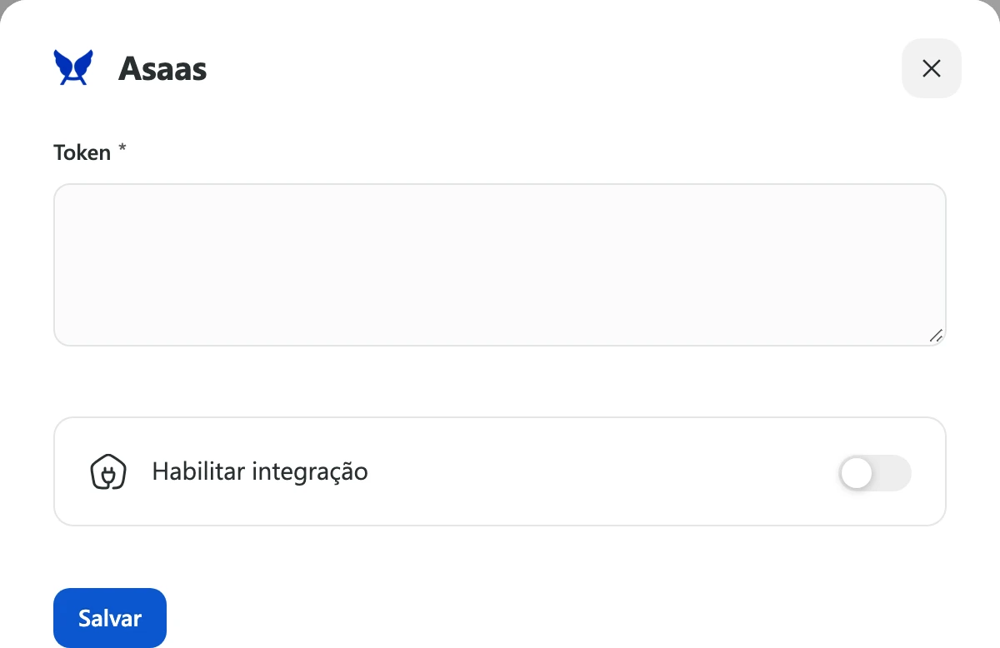

A integração liga a conta do Asaas da sua empresa ao bot da Kinbox para enviar ao cliente, na conversa, a segunda via dos boletos em aberto buscando pelo CPF do contato. Ela funciona somente no bot e não cria quadro na conversa.

Esta integração usa o Asaas da sua empresa para atender seus clientes; se você procura as faturas da assinatura da Kinbox, veja [Faturas, boletos e nota fiscal](/docs/assinatura/faturas).

<Note>
  Quem pode configurar: proprietário do workspace ou membros com a permissão **Integrações** (veja [Referência de permissões](/docs/administracao/referencia-de-permissoes)). Para usar, você precisa do token de API do Asaas e de um campo personalizado de CPF no contato.
</Note>

## Antes de começar

- Tenha em mãos o token de API da sua conta no Asaas.
- Crie um campo personalizado na entidade **Contato** com a **Chave reservada** `cpf` (um campo chamado "CPF" gera essa chave; veja [Criar campos personalizados](/docs/configuracoes-no-workspace/campos-personalizados-no-kinbox)).

## Passo a passo

<Steps>
  <Step title="Abra o app Asaas">
    Vá em **Configurações** → **Integrações** → **Apps** e clique em **Asaas** (veja [Apps e integrações: instalar e usar](/docs/integracoes/visao-geral)).
  </Step>

  <Step title="Cole o token do Asaas">
    Preencha o campo obrigatório **Token** com o token de API do Asaas.

    <Frame caption="Painel Asaas com o campo Token, interruptor Habilitar integração e botão Salvar">
      
    </Frame>
  </Step>

  <Step title="Habilite e salve">
    Ligue **Habilitar integração** e clique em **Salvar**. Aparece "Salvo".
  </Step>
</Steps>

## Usar na conversa

**Não há quadro do Asaas na conversa.** A integração não aparece no painel **Detalhes** e não tem botões para o membro; todo o uso acontece pelo bot.

## No bot

No bloco **Integração** do bot, escolha **Consulta boletos ASAAS** em **Tipo de integração**, dentro do grupo **Outros** (veja [Chamar um sistema externo no bot](/docs/bot/integracoes-do-bot)). A ação não tem campos próprios na gaveta e é pulada no **Simular bot** — teste em uma conversa real.

Quando o fluxo executa o bloco, o bot:

1. Lê o **Token** salvo no painel **Asaas** e o campo personalizado `cpf` do contato.
2. Procura no Asaas o cliente com esse CPF (usando apenas os dígitos).
3. Busca as cobranças pendentes ou vencidas em boleto (ou sem forma definida).
4. Envia ao cliente na conversa, como mensagem do bot, uma mensagem por boleto com vencimento, valor e link da segunda via.
5. Se não encontrar o cliente ou não houver boleto em aberto, envia ao cliente "Não foram encontrados boletos dentro dos parâmetros enviados".

O bot **não** gera boleto novo, não cria cobrança, não gera Pix nem link de pagamento, não inclui cobranças só de Pix ou cartão, não dá baixa, não cancela e não confirma pagamento.

<Warning>
  A ação envia ao cliente os boletos em aberto do CPF que estiver preenchido no campo `cpf` do contato — ela não confirma quem está falando na conversa. Garanta no fluxo do bot que o CPF pertence ao cliente antes de executar o bloco.
</Warning>

## Desligar a integração

Para marcar o app como desabilitado em **Apps**, abra **Asaas**, desligue **Habilitar integração** e clique em **Salvar**.

Desligar **Habilitar integração** **não** para a ação **Consulta boletos ASAAS** no bot. Para interromper o envio de boletos, retire o bloco do fluxo do bot.

## Problemas comuns

- **O cliente pediu o boleto e não recebeu nada.** Falta o **Token** no painel **Asaas**, o contato está sem o campo `cpf` preenchido, ou ocorreu erro com o token ou com o Asaas. Nesses casos, a equipe vê uma mensagem interna na conversa, mas o cliente não recebe nada. Confira o token no painel e o CPF do contato.
- **O cliente recebeu "Não foram encontrados boletos dentro dos parâmetros enviados".** O CPF não está cadastrado no Asaas ou não há boleto pendente nem vencido para ele.
- **Chegaram boletos de meses antigos.** A ação lista todos os boletos pendentes e vencidos de qualquer mês, não apenas os do mês atual.
- **Quero gerar um boleto novo ou cobrar por Pix.** A integração do Asaas só consulta boletos que já existem. Para gerar um boleto na conversa, veja [Integrar com o Banco Inter](/docs/integracoes/banco-inter).

## Detalhes

- Cada workspace mantém uma única integração Asaas.
- Não há filtro por período: vêm todos os boletos pendentes ou vencidos de qualquer mês retornados na primeira página do Asaas.
- Cada boleto é enviado em uma mensagem separada do bot, com 1 segundo de espera antes de cada envio.
- O campo `cpf` aceita pontuação (o bot usa só os dígitos); um CNPJ preenchido nesse mesmo campo também é consultado.
- Se houver mais de um cliente com o mesmo CPF no Asaas, o bot usa apenas o primeiro encontrado.
