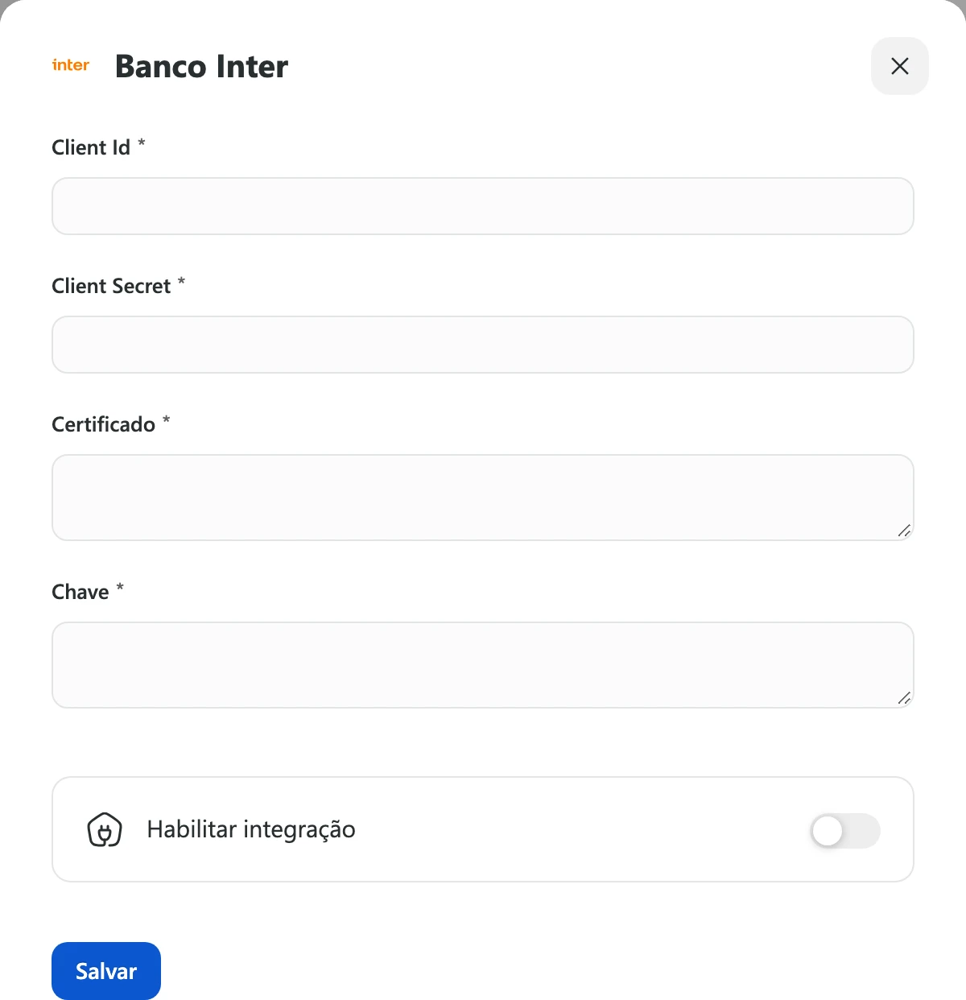

A integração liga a conta do Banco Inter à Kinbox para o membro gerar boletos de cobrança sem sair da conversa. Pelo quadro **Banco Inter**, você gera o boleto, copia a linha digitável ou baixa o PDF e envia ao contato manualmente — a Kinbox não envia o boleto sozinha nem gera Pix.

<Note>
  Quem pode configurar: proprietário do workspace ou membros com a permissão **Integrações** (veja [Referência de permissões](/docs/administracao/referencia-de-permissoes)). Para configurar, você precisa de uma conta no Banco Inter com credenciais de cobrança.
</Note>

## Antes de começar

- Tenha em mãos as credenciais da aplicação de cobrança do Banco Inter: **Client Id**, **Client Secret**, certificado e chave.
- A aplicação no Banco Inter precisa ter permissão para emitir e consultar boletos de cobrança.

## Passo a passo

<Steps>
  <Step title="Abra o app Banco Inter">
    Vá em **Configurações** → **Integrações** → **Apps** e clique em **Banco Inter** (veja [Apps e integrações: instalar e usar](/docs/integracoes/visao-geral)).
  </Step>

  <Step title="Preencha as credenciais">
    Preencha os quatro campos obrigatórios: **Client Id**, **Client Secret**, **Certificado** e **Chave**. Cole o conteúdo inteiro do certificado e da chave (as caixas aceitam texto de várias linhas).

    <Frame caption="Painel Banco Inter com os campos de credenciais, interruptor Habilitar integração e botão Salvar">
      
    </Frame>
  </Step>

  <Step title="Habilite e salve">
    Ligue **Habilitar integração** e clique em **Salvar**. Aparece "Salvo".
  </Step>
</Steps>

## Usar na conversa

Com **Habilitar integração** ligado, abra uma conversa e localize o quadro **Banco Inter** no painel **Detalhes** (veja [Caixa de entrada: visão geral](/docs/conversas/caixa-de-entrada-do-kinbox)). O quadro não aparece para membros com a restrição **Esconder informações de integração** nem no modo de treino da Academia.

- O quadro mostra apenas o botão **Gerar Boleto**, que fica desativado enquanto algum dos quatro campos do painel estiver vazio. Ele não lista dados do contato nem boletos emitidos antes.
- Ao clicar em **Gerar Boleto**, abre a janela **Gerar Boleto** com os dados da cobrança: **Identificador**, **Valor** e **Data de vencimento**. Abaixo fica a seção **Pagador**, com **CPF/CNPJ**, **Tipo de pessoa** (**Fisica** ou **Juridica**), **Nome** e endereço. A janela sempre abre vazia, sem preencher dados do contato. Depois de preencher, clique em **Gerar**.
- Com o boleto emitido, o título muda para **Compartilhar boleto**, mostrando a **Linha Digitável** com o botão **Copiar** e o botão **Baixar PDF**. O botão **Fechar** do rodapé fica oculto nessa tela; para sair, feche a janela.
- Nenhuma mensagem vai automaticamente ao contato: cole a linha digitável ou anexe o PDF na conversa. A integração também não gera Pix nem consulta, dá baixa ou cancela boletos já emitidos.

## No bot

O bot não tem ação pronta do Banco Inter. Para o bot enviar a segunda via de boletos já emitidos, veja [Integrar com o Asaas](/docs/integracoes/asaas) ou [Integrar com a Hinova](/docs/integracoes/hinova).

## Desligar a integração

Para desligar, abra **Banco Inter** em **Apps**, desligue **Habilitar integração** e clique em **Salvar**. O quadro deixa de aparecer nas conversas. Os dados preenchidos continuam salvos no painel.

## Problemas comuns

- **Botão Gerar Boleto desativado.** Falta preencher **Client Id**, **Client Secret**, **Certificado** ou **Chave** no painel **Banco Inter**. Peça a quem tem a permissão **Integrações** para completar os quatro campos.
- **Aviso "Não foi possível autenticar suas credenciais do banco Inter".** Client Id, Client Secret, certificado ou chave incorretos, ou aplicação sem permissão para emitir e consultar boletos. Confira os quatro campos no painel e recopie o certificado e a chave inteiros.
- **Aviso "Token expirado ou inválido. Tente novamente.".** A Kinbox renova o acesso automaticamente; clique em **Gerar** novamente.
- **Mensagem de erro do banco ao clicar em Gerar.** Corrija o dado indicado no aviso (por exemplo, CPF/CNPJ ou CEP) e tente de novo; a janela permanece aberta com os campos preenchidos.
- **Baixar PDF não faz nada.** O Banco Inter não entregou o PDF. Tente clicar novamente ou copie a **Linha Digitável** para mandar ao cliente.
- **O cliente não recebeu o boleto.** A Kinbox não envia o boleto sozinha. Copie a **Linha Digitável** ou baixe o PDF e envie na conversa.
- **O quadro Banco Inter não aparece na conversa.** Confira se **Habilitar integração** está ligado, se o seu papel não tem a restrição **Esconder informações de integração** e se você não está no modo de treino da Academia.
