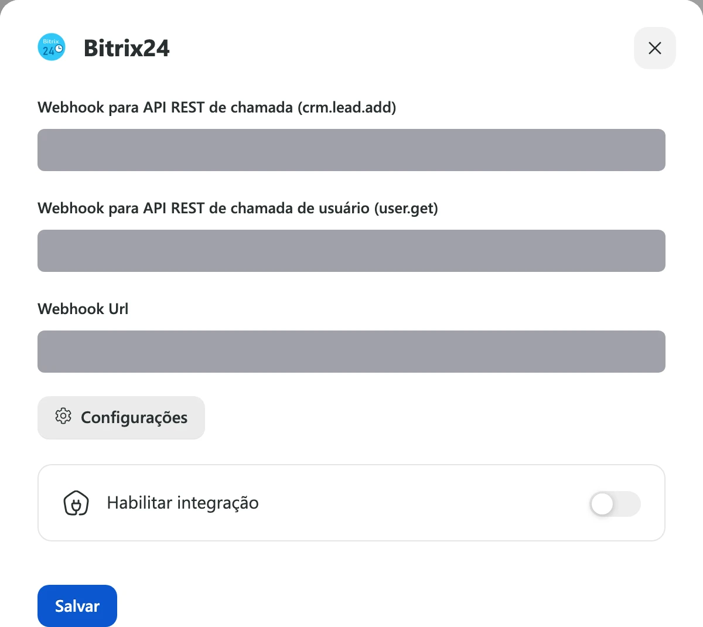

Com a integração do Bitrix24, o quadro **Bitrix24** da conversa cria um lead no Bitrix24 a partir do contato e abre esse lead. No bot, ações prontas criam ou atualizam contatos e negócios no Bitrix24. Tudo acontece quando o membro clica no quadro ou quando o fluxo do bot passa pelo bloco.

<Note>
  Quem pode configurar: proprietário do workspace ou membros com a permissão **Integrações** (veja [Referência de permissões](/docs/administracao/referencia-de-permissoes)). Você precisa de endereços de webhook de entrada do Bitrix24.
</Note>

## Antes de começar

O quadro da conversa e o bot usam campos diferentes do painel. Decida o que você vai usar e crie no Bitrix24 os webhooks de entrada correspondentes:

| Campo do painel | Usado por | Acesso que o webhook precisa no Bitrix24 |
| --- | --- | --- |
| **Webhook para API REST de chamada (crm.lead.add)** | Quadro da conversa (botão **Add lead**) | CRM |
| **Webhook para API REST de chamada de usuário (user.get)** | Quadro da conversa (opcional: define o responsável do lead) | Usuários |
| **Webhook Url** | Ações prontas do bot | CRM (contatos, negócios e funis) e usuários |

## Passo a passo

<Tabs>
  <Tab title="Quadro da conversa (com ou sem bot)">
    <Steps>
      <Step title="Abra o app Bitrix24">
        Vá em **Configurações** → **Integrações** → **Apps** e clique em **Bitrix24**.
      </Step>
      <Step title="Preencha os endereços">
        Cole o endereço inteiro do webhook em **Webhook para API REST de chamada (crm.lead.add)**, terminado em `/`, no mesmo formato do exemplo que aparece dentro do campo. Se quiser que o lead vá para o usuário do Bitrix24 com o mesmo e-mail do membro que clicou, preencha também **Webhook para API REST de chamada de usuário (user.get)**. Se também for usar as ações do bot, preencha **Webhook Url**.

        <Frame caption="Painel do Bitrix24 com endereços de exemplo">
          
        </Frame>
      </Step>
      <Step title="Habilite e salve">
        Ligue **Habilitar integração** e clique em **Salvar**. Com o interruptor ligado, a tela só salva se **Webhook para API REST de chamada (crm.lead.add)** estiver preenchido.
      </Step>
    </Steps>
  </Tab>
  <Tab title="Só as ações do bot">
    <Steps>
      <Step title="Abra o app Bitrix24">
        Vá em **Configurações** → **Integrações** → **Apps** e clique em **Bitrix24**.
      </Step>
      <Step title="Preencha o Webhook Url">
        Cole o endereço inteiro do webhook em **Webhook Url**, terminado em `/`.
      </Step>
      <Step title="Salve com o interruptor desligado">
        Deixe **Habilitar integração** desligado e clique em **Salvar**. As ações do bot usam o **Webhook Url** mesmo com o interruptor desligado; o quadro não aparece nas conversas.
      </Step>
    </Steps>
  </Tab>
</Tabs>

O botão **Configurações** do painel abre um **Mapa de campos** que não altera o lead criado pelo quadro nem as ações do bot. No bot, vale o mapa configurado dentro de cada bloco.

## Usar na conversa

Com **Habilitar integração** ligado, abra uma conversa e localize o quadro **Bitrix24** no painel **Detalhes** (veja [Caixa de entrada: visão geral](/docs/conversas/caixa-de-entrada-do-kinbox)). O quadro não aparece para membros com a restrição **Esconder informações de integração** nem no modo de treino da Academia.

- **Contato ainda não ligado:** clique em **Add lead**. O botão fica desativado se **Webhook para API REST de chamada (crm.lead.add)** estiver vazio.
  - O lead recebe o título "Lead \<nome do contato\>", o nome e o sobrenome (primeira e segunda palavras do nome), o e-mail e o telefone do contato.
  - Se o campo de usuário estiver preenchido e o e-mail do membro existir no Bitrix24, o lead vai para esse usuário.
  - Ao concluir, aparece "Lead criado no Bitrix24.".
- **Contato já ligado:** o quadro mostra o botão **Ver lead** (abre o lead no Bitrix24 em uma nova aba) e o menu **Ações** com **Desfazer integração** (botão **Desfazer**), que remove apenas o vínculo na Kinbox. O quadro não lê nem exibe dados ou etapa do lead.

## No bot

No bloco **Integração** do bot (grupo **Outros**), existem três ações prontas do Bitrix24 (veja [Chamar um sistema externo no bot](/docs/bot/integracoes-do-bot)):

- **Cria ou atualiza contato no Bitrix:** permite configurar o **Mapa de campos** para enviar dados do contato ou da sessão aos campos de contato do Bitrix24.
- **Cria Oportunidade no Bitrix:** pede **Funil de vendas** (a lista começa com **Padrão**), **Etapa do funil** e **Mapa de campos**; cria um novo negócio apenas se o contato ainda não tiver negócio aberto naquele funil.
- **Atualiza Oportunidade no Bitrix:** pede **Funil de vendas**, **Etapa do funil** e **Mapa de campos** para atualizar um negócio aberto do contato.

As ações do bot exigem o **Webhook Url** preenchido no painel do app e telefone cadastrado no contato. **Cria Oportunidade no Bitrix** também exige que o contato já exista no Bitrix24: use **Cria ou atualiza contato no Bitrix** antes, se necessário.

## Desligar a integração

Para esconder o quadro, abra **Bitrix24** em **Apps**, desligue **Habilitar integração** e clique em **Salvar**. As ações do bot continuam usando o **Webhook Url** salvo; para pará-las, tire essas ações dos bots.

## Problemas comuns

- **Botão Add lead desativado.** O campo **Webhook para API REST de chamada (crm.lead.add)** está vazio. Preencha o endereço e salve.
- **O painel não salva com Habilitar integração ligado.** Falta o **Webhook para API REST de chamada (crm.lead.add)**. Se você só usa o bot, salve com o interruptor desligado.
- **O lead foi criado sem o responsável certo.** O campo **Webhook para API REST de chamada de usuário (user.get)** está vazio ou o e-mail do membro na Kinbox é diferente do e-mail do usuário no Bitrix24.
- **A ação do bot não faz nada.** Confira se **Webhook Url** está preenchido no painel **Bitrix24**, se o contato tem telefone e, no caso de **Cria Oportunidade no Bitrix**, se o contato já existe no Bitrix24.
- **Listas de funil, etapas ou campos aparecem vazias no bot.** O endereço do webhook foi colado sem a barra `/` no final, está inválido ou não tem acesso ao CRM no Bitrix24.
- **Botão Configurações desativado.** Ele só libera depois que **Webhook para API REST de chamada (crm.lead.add)** ou **Webhook Url** está preenchido.
