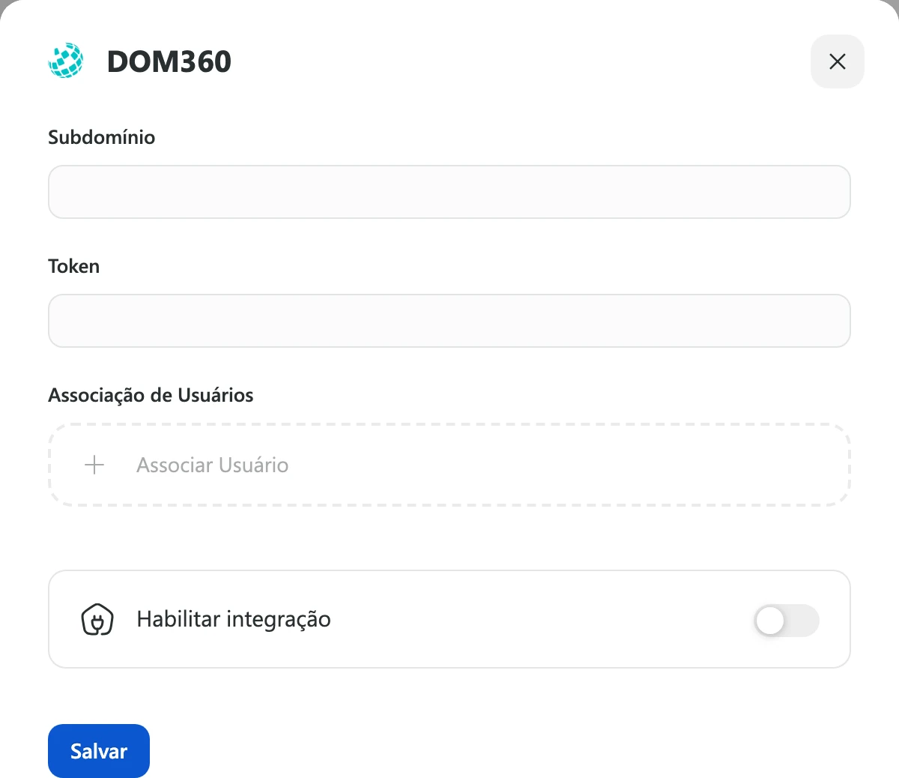

A integração liga o CRM Dom360 à Kinbox para o membro consultar ou criar o lead do contato, adicionar comentários, ver oportunidades e abrir chamados sem sair da conversa, além de oferecer três ações prontas no bot. O quadro busca o cadastro no Dom360 pelo telefone do contato a cada abertura da conversa.

<Note>
  Quem pode configurar: proprietário do workspace ou membros com a permissão **Integrações** (veja [Referência de permissões](/docs/administracao/referencia-de-permissoes)). Para configurar, você precisa do subdomínio e do token da sua conta no Dom360.
</Note>

## Antes de começar

- Tenha em mãos o **subdomínio** da sua conta no Dom360 (o trecho inicial do endereço de acesso ao seu Dom360) e o **token** de API da conta.

## Passo a passo

<Steps>
  <Step title="Abra o app Dom360">
    Vá em **Configurações** → **Integrações** → **Apps** e clique em **Dom360** (veja [Apps e integrações: instalar e usar](/docs/integracoes/visao-geral)). O painel abre com o título **DOM360**.
  </Step>

  <Step title="Preencha subdomínio e token">
    Preencha **Subdomínio** e **Token**. Os dois campos passam a ser obrigatórios quando **Habilitar integração** está ligado.

    <Frame caption="Painel DOM360 com Subdomínio, Token, Associação de Usuários, Habilitar integração e Salvar">
      
    </Frame>
  </Step>

  <Step title="Associe os membros aos usuários do Dom360">
    Em **Associação de Usuários**, clique em **Associar Usuário** (fica ativo depois de preencher **Subdomínio** e **Token**). Na janela **Adicionar Associação**, selecione o **Usuário Kinbox** e o **Usuário Dom360** e clique em **Associar**. Repita para cada membro que vai usar a integração (use o **X** ao lado do par para remover).

    A associação define quem entra como **Responsável** padrão ao criar um lead, quem assina comentários e chamados pelo quadro e para qual membro o bot transfere a conversa quando o cadastro já tem dono no Dom360. Sem associação, o quadro ainda funciona, mas sem responsável padrão.
  </Step>

  <Step title="Habilite e salve">
    Ligue **Habilitar integração** e clique em **Salvar**. Aparece "Salvo". As associações só valem depois de salvar.
  </Step>
</Steps>

## Usar na conversa

Com **Habilitar integração** ligado, abra uma conversa e localize o quadro **Dom360** no painel **Detalhes** (veja [Caixa de entrada: visão geral](/docs/conversas/caixa-de-entrada-do-kinbox)). O quadro não aparece para membros com a restrição **Esconder informações de integração** nem no modo de treino da Academia. Nenhuma ação do quadro envia mensagem ao contato.

- **Telefone não encontrado no Dom360:** o quadro exibe o botão **Add lead** (desativado se o contato não tiver telefone ou enquanto as listas do Dom360 carregam). Clicar abre a janela **Adicionar Lead** para criar o lead no Dom360.
- **Lead encontrado:** o quadro exibe **Tipo** (**Lead**), **Status**, **Responsável**, **Ver Lead** (abre no Dom360 em nova aba) e **Adicionar Comentário**. Clicar em **Tipo**, **Status** ou **Responsável** abre **Editar Lead**.
- **Contato encontrado** *(cadastro existente como contato no Dom360)*: exibe **Tipo** (**Contato**), **Responsável**, **Ver contato** (abre no Dom360) e três ações:
  - **Ver Oportunidades:** abre a janela **Oportunidades** em modo somente leitura; clicar na linha abre a oportunidade no Dom360 (não é possível criar oportunidades pelo quadro).
  - **Ver Chamados:** abre a janela **Chamados** com a lista de chamados e o botão **Add Chamado** para cadastrar um novo chamado.
  - **Adicionar Comentário:** abre a janela **Adicionar comentário** para enviar um comentário (com opção **Privado**) ao lead ou ao contato no Dom360.

## No bot

No bloco **Integração** do bot, dentro do grupo **Outros** (veja [Chamar um sistema externo no bot](/docs/bot/integracoes-do-bot)), há três ações prontas do Dom360, sem campos próprios na gaveta (puladas no **Simular bot** — teste em uma conversa real):

- **Criar lead no Dom360:** procura o telefone no Dom360; se não existir, cria o lead com os dados básicos do contato; se já existir, transfere a conversa para o membro associado ao responsável no Dom360.
- **Consulta usuário no Dom360:** procura o telefone no Dom360 e, se houver responsável associado a um membro da Kinbox, transfere a conversa para esse membro (sem alterar nada no Dom360).
- **Atualizar usuário no Dom360:** grava no lead ou contato do Dom360 o usuário associado ao membro que está atendendo a conversa.

## Desligar a integração

Para desligar o quadro na conversa, abra **Dom360** em **Apps**, desligue **Habilitar integração** e clique em **Salvar**. O quadro deixa de aparecer e as configurações continuam salvas no painel.

Desligar **Habilitar integração** **não** para as três ações do Dom360 no bot. Para interromper o uso no bot, retire esses blocos do fluxo do bot.

## Problemas comuns

- **Associar Usuário desativado.** Preencha **Subdomínio** e **Token** primeiro.
- **Aviso "Erro ao buscar usuários, verifique seu token e subdomínio.".** O token ou o subdomínio está incorreto ou sem acesso no Dom360. Revise os dois campos e tente novamente.
- **O quadro só mostra Add lead, mas o cliente já existe no Dom360.** O telefone do contato não bate com o cadastro no Dom360 ou o Dom360 não respondeu.
- **Botão Add lead desativado.** O contato não tem número de telefone, as listas do Dom360 ainda estão carregando ou o token está inválido.
- **A conversa foi transferida para outro membro depois de um bloco do bot.** **Criar lead no Dom360** e **Consulta usuário no Dom360** transferem a conversa ao membro associado ao responsável do cadastro no Dom360.
- **O bot continuou acessando o Dom360 com a integração desligada.** Desligar **Habilitar integração** oculta apenas o quadro; retire os blocos do Dom360 do fluxo do bot para interrompê-los.
- **O quadro Dom360 não aparece na conversa.** Confira se **Habilitar integração** está ligado, se o seu papel não tem a restrição **Esconder informações de integração** e se você não está no modo de treino da Academia.
