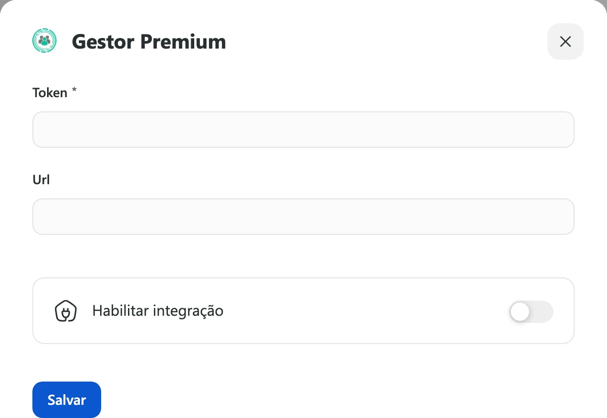

A integração liga o Gestor Premium à Kinbox para o membro consultar o cliente de IPTV ou P2P do contato direto no painel da conversa e criar usuário ou teste, editar, renovar, ajustar conexões, bloquear, migrar entre servidores e copiar dados de acesso sem sair do atendimento.

<Note>
  Quem pode configurar: proprietário do workspace ou membros com a permissão **Integrações** (veja [Referência de permissões](/docs/administracao/referencia-de-permissoes)). Para configurar, você precisa do token da sua conta no Gestor Premium.
</Note>

## Antes de começar

- Tenha em mãos o token do Gestor Premium.
- Se o seu provedor informou um endereço próprio para a integração, tenha essa URL à mão; caso contrário, deixe o campo **Url** em branco.

## Passo a passo

<Steps>
  <Step title="Abra o app Gestor Premium">
    Vá em **Configurações** → **Integrações** → **Apps** e clique em **Gestor Premium** (veja [Apps e integrações: instalar e usar](/docs/integracoes/visao-geral)).
  </Step>

  <Step title="Preencha o token e a URL">
    Preencha o campo obrigatório **Token**. Deixe o campo opcional **Url** vazio se o seu provedor não indicou outro endereço.

    <Frame caption="Painel Gestor Premium com os campos Token, Url, interruptor Habilitar integração e botão Salvar">
      
    </Frame>
  </Step>

  <Step title="Habilite e salve">
    Ligue **Habilitar integração** e clique em **Salvar**. Aparece "Salvo".
  </Step>
</Steps>

## Usar na conversa

Com **Habilitar integração** ligado, abra uma conversa e localize o quadro **Gestor Premium** no painel **Detalhes** (veja [Caixa de entrada: visão geral](/docs/conversas/caixa-de-entrada-do-kinbox)). O quadro não aparece para membros com a restrição **Esconder informações de integração** nem no modo de treino da Academia.

O quadro procura o usuário pelo vínculo salvo no contato (campo oculto de integração) ou pelo **telefone do contato** (somente números). Quando encontra pelo telefone, salva esse vínculo no contato automaticamente.

<Warning>
  Criar usuário, editar, renovar, renovar teste, ajustar conexões, bloquear, desbloquear e migrar alteram **de verdade** a conta do cliente final no Gestor Premium no momento em que você confirma. Nenhuma ação envia mensagem automaticamente ao contato: use **Copiar informações** ou **Copiar lista** e cole na conversa.
</Warning>

- **Contato encontrado:** o quadro exibe **Servidor Atual** (IPTV ou P2P), os dados de acesso da conta, **Habilitado** (Sim/Não), **Conexões max**, **Em testes** (Sim/Não), **Criado em**, **Expira em** e **Planos**. No servidor IPTV, mostra também uma tabela com **Canal**, **Pais**, **Conns** e **IP**.
- **Contato não encontrado (ou token/URL incorretos):** o quadro mostra apenas o botão **Criar usuário** (desabilitado se **Token** estiver vazio). Ao clicar, abre a janela **Criar usuário** para cadastrar o usuário em IPTV ou **Servidor P2P**, com **Nome de usuário**, **Senha**, **Pacotes** e **Habilitar Teste**. **Meses** e **Conexões máximas** só aparecem com **Habilitar Teste** desligado (**Conexões máximas** só no IPTV).

<Warning>
  Na janela **Criar usuário**, o interruptor **Habilitar Teste** vem **ligado por padrão**. Se você quiser criar um cliente pago em vez de um teste, desligue **Habilitar Teste** antes de clicar em **Criar** (com o interruptor desligado aparece **Meses** e, no IPTV, também **Conexões máximas**).
</Warning>

Quando há um usuário encontrado, o menu **Ações** (três pontos) traz estas opções:

| Ação | O que faz | Disponível em |
| --- | --- | --- |
| **Editar cliente** | Altera **Nome de usuário**, **Senha** e **Pacotes**. | IPTV e P2P |
| **Renovar cliente** | Estende a validade escolhendo **Meses**, **Conexões máximas** (IPTV) e **Comprovante** (opcional). | IPTV e P2P |
| **Renovar teste** | Estende o teste em **4 horas** ou **24 horas** e define **Conexões máximas** (fica desabilitado se o usuário não for de teste). | IPTV e P2P |
| **Adicionar conexão** / **Diminuir conexão** | Aumenta ou diminui o número de conexões do usuário, com confirmação. | Só IPTV |
| **Bloquear cliente** / **Desbloquear cliente** | Bloqueia ou libera o acesso do cliente, com confirmação. | IPTV e P2P |
| **Desbloqueio de confiança** | Libera o desbloqueio de confiança do usuário, com confirmação. | Só IPTV |
| **Histórico de canais** | Abre uma janela somente leitura com **Canal**, **Tempo** e **Stream**. | Só IPTV |
| **Adicionar Lista SSIPTV** | Envia o **Código de conexão** para adicionar a lista SSIPTV. | Só IPTV |
| **Migrar cliente para P2P** / **Migrar cliente para IPTV** | Troca o tipo de servidor do usuário (selecione o pacote de destino em **Pacotes** antes de clicar em **Migrar**). | IPTV ↔ P2P |
| **Copiar informações** | Copia os dados de acesso da conta, o endereço e a validade formatados para colar na conversa (não altera a conta). | IPTV e P2P |
| **Copiar lista** / **Copiar lista curta** | Copia o link da lista em **Lista de canais (MPEG-TS)**, **Lista de canais (HLS)** ou **Lista de canais (SS IPTV)** (não altera a conta). | Só IPTV |

## No bot

O bot não tem ação pronta do Gestor Premium.

## Desligar a integração

Para desligar, abra **Gestor Premium** em **Apps**, desligue **Habilitar integração** e clique em **Salvar**. O quadro deixa de aparecer nas conversas e os campos continuam salvos no painel.

## Problemas comuns

- **O quadro só mostra Criar usuário, mas o cliente já existe.** O telefone do contato não bate com o cadastro, o contato está sem telefone, ou **Token**/**Url** estão incorretos (a tela não diferencia esses casos). Confira o telefone do contato e os dados em **Apps** → **Gestor Premium**.
- **Botão Criar usuário desabilitado.** O campo **Token** está vazio no painel **Gestor Premium**.
- **Criar usuário gerou um teste em vez de um cliente.** O interruptor **Habilitar Teste** vem ligado por padrão; desligue-o antes de clicar em **Criar**.
- **Renovar teste aparece desabilitado.** Essa ação só fica disponível para usuários que estão em teste.
- **Faltam ações no menu.** Usuários no servidor P2P mostram um menu reduzido, sem opções exclusivas de IPTV.
- **Adicionar Lista SSIPTV mostrou aviso de tempo esgotado.** A operação pode ter sido concluída mesmo após o aviso; recarregue o quadro para conferir.
- **O quadro demora ao abrir a conversa.** A cada abertura, o quadro carrega as listas de pacotes IPTV e P2P.
- **O quadro Gestor Premium não aparece na conversa.** Confira se **Habilitar integração** está ligado, se o seu papel não tem a restrição **Esconder informações de integração** e se você não está no modo de treino da Academia.
