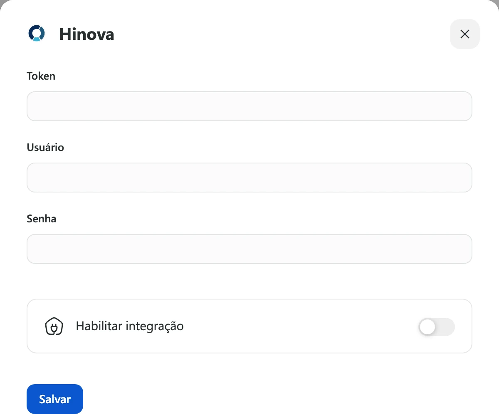

A integração liga o sistema SGA da Hinova ao bot da Kinbox para consultar os boletos de um associado pelo CPF e enviá-los na conversa. A Hinova não tem quadro na conversa; ela funciona somente pelo bot.

<Note>
  Quem pode configurar: proprietário do workspace ou membros com a permissão **Integrações** (veja [Referência de permissões](/docs/administracao/referencia-de-permissoes)). Para usar no bot, você precisa do token, usuário e senha da Hinova e de um campo personalizado de CPF no contato.
</Note>

## Antes de começar

- Tenha em mãos o token de acesso, o usuário e a senha fornecidos pela Hinova.
- Crie um campo personalizado na entidade **Contato** com a **Chave reservada** `cpf` (um campo chamado "CPF" gera essa chave; veja [Criar campos personalizados](/docs/configuracoes-no-workspace/campos-personalizados-no-kinbox)).

## Passo a passo

<Steps>
  <Step title="Abra o app Hinova">
    Vá em **Configurações** → **Integrações** → **Apps** e clique em **Hinova** (veja [Apps e integrações: instalar e usar](/docs/integracoes/visao-geral)).
  </Step>

  <Step title="Preencha as credenciais">
    Preencha **Token**, **Usuário** e **Senha**. A tela permite salvar com campos vazios, mas a ação do bot precisa dos três preenchidos para funcionar.

    <Frame caption="Painel Hinova com os campos Token, Usuário, Senha, interruptor Habilitar integração e botão Salvar">
      
    </Frame>
  </Step>

  <Step title="Habilite e salve">
    Ligue **Habilitar integração** e clique em **Salvar**. Aparece "Salvo".
  </Step>
</Steps>

## Usar na conversa

**Não há quadro da Hinova na conversa.** A integração não aparece no painel **Detalhes**; todo o uso acontece pelo bot.

## No bot

No bloco **Integração** do bot, escolha **Consulta boletos SGA** em **Tipo de integração**, dentro do grupo **Outros** (SGA é como o sistema da Hinova aparece no bot; veja [Chamar um sistema externo no bot](/docs/bot/integracoes-do-bot)). A ação não tem campos próprios na gaveta e é pulada no **Simular bot** — publique o fluxo e teste em uma conversa real.

Quando o fluxo passa pelo bloco, o bot:

1. Autentica na Hinova com **Token**, **Usuário** e **Senha** salvos no painel.
2. Lê o CPF do campo personalizado `cpf` do contato.
3. Busca os boletos desse CPF com vencimento do mês anterior até o fim do mês atual.
4. Envia ao cliente na conversa, como mensagem do bot, até 4 boletos com modelo do veículo, placa, data de vencimento, valor, situação e link do boleto.
5. Para boletos que não estão baixados e têm link, envia também a linha digitável, o texto "Segue abaixo o boleto em PDF:" e o arquivo PDF.

Se não houver boleto no período, o cliente não recebe nada e pode não aparecer aviso para a equipe. Em falha de credencial ou com o campo `cpf` vazio, a equipe vê uma mensagem interna na conversa e o cliente não recebe mensagem.

A integração apenas consulta boletos já existentes no SGA: ela não gera boleto novo, não gera Pix nem dá baixa ou recebe pagamento pela Kinbox.

<Warning>
  A ação envia na conversa os boletos encontrados na Hinova para o CPF salvo no campo `cpf` do contato. Confirme a identidade do associado no fluxo do bot antes deste bloco.
</Warning>

## Desligar a integração

Para marcar o app como desabilitado em **Apps**, abra **Hinova**, desligue **Habilitar integração** e clique em **Salvar**. Os dados continuam salvos no painel.

Desligar **Habilitar integração** **não** para a ação **Consulta boletos SGA** no bot. Para interromper a consulta, retire o bloco do fluxo do bot e clique em **Publicar**.

## Problemas comuns

- **O bot não respondeu com boletos e o cliente ficou sem retorno.** Falta o campo personalizado `cpf` preenchido no contato, as credenciais (**Token**, **Usuário** ou **Senha**) estão vazias ou incorretas, ou não há boletos no período buscado (mês anterior até o fim do mês atual). Na falha de credencial ou de CPF, a equipe vê uma mensagem interna na conversa; quando só não há boleto no período, pode não aparecer aviso nenhum.
- **Chegaram apenas alguns boletos.** A ação envia no máximo 4 boletos por consulta.
- **Mesmo desligando Habilitar integração, o bot continua consultando.** O interruptor não vale para o bot; retire o bloco **Consulta boletos SGA** do fluxo do bot e clique em **Publicar**.

## Detalhes

- Cada workspace mantém uma única integração Hinova.
- O valor do campo `cpf` é enviado à Hinova exatamente como está preenchido no contato (sem limpar nem acrescentar pontuação).
- A consulta envia no máximo 4 boletos por execução e não grava dados no contato.
