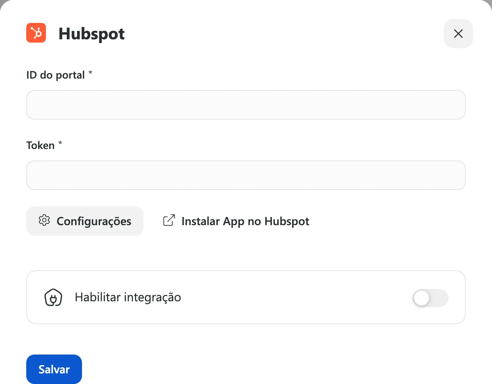

Com a integração do HubSpot ligada, cada conversa exibe o quadro **Hubspot** no painel **Detalhes**. Nele você encontra o contato no HubSpot (por padrão, pelo telefone), cria o contato e cria ou edita negócios com produtos, sem sair do atendimento. O quadro consulta o HubSpot na hora em que você abre a conversa.

Essa conexão é diferente do app **HubSpot** usado pelo agente de IA, que tem login próprio (veja [Dar ferramentas ao agente: Agenda, Google Calendar e HubSpot](/docs/agente-de-ia/ferramentas)).

<Note>
  Quem pode configurar: proprietário do workspace ou membros com a permissão **Integrações** (veja [Referência de permissões](/docs/administracao/referencia-de-permissoes)). Você precisa de uma conta no HubSpot com o número do portal (**ID do portal**) e o token de um app privado do HubSpot.
</Note>

## Antes de começar

- Crie um app privado no HubSpot com acesso de leitura e escrita a contatos e negócios, e leitura de usuários (responsáveis), funis e produtos, e tenha em mãos o **token de acesso** dele. Tudo o que a integração faz no HubSpot funciona com esse token, preenchido no campo **Token**.
- Separe o **ID do portal** da sua conta no HubSpot. Ele é exigido no painel e usado nos links que abrem o contato e o negócio no HubSpot.

## Passo a passo

<Steps>
  <Step title="Abra a tela Apps">
    Vá em **Configurações** → **Integrações** → **Apps** e clique em **Hubspot**.
  </Step>

  <Step title="Preencha o ID do portal e o Token">
    Informe o **ID do portal** e cole o token de acesso do app privado no campo **Token**.

    <Frame caption="Painel de configuração do Hubspot">
      
    </Frame>
  </Step>

  <Step title="Ajuste campos e regras (opcional)">
    Com um **Token** válido digitado, clique em **Configurações** para abrir **Ajustes do Hubspot**, faça os ajustes (veja [Ajustes opcionais](#ajustes-opcionais)) e clique em **Salvar** dentro de **Ajustes do Hubspot**.
  </Step>

  <Step title="Habilite e salve no painel do app">
    Ligue **Habilitar integração** e clique em **Salvar** no painel **Hubspot**. Os ajustes de **Configurações** só são gravados quando você clica em **Salvar** no painel do app.
  </Step>
</Steps>

## Ajustes opcionais

Em **Configurações** → **Ajustes do Hubspot** (os campos e funis vêm direto do seu HubSpot):

- **Campos de Formulário do Contato:** propriedades de contato que aparecem ao criar um contato pelo quadro.
- **Campos de Formulário do Negócio:** propriedades de negócio que aparecem ao criar ou editar um negócio.
- **Identificador do contato:** como o quadro encontra o contato no HubSpot: **Celular** (padrão), **Id do contato do Hubspot** ou **Campo personalizado**.
- **Obrigatoriedade:** campos do negócio que ficam obrigatórios ao escolher uma etapa no quadro.
- **Mapa de campos:** liga [campos personalizados](/docs/configuracoes-no-workspace/campos-personalizados-no-kinbox) da Kinbox a propriedades de contato do HubSpot.
- **Tokens reservas:** tokens adicionais, se o seu workspace faz muitas chamadas ao HubSpot.

Nenhum ajuste é obrigatório: sem eles, o quadro procura o contato pelo telefone e mostra os formulários com nome, sobrenome e os campos básicos do negócio.

## Usar na conversa

Com **Habilitar integração** ligado, abra uma conversa e localize o quadro **Hubspot** no painel **Detalhes** (veja [Caixa de entrada: visão geral](/docs/conversas/caixa-de-entrada-do-kinbox)). O quadro não aparece para membros com a restrição **Esconder informações de integração** nem no modo de treino da Academia.

No modo padrão (**Celular**), o quadro abre o contato do HubSpot já vinculado ao contato da Kinbox. Se ainda não houver vínculo, procura pelo telefone e guarda o vínculo encontrado.

- **Contato não encontrado:** clique em **Criar Contato**, confira **Nome**, **Sobrenome** e os campos configurados na janela **Adicionar Contato** e clique em **Cadastrar Contato**. Nos modos **Celular** e **Campo personalizado**, o botão fica desativado se o contato não tiver telefone. O quadro só cria contatos novos; não edita contatos já existentes.
- **Contato encontrado:** o cabeçalho mostra nome, telefone (ou e-mail), o botão **Abrir no HubSpot** (quando o **ID do portal** está preenchido) e, no modo **Celular**, o botão **Trocar contato vinculado**, que abre uma busca para vincular outro contato do HubSpot.
- **Negócios:** a lista mostra o nome e a etapa de cada negócio do contato. Passe o mouse sobre um negócio para ver mais detalhes.

### Criar ou editar um negócio

<Steps>
  <Step title="Abra o negócio">
    Clique em **Negócio** para criar, ou clique em um negócio da lista para editar.
  </Step>
  <Step title="Preencha os dados">
    Na gaveta **Adicionar Negócio** / **Editar Negócio**, preencha **Nome**, **Funil de vendas**, **Etapa do funil** e **Responsável** (ao criar, vem sugerido o usuário do HubSpot com o mesmo e-mail do membro logado), além do **Valor** e dos campos configurados.
  </Step>
  <Step title="Adicione produtos (opcional)">
    Em **Itens de linha**, clique em **Produto** e informe **Produto**, **Preço** e **Quantidade**. Nos itens já salvos, **Produto**, **Preço** e **Quantidade** ficam desativados: para trocar um item, exclua-o (a exclusão vale na hora e não tem volta) e adicione outro.
  </Step>
  <Step title="Salve">
    Clique em **Cadastrar Negócio** ou **Salvar**. O quadro recarrega alguns segundos depois. Ao editar um negócio, use **Ver no Hubspot** para abri-lo no HubSpot.
  </Step>
</Steps>

## No bot e nas automações

- **No bot:** o bloco **Integração** (grupo **Outros**) tem ações prontas que usam o **Token** salvo no painel **Hubspot**, entre elas **Consulta contato no HubSpot**, **Consulta negócio no HubSpot**, **Atualiza negócio no HubSpot** e **Cria ou atualiza Objeto no HubSpot**. Veja [Chamar um sistema externo no bot](/docs/bot/integracoes-do-bot).
- **Nas automações:** a ação **Integração** traz opções do HubSpot, como **Atualizar responsável do negócio**, **Salvar mensagens no negócio do Hubspot** e **Salvar mensagens no contato do Hubspot**.

## Instalar o app da Kinbox no HubSpot (opcional)

O botão **Instalar App no Hubspot** abre a tela de autorização do HubSpot em uma nova aba. Depois de instalar, o app da Kinbox aparece nos fluxos de trabalho do HubSpot.

Esse botão não substitui o **Token**: para o quadro da conversa, o bot, as automações e os fluxos de trabalho funcionarem, o **Token** precisa estar preenchido e salvo no painel **Hubspot**.

## Desligar a integração

Para esconder o quadro nas conversas, abra **Hubspot** em **Apps**, desligue **Habilitar integração** e clique em **Salvar**. As ações do bot, das automações e dos fluxos de trabalho do HubSpot continuam usando o token mesmo com o interruptor desligado. Para pará-las também, tire essas ações dos bots, das automações e dos fluxos de trabalho do HubSpot.

## Problemas comuns

- **Ajustes do Hubspot fecha sozinho ao abrir.** O **Token** está vazio, inválido ou sem permissão no HubSpot. Confira o token e abra **Configurações** de novo.
- **O quadro mostra "Erro ao buscar informações de contato do Hubspot."** O token está inválido, expirou ou o HubSpot bloqueou por excesso de chamadas. Clique em **Recarregar**; se continuar, gere outro token e atualize no painel.
- **O botão Criar Contato está desativado.** O contato da conversa não tem telefone cadastrado (nos modos **Celular** e **Campo personalizado** do **Identificador do contato**).
- **O quadro mostra o contato errado.** Existem contatos duplicados no HubSpot com o mesmo telefone. No modo **Celular**, clique em **Trocar contato vinculado** e escolha o contato certo.
- **Instalei pelo botão Instalar App no Hubspot e nada aparece na conversa.** O botão não configura o token. Preencha **ID do portal** e **Token**, ligue **Habilitar integração** e clique em **Salvar**.
- **O formulário de negócio exige um campo.** A etapa selecionada tem regra em **Configurações** → **Obrigatoriedade**.
