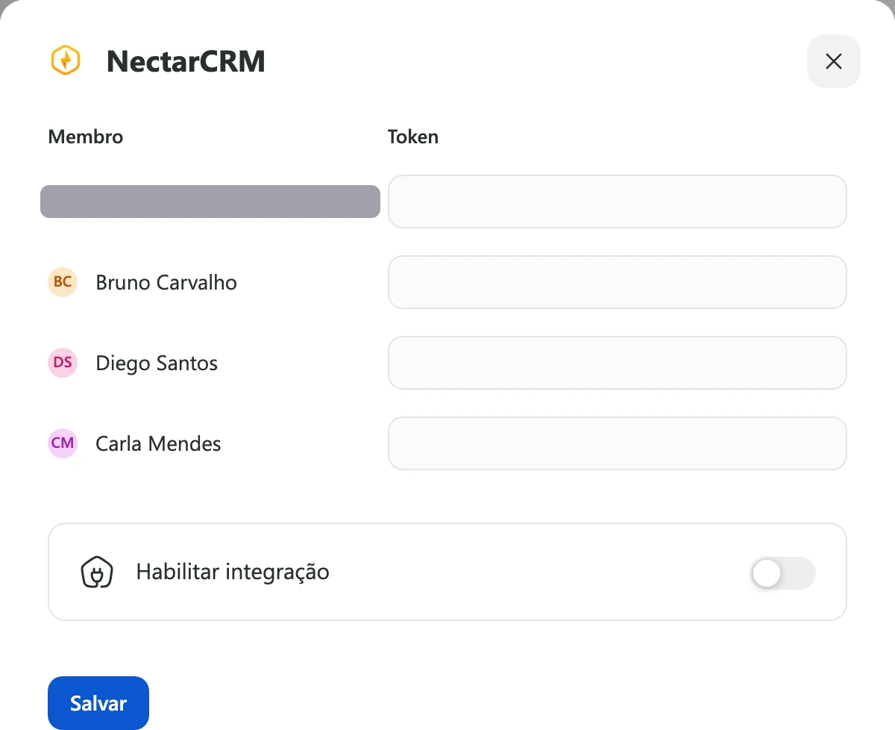

A integração liga cada membro da Kinbox à conta dele no NectarCRM. Na conversa, o quadro **NectarCRM** cria o contato no NectarCRM, exibe responsável, segmento, origem e a contagem de oportunidades e tarefas, atualiza os dados do contato, salva a conversa como publicação e abre o contato ou as oportunidades no NectarCRM. Tudo acontece quando o membro clica no quadro.

<Note>
  Quem pode configurar: proprietário do workspace ou membros com a permissão **Integrações** (veja [Referência de permissões](/docs/administracao/referencia-de-permissoes)). **Cada membro** que vai usar o quadro na conversa precisa ter o próprio token de API do NectarCRM preenchido na linha dele; sem token, o botão **Add contato** fica desativado.
</Note>

## Antes de começar

- Tenha em mãos o **token de API do NectarCRM de cada membro** que vai usar a integração no atendimento.

## Passo a passo

<Steps>
  <Step title="Abra o app NectarCRM">
    Vá em **Configurações** → **Integrações** → **Apps** e clique em **NectarCRM**.
  </Step>

  <Step title="Cole o token de cada membro">
    O painel mostra as colunas **Membro** e **Token**, com uma linha por membro do workspace (o proprietário aparece primeiro). Cole o token de API do NectarCRM na linha de cada membro que vai usar a integração.

    <Frame caption="Painel NectarCRM com um campo de token por membro">
      
    </Frame>
  </Step>

  <Step title="Habilite e salve">
    Ligue **Habilitar integração** e clique em **Salvar**. Aparece "Salvo".
  </Step>
</Steps>

## Usar na conversa

Com **Habilitar integração** ligado, abra uma conversa e localize o quadro **NectarCRM** no painel **Detalhes** (veja [Caixa de entrada: visão geral](/docs/conversas/caixa-de-entrada-do-kinbox)). O quadro não aparece para membros com a restrição **Esconder informações de integração** nem no modo de treino da Academia.

- **Contato ainda não ligado:** o quadro mostra o botão **Add contato** (desativado se o seu membro não tiver token salvo no painel). Clicar cria um contato no NectarCRM com nome, telefone e e-mail (quando preenchidos) — e também envia Segmento e Origem se o contato da Kinbox tiver os campos personalizados `segmento` e `origem`. Ao concluir, aparece "Contato criado no NectarCRM.".
- **Contato já ligado:** o quadro mostra **Responsável**, **Segmento** e **Origem** (quando têm valor), além das contagens de **Oportunidades** e **Tarefas**, e o menu **Ações** (três pontos):
  - **Salvar dados:** envia nome, telefone, e-mail e origem (do campo personalizado `origem`) do contato para o NectarCRM e exibe "Contato atualizado".

    <Warning>
      **Salvar dados** substitui o Segmento do contato no NectarCRM pelo texto fixo "WhatsApp/Kinbox".
    </Warning>

  - **Salvar conversa nas notas:** grava as últimas mensagens da conversa (até 100) como uma publicação com título e assunto "Conversa" no contato no NectarCRM, com nome, hora e data; ao terminar, aparece uma confirmação.
  - **Ver oportunidades:** abre a aba de oportunidades do contato no NectarCRM em uma nova aba.
  - **Ver contato:** abre a ficha do contato no NectarCRM em uma nova aba.
  - **Desfazer integração:** pede confirmação com o botão **Desfazer** e remove apenas o vínculo na Kinbox, sem apagar nada no NectarCRM.

## No bot e nas automações

Não há ações do NectarCRM no bot nem nas automações: a integração funciona apenas pelo quadro na conversa.

## Desligar a integração

Para desligar, abra **NectarCRM** em **Apps**, desligue **Habilitar integração** e clique em **Salvar**. Os tokens salvos continuam guardados no painel.

## Problemas comuns

- **Botão Add contato desativado.** Falta preencher o token do seu membro no painel **NectarCRM**. Peça a quem tem a permissão **Integrações** para cadastrar o seu token.
- **Erro do NectarCRM ao abrir a conversa ou ao criar contato.** O token na linha do seu membro está vazio ou inválido. Confira o token no NectarCRM e salve novamente no painel.
- **O Segmento do contato mudou para "WhatsApp/Kinbox" no NectarCRM.** É o efeito de **Salvar dados**, que sempre grava esse texto no Segmento.
- **O quadro NectarCRM não aparece na conversa.** Confira se **Habilitar integração** está ligado, se o seu papel não tem a restrição **Esconder informações de integração** e se você não está no modo de treino da Academia.
