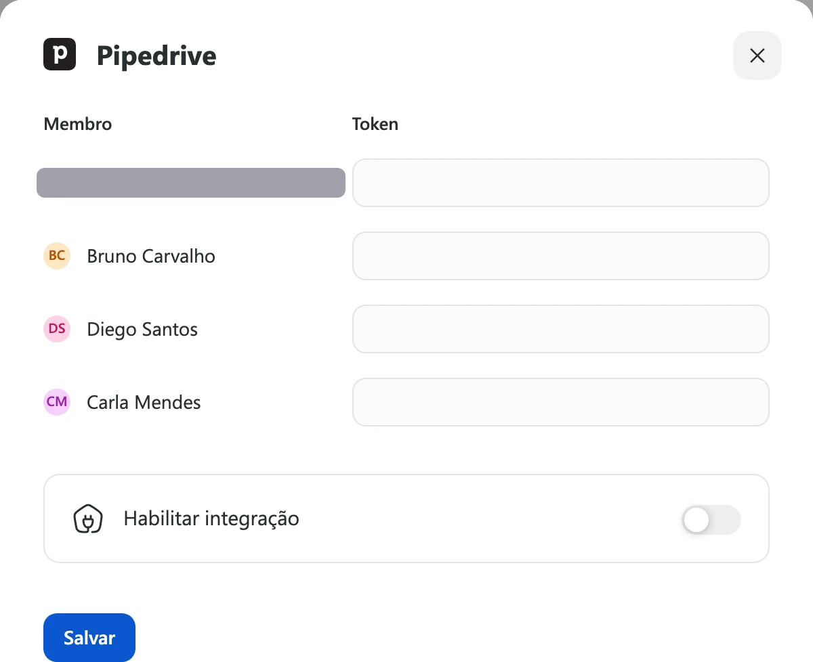

A integração liga cada membro da Kinbox à conta dele no Pipedrive. Na conversa, o quadro **Pipedrive** cria a pessoa no Pipedrive a partir do contato, mostra quantas oportunidades e atividades abertas ela tem, cria oportunidades, atualiza os dados da pessoa e salva a conversa como nota. Tudo acontece quando o membro aciona o quadro, sem sincronização automática.

<Note>
  Quem pode configurar: proprietário do workspace ou membros com a permissão **Integrações** (veja [Referência de permissões](/docs/administracao/referencia-de-permissoes)). Na configuração atual, **cada membro** que vai usar o quadro na conversa precisa ter o próprio token de API do Pipedrive preenchido na linha dele; sem ele, o botão **Add contato** fica desativado.
</Note>

## Antes de começar

- Tenha em mãos o **token de API do Pipedrive de cada membro** que vai usar a integração no atendimento.

## Passo a passo

<Steps>
  <Step title="Abra o app Pipedrive">
    Vá em **Configurações** → **Integrações** → **Apps** e clique em **Pipedrive**.
  </Step>

  <Step title="Cole o token de cada membro">
    O painel mostra as colunas **Membro** e **Token**, com uma linha para cada membro do workspace (o proprietário aparece primeiro). Cole o token de API do Pipedrive na linha de cada membro que vai usar a integração.

    <Frame caption="Painel Pipedrive com um campo de token por membro">
      
    </Frame>
  </Step>

  <Step title="Habilite e salve">
    Ligue **Habilitar integração** e clique em **Salvar**. Aparece "Salvo".
  </Step>
</Steps>

## Usar na conversa

Com **Habilitar integração** ligado, abra uma conversa e localize o quadro **Pipedrive** no painel **Detalhes** (veja [Caixa de entrada: visão geral](/docs/conversas/caixa-de-entrada-do-kinbox)). O quadro não aparece para membros com a restrição **Esconder informações de integração** nem no modo de treino da Academia.

- **Contato ainda não ligado:** clique em **Add contato**. Na configuração atual, o botão fica desativado se o seu membro não tiver token salvo no painel.
  - A Kinbox cria a pessoa no Pipedrive com nome, e-mail e telefone do contato e liga o contato a ela.
  - Também vão os [campos personalizados](/docs/configuracoes-no-workspace/campos-personalizados-no-kinbox) preenchidos que tenham o mesmo nome de um campo de pessoa no Pipedrive (de texto, número, e-mail ou telefone).
  - Ao concluir, aparece "Contato criado no pipedrive.".
- **Contato já ligado:** o quadro mostra **Oportunidades abertas** e **Atividades abertas** e o botão de menu **Ações** (três pontos) com cinco opções:
  - **Criar oportunidade:** abre a janela **Adicionar negócio** com **Título** (obrigatório), **Valor**, **Funil** (obrigatório) e **Etapa do funil** (obrigatório). Ao salvar, cria a oportunidade ligada à pessoa e atualiza a contagem.
  - **Salvar dados:** atualiza nome, e-mail, telefone e os campos personalizados compatíveis do contato no Pipedrive (exibe "Salvando dados no Pipedrive..." enquanto envia).
  - **Salvar conversa nas notas:** grava as últimas mensagens da conversa (até 100) como uma nota na pessoa no Pipedrive, com nome de quem enviou, hora e data, e avisa "Nota salva no Pipedrive.".
  - **Ver no Pipedrive:** abre a pessoa no Pipedrive em uma nova aba.
  - **Desfazer integração:** pede confirmação com o botão **Desfazer** e remove apenas o vínculo na Kinbox, sem apagar nada no Pipedrive.

## No bot

No bloco **Integração** do bot (grupo **Outros**), há três ações prontas do Pipedrive (veja [Chamar um sistema externo no bot](/docs/bot/integracoes-do-bot)):

- **Sincroniza contato, lead, deal, activity e notas no Pipedrive**
- **Cria ou atualiza a deal no Pipedrive**
- **Cria ou atualiza atividade de agenda no Pipedrive**

O bot pode usar outro token configurado no painel, não necessariamente o do membro que está atendendo.

## Desligar a integração

Para desligar, abra **Pipedrive** em **Apps**, desligue **Habilitar integração** e clique em **Salvar**. Isso esconde o quadro nas conversas e também interrompe as ações do Pipedrive no bot. Os tokens salvos continuam guardados no painel.

## Problemas comuns

- **Botão Add contato desativado.** Na configuração atual, falta preencher o token do seu membro no painel **Pipedrive**. Peça a quem tem a permissão **Integrações** para cadastrar o seu token.
- **Aviso de erro do Pipedrive ao abrir a conversa.** O token salvo na linha do seu membro está vazio ou inválido. Gere ou copie o token novamente no Pipedrive e salve no painel.
- **Um campo personalizado não foi enviado ao Pipedrive.** Confira se o campo está preenchido no contato, se o nome dele na Kinbox é igual ao nome do campo de pessoa no Pipedrive (sem diferenciar maiúsculas) e se o campo no Pipedrive é de texto, número, e-mail ou telefone.
- **O quadro Pipedrive não aparece na conversa.** Confira se **Habilitar integração** está ligado, se o seu papel não tem a restrição **Esconder informações de integração** e se você não está no modo de treino da Academia.
