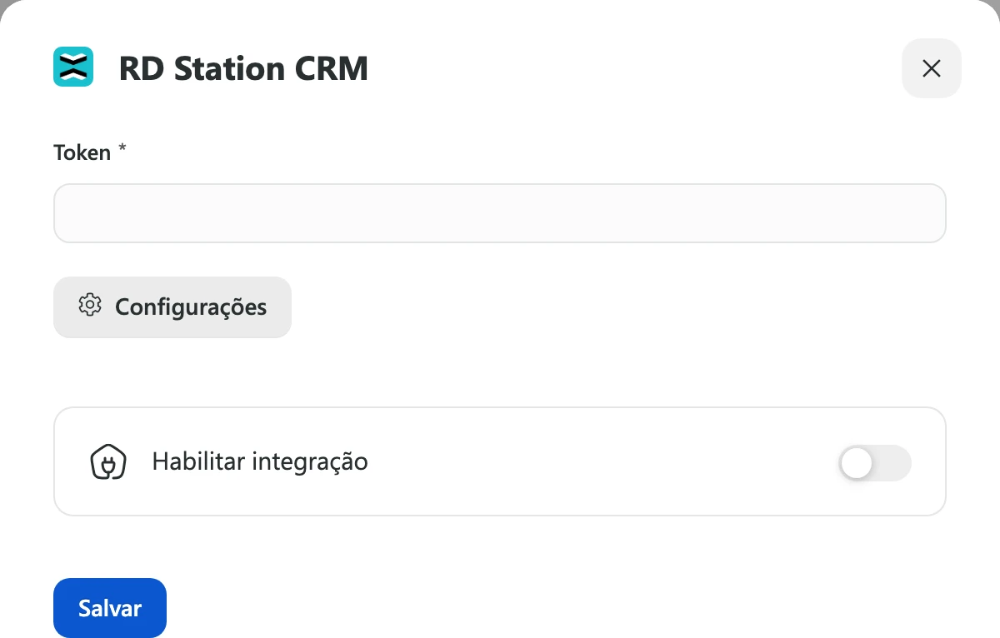

Com a integração do RD Station CRM ligada, o quadro **RD Station CRM** na conversa cria uma oportunidade (negociação), um contato e uma empresa no RD a partir do atendimento, salva o link e as mensagens da conversa como anotação e lista as negociações daquela empresa. Não há sincronização automática: tudo acontece quando o membro usa o quadro.

<Note>
  Quem pode configurar: proprietário do workspace ou membros com a permissão **Integrações** (veja [Referência de permissões](/docs/administracao/referencia-de-permissoes)). Você precisa de uma conta no RD Station CRM e do token de API dela.
</Note>

## Antes de começar

- Tenha em mãos o **token de API do RD Station CRM**.

## Passo a passo

<Steps>
  <Step title="Abra o app RD Station CRM">
    Vá em **Configurações** → **Integrações** → **Apps** e clique em **RD Station CRM**.
  </Step>

  <Step title="Cole o Token">
    Preencha o campo obrigatório **Token** com o token de API do RD Station CRM.

    <Frame caption="Painel de configuração do RD Station CRM">
      
    </Frame>
  </Step>

  <Step title="Escolha o estágio do funil padrão (opcional)">
    Com o **Token** preenchido, clique em **Configurações** para abrir **Ajustes do RDStation**. Escolha a etapa padrão em **Estágio do funil** (no formato `<funil> - <etapa>`) e clique em **Salvar**. Esse campo é opcional e só é gravado de fato quando você salva no passo seguinte.
  </Step>

  <Step title="Habilite e salve no painel do app">
    Ligue **Habilitar integração** e clique em **Salvar** no painel **RD Station CRM**. Aparece "Salvo".
  </Step>
</Steps>

## Usar na conversa

Com **Habilitar integração** ligado, abra uma conversa e localize o quadro **RD Station CRM** no painel **Detalhes** (veja [Caixa de entrada: visão geral](/docs/conversas/caixa-de-entrada-do-kinbox)). O quadro não aparece para membros com a restrição **Esconder informações de integração** nem no modo de treino da Academia.

- **Contato ainda não ligado:** o quadro mostra o botão **Add oportunidade** (desativado se não houver token salvo). Ao clicar, a Kinbox cria no RD Station CRM:
  - uma negociação com o nome do contato (na etapa definida em **Estágio do funil**, se houver);
  - um contato com nome, e-mail e telefone do contato da Kinbox;
  - uma empresa com o nome do contato;
  - uma anotação na negociação com o link da conversa e as mensagens (até 100).
  Quando termina, aparece "Oportunidade criada no RD Station CRM." e o contato da Kinbox fica ligado à empresa criada.
- **Contato já ligado:** o quadro lista as negociações daquela empresa no RD, mostrando nome, valor total e etapa. Clique em uma negociação para abri-la no RD Station CRM em uma nova aba.
- **Menu Ações (três pontos):**
  - **Ver contato:** abre o contato no RD Station CRM em uma nova aba.
  - **Ver cliente/empresa:** abre a empresa no RD Station CRM em uma nova aba.
  - **Desfazer integração:** pede confirmação com o botão **Desfazer** e remove apenas o vínculo na Kinbox, sem apagar nada no RD. Depois disso, o quadro volta a mostrar **Add oportunidade**.

<Warning>
  Cada clique em **Add oportunidade** cria um contato, uma empresa e uma negociação novos no RD Station CRM — a Kinbox não procura registros que já existam lá. Se você usar **Desfazer integração** e clicar em **Add oportunidade** de novo, uma nova empresa e uma nova negociação serão criadas no RD.
</Warning>

## No bot

Não há ação pronta do bot para o RD Station CRM. As ações prontas de RD no bot são exclusivas para o [RD Station Marketing](/docs/integracoes/rdstation-marketing).

## Desligar a integração

Para desligar, abra **RD Station CRM** em **Apps**, desligue **Habilitar integração** e clique em **Salvar**. O token salvo permanece guardado no painel.

## Problemas comuns

- **Botão Configurações desativado.** O campo **Token** está vazio. Preencha o token para liberar o botão.
- **Estágio do funil abre sem opções.** O token está errado ou sem acesso no RD Station CRM. Confira o token e abra **Configurações** novamente.
- **O quadro não aparece na conversa.** Confira se **Habilitar integração** está ligado, se o seu papel não tem a restrição **Esconder informações de integração** e se você não está no modo de treino da Academia.
- **Negociações repetidas no RD Station CRM.** **Add oportunidade** foi clicado mais de uma vez ou após usar **Desfazer integração**.
