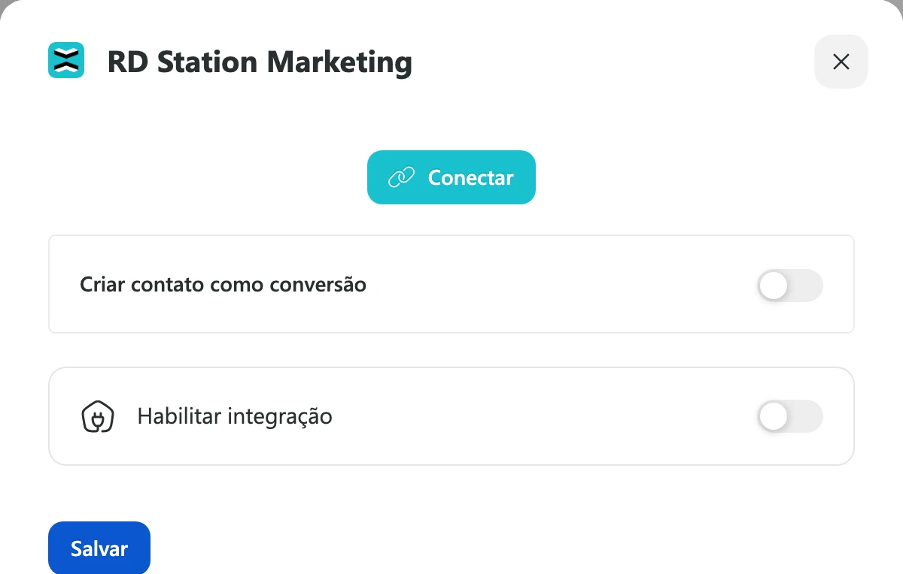

A integração com o RD Station Marketing **envia** dados da Kinbox para o RD: no quadro da conversa, você procura o contato no RD pelo e-mail, vê os dados dele e cria ou atualiza o contato com nome, e-mail, celular, observações e tags da conversa (com opção de registrar também uma conversão). A mesma conexão libera a ação pronta do RD Station Marketing no bot.

<Note>
  Quem pode configurar: proprietário do workspace ou membros com a permissão **Integrações** (veja [Referência de permissões](/docs/administracao/referencia-de-permissoes)). Você não precisa copiar chaves: a conexão é feita entrando na sua conta do RD Station Marketing.
</Note>

## Antes de começar

- Tenha acesso de login à conta do RD Station Marketing que você quer ligar ao workspace.

## Passo a passo

<Steps>
  <Step title="Abra o app RD Station Marketing">
    Vá em **Configurações** → **Integrações** → **Apps** e clique em **RD Station Marketing**.

    <Frame caption="Painel RD Station Marketing antes de conectar">
      
    </Frame>
  </Step>

  <Step title="Salve o painel antes de conectar">
    Se esta é a primeira vez que você configura o app no workspace, clique em **Salvar** **antes** de clicar em **Conectar**. Sem salvar primeiro, a tela de retorno não conclui a conexão.
  </Step>

  <Step title="Conecte e autorize no RD">
    Reabra **RD Station Marketing** se necessário, clique em **Conectar** e autorize o acesso na página do RD Station Marketing. Ao retornar para a Kinbox, aparece "RD Station Marketing Conectado." e o interruptor **Habilitar integração** já fica ligado.
  </Step>

  <Step title="Ative conversões (opcional) e salve">
    Se quiser registrar também uma conversão no RD sempre que um contato for criado ou atualizado pelo quadro ou pelo bot, ligue **Criar contato como conversão**, confirme **Habilitar integração** ligado e clique em **Salvar**.
  </Step>
</Steps>

## Desconectar ou desligar

- **Desconectar:** abra **RD Station Marketing** em **Apps** e clique no botão vermelho **Desconectar**. O acesso é removido na hora na Kinbox (sem precisar clicar em **Salvar**), sem alterar **Habilitar integração** e sem revogar a autorização dentro do RD.
- **Desligar:** para apenas ocultar o quadro nas conversas, desligue **Habilitar integração** e clique em **Salvar**.

## Usar na conversa

Com **Habilitar integração** ligado, abra uma conversa e localize o quadro **RD Station Marketing** no painel **Detalhes** (veja [Caixa de entrada: visão geral](/docs/conversas/caixa-de-entrada-do-kinbox)). O quadro não aparece para membros com a restrição **Esconder informações de integração** nem no modo de treino da Academia.

O quadro procura o contato no RD **pelo e-mail** do contato na Kinbox. Se você alterar o e-mail do contato na Kinbox, o quadro passa a buscar o novo e-mail no RD.

- **Contato não encontrado (ou sem e-mail):** o quadro mostra **Add contato** (desativado se a conta não estiver conectada). Se o contato não tiver e-mail, clicar exibe "Necessário setar o e-mail para criar contato no RD Marketing.". Com e-mail preenchido, clicar cria o contato no RD com nome, e-mail, celular, observações (bio) e as [tags](/docs/configuracoes-no-workspace/criar-e-gerenciar-tags) da conversa em minúsculas, exibe "Contato salvo" e recarrega o quadro.
- **Contato encontrado:** o quadro exibe em modo somente leitura os dados preenchidos no RD — **Contato**, **Cargo**, **Telefone pessoal**, **Celular**, **Bio**, **Website**, **Cidade**, **Estado**, **Twitter**, **Facebook**, **Linkedin**, **Tags** e campos personalizados do RD.
- **Menu Ações (três pontos):**
  - **Ver contato:** abre a busca de leads do RD Station Marketing pelo e-mail do contato em uma nova aba.
  - **Atualizar contato:** envia nome, celular, observações e tags atuais da conversa para o contato no RD (não altera o e-mail) e exibe "Contato salvo". Se **Criar contato como conversão** estiver ligado, registra também a conversão.

## No bot

No bloco **Integração** do bot (grupo **Outros**), use a ação pronta **Cria ou atualiza contato no RDMarketing** (veja [Chamar um sistema externo no bot](/docs/bot/integracoes-do-bot)). Ela permite configurar o **Mapa de campos** ligando **Nome**, **E-mail**, **Data criação da sessão**, **Data fim da sessão**, **Atendente da sessão** e campos personalizados da Kinbox aos campos do RD.

O contato precisa ter e-mail preenchido antes da ação rodar; sem e-mail, o bot registra a mensagem "Erro ao consultar/criar contato no RdStation: O contato precisa ter um e-mail".

## Receber leads do RD na Kinbox

A integração em **Apps** só envia dados da Kinbox para o RD. Para trazer leads convertidos no RD Station Marketing para a Kinbox, veja [Receber leads do RD Station Marketing por webhook](/docs/integracoes/rdstation-marketing-webhook).

## Problemas comuns

- **Depois de autorizar no RD, a tela fica carregando sem parar.** O painel ainda não tinha sido salvo antes da conexão. Volte a **Apps** → **RD Station Marketing**, clique em **Salvar** e só depois clique em **Conectar**.
- **Add contato aparece para um contato que já existe no RD.** O e-mail cadastrado na Kinbox é diferente do e-mail no RD, ou a conexão expirou. Confira o e-mail; se estiver igual, abra o app, clique em **Desconectar** e depois em **Conectar** novamente.
- **Aviso "Necessário setar o e-mail para criar contato no RD Marketing."** Preencha o e-mail do contato na Kinbox antes de clicar em **Add contato**.
- **Bot registra "O contato precisa ter um e-mail".** Peça e salve o e-mail do contato em um bloco anterior do fluxo antes da ação do RD Station Marketing.
