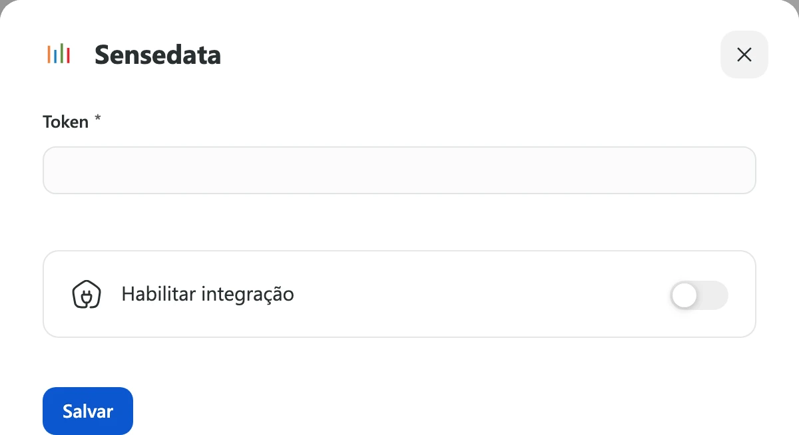

A integração mostra no painel da conversa, em modo somente leitura, os dados de Customer Success da empresa do contato vindos da Sensedata: **Porte**, **Grupo**, **Status**, **CSM** e **Fase**.

<Note>
  Quem pode configurar: proprietário do workspace ou membros com a permissão **Integrações** (veja [Referência de permissões](/docs/administracao/referencia-de-permissoes)). Para configurar, você precisa do token de API da sua conta na Sensedata.
</Note>

## Antes de começar

- Tenha em mãos o token de API da Sensedata.

## Passo a passo

<Steps>
  <Step title="Abra o app Sensedata">
    Vá em **Configurações** → **Integrações** → **Apps** e clique em **Sensedata** (veja [Apps e integrações: instalar e usar](/docs/integracoes/visao-geral)).
  </Step>

  <Step title="Cole o token da Sensedata">
    Preencha o campo obrigatório **Token** com o token de API da Sensedata.

    <Frame caption="Painel Sensedata com o campo Token, interruptor Habilitar integração e botão Salvar">
      
    </Frame>
  </Step>

  <Step title="Habilite e salve">
    Ligue **Habilitar integração** e clique em **Salvar**. Aparece "Salvo".
  </Step>
</Steps>

## Usar na conversa

Com **Habilitar integração** ligado, abra uma conversa e localize o quadro **Sensedata** no painel **Detalhes** (veja [Caixa de entrada: visão geral](/docs/conversas/caixa-de-entrada-do-kinbox)). O quadro não aparece para membros com a restrição **Esconder informações de integração** nem no modo de treino da Academia.

- Ao abrir a conversa, a Kinbox busca contatos na Sensedata pelo **telefone da conversa**, usa o primeiro contato retornado e exibe cinco campos da empresa vinculada a ele: **Porte**, **Grupo**, **Status**, **CSM** e **Fase**. Os rótulos aparecem mesmo quando o valor está vazio.
- O quadro é somente leitura: não há botões, ações nem envio de mensagem ao contato.
- Se a conversa não tiver telefone, o telefone não existir na Sensedata ou ocorrer erro de consulta ou de token, o quadro mostra **Não encontrado** (a tela não diferencia token inválido de contato inexistente).

## No bot

O bot não tem ação pronta da Sensedata.

## Desligar a integração

Para desligar, abra **Sensedata** em **Apps**, desligue **Habilitar integração** e clique em **Salvar**. O quadro deixa de aparecer nas conversas. Os dados preenchidos continuam salvos no painel.

## Problemas comuns

- **O quadro mostra Não encontrado.** O telefone da conversa não está cadastrado na Sensedata (ou está em formato diferente), o contato não tem empresa vinculada na Sensedata, a conversa não tem telefone ou o **Token** está inválido. Confira o token no painel e o cadastro do contato na Sensedata.
- **Os dados parecem desatualizados.** O quadro consulta a Sensedata a cada abertura da conversa e não tem botão de atualizar. Atualize o cadastro na Sensedata e reabra a conversa.
- **O quadro Sensedata não aparece na conversa.** Confira se **Habilitar integração** está ligado, se o seu papel não tem a restrição **Esconder informações de integração** e se você não está no modo de treino da Academia.

## Detalhes

- Cada workspace mantém uma única integração Sensedata.
- A busca envia exatamente o telefone da conversa como guardado na Kinbox, sem testar variações (como adicionar ou remover nono dígito ou DDI).
- A consulta se repete a cada troca de conversa, sem gravar nada na Kinbox nem na Sensedata.
- Se houver dois ou mais contatos com o mesmo telefone na Sensedata, o quadro usa apenas o primeiro devolvido.
