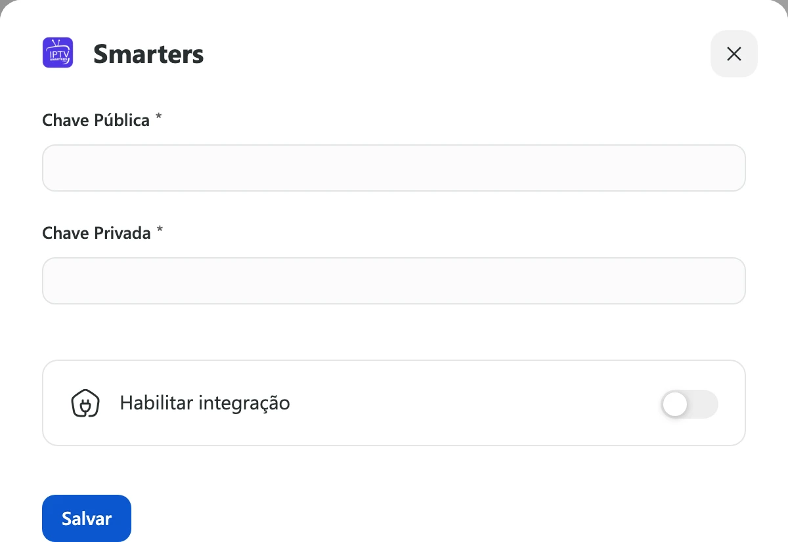

A integração liga a Smarters à Kinbox para o membro consultar o usuário de IPTV do contato direto no painel da conversa e criar teste, editar, renovar, liberar confiança e copiar dados de acesso sem sair do atendimento.

<Note>
  Quem pode configurar: proprietário do workspace ou membros com a permissão **Integrações** (veja [Referência de permissões](/docs/administracao/referencia-de-permissoes)). Para configurar, você precisa das chaves pública e privada da sua conta na Smarters.
</Note>

## Antes de começar

- Tenha em mãos a chave pública e a chave privada da sua conta na Smarters.

## Passo a passo

<Steps>
  <Step title="Abra o app Smarters">
    Vá em **Configurações** → **Integrações** → **Apps** e clique em **Smarters** (veja [Apps e integrações: instalar e usar](/docs/integracoes/visao-geral)).
  </Step>

  <Step title="Preencha as chaves">
    Preencha os dois campos obrigatórios: **Chave Pública** e **Chave Privada**.

    <Frame caption="Painel Smarters com os campos Chave Pública, Chave Privada, interruptor Habilitar integração e botão Salvar">
      
    </Frame>
  </Step>

  <Step title="Habilite e salve">
    Ligue **Habilitar integração** e clique em **Salvar**. Aparece "Salvo".
  </Step>
</Steps>

## Usar na conversa

Com **Habilitar integração** ligado, abra uma conversa e localize o quadro **Smarters** no painel **Detalhes** (veja [Caixa de entrada: visão geral](/docs/conversas/caixa-de-entrada-do-kinbox)). O quadro não aparece para membros com a restrição **Esconder informações de integração** nem no modo de treino da Academia.

O quadro procura o usuário na Smarters pelo **telefone do contato** e não grava nada nos campos do contato na Kinbox.

<Warning>
  As ações de criar teste, editar, renovar, renovar teste e desbloquear confiança alteram **de verdade** a conta do cliente final na Smarters assim que você confirma. Nenhuma ação envia mensagem automaticamente ao contato: depois de criar ou renovar, use **Copiar informações** e cole na conversa.
</Warning>

- **Contato encontrado:** o quadro exibe os dados de acesso da conta, **Telas**, **Adulto** (Sim/Não), **Online** (Sim/Não), **Texto de modelo**, **Criado em** e **Expira em**, com o menu **Ações** (três pontos) no fim. Se o cliente estiver online, aparece também a tabela com **Canal**, **Início**, **IP** e **SSIP**.
- **Contato não encontrado (ou chaves inválidas):** o quadro mostra apenas o botão **Add teste**, sem mensagem de erro. Ao clicar em **Add teste**, abre a janela **Adicionar usuário Smarters** para criar um usuário de teste (a duração do teste é a definida pela Smarters).
- **Menu Ações** (quando há usuário encontrado):
  - **Editar cliente:** altera **Usuário**, **Senha** e **Canal adulto** na conta do cliente.
  - **Renovar cliente:** renova a conta escolhendo **Telas**, **Meses** e **Canal adulto**.
  - **Renovar teste** *(aparece só para usuários de teste)*: estende o teste em **1 hora**, **6 horas**, **4 horas** ou **24 horas**.
  - **Desbloquear confiança** *(aparece só para usuários que não são de teste)*: pede confirmação ("Você deseja liberar 3 dias de confiança para o cliente?") para liberar o acesso de confiança.
  - **Copiar informações:** copia os dados de acesso da conta formatados para colar na conversa (não altera a conta).
  - **Copiar lista:** copia o link da lista de canais em **Lista de canais (MPEG-TS)**, **Lista de canais (HLS)** ou **Lista de canais (SS IPTV)** para colar na conversa (não altera a conta).

## No bot

O bot não tem ação pronta da Smarters.

## Desligar a integração

Para desligar, abra **Smarters** em **Apps**, desligue **Habilitar integração** e clique em **Salvar**. O quadro deixa de aparecer nas conversas e as chaves continuam salvas no painel.

## Problemas comuns

- **O quadro só mostra Add teste, mas o cliente já existe.** O telefone do contato não bate com o cadastro na Smarters ou as chaves estão incorretas (a tela não diferencia os dois casos). Confira o telefone do contato e as chaves em **Apps** → **Smarters**.
- **Triângulo vermelho ao lado de Usuário.** O nome do usuário na Smarters não contém o telefone da conversa. Confira se o usuário pertence mesmo ao contato; se pertencer, o aviso pode ser ignorado.
- **Botão Add teste desabilitado.** O contato não tem telefone preenchido. Cadastre o telefone no contato e reabra a conversa.
- **Cliquei em Add teste e o usuário não foi criado.** A janela fecha mesmo quando a Smarters retorna erro; confira o aviso vermelho na tela para ver o motivo.
- **Menu sem Renovar teste ou sem Desbloquear confiança.** **Renovar teste** só aparece para usuários de teste; **Desbloquear confiança** só aparece para usuários que não são de teste.
- **O quadro Smarters não aparece na conversa.** Confira se **Habilitar integração** está ligado, se o seu papel não tem a restrição **Esconder informações de integração** e se você não está no modo de treino da Academia.
