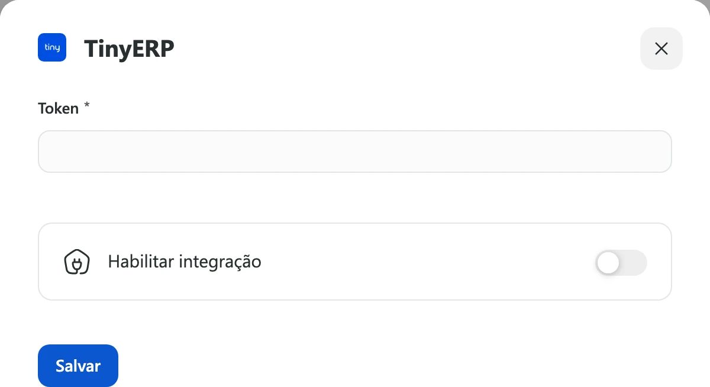

A integração liga o contato da conversa a um cliente no Tiny ERP. Pelo quadro **Tiny ERP** no painel da conversa, o membro cria o cliente no Tiny a partir do contato e consulta os dados cadastrais dele sem sair da Kinbox — tudo por ação manual, sem sincronização automática.

<Note>
  Quem pode configurar: proprietário do workspace ou membros com a permissão **Integrações** (veja [Referência de permissões](/docs/administracao/referencia-de-permissoes)). Para configurar, você precisa do token de API da sua conta do Tiny ERP.
</Note>

## Antes de começar

- Tenha em mãos o token de API do Tiny ERP. O token é único para todo o workspace.

## Passo a passo

<Steps>
  <Step title="Abra o app Tiny ERP">
    Vá em **Configurações** → **Integrações** → **Apps** e clique em **Tiny ERP** (veja [Apps e integrações: instalar e usar](/docs/integracoes/visao-geral)). O painel abre com o título **TinyERP**.
  </Step>

  <Step title="Cole o token do Tiny ERP">
    Preencha o campo obrigatório **Token** com o token de API do Tiny ERP.

    <Frame caption="Painel TinyERP com o campo Token, interruptor Habilitar integração e botão Salvar">
      
    </Frame>
  </Step>

  <Step title="Habilite e salve">
    Ligue **Habilitar integração** e clique em **Salvar**. Aparece "Salvo".
  </Step>
</Steps>

## Usar na conversa

Com **Habilitar integração** ligado, abra uma conversa e localize o quadro **Tiny ERP** no painel **Detalhes** (veja [Caixa de entrada: visão geral](/docs/conversas/caixa-de-entrada-do-kinbox)). O quadro não aparece para membros com a restrição **Esconder informações de integração** nem no modo de treino da Academia. Nenhuma ação do quadro envia mensagem ao contato.

- **Contato ainda não ligado:** o quadro mostra o botão **Add cliente** (desativado enquanto não houver **Token** salvo). Ao clicar, a Kinbox cria o cliente no Tiny ERP com nome, telefone (como celular) e e-mail do contato, grava o vínculo no contato e exibe "Cliente criado no TinyERP.".
- **Contato já ligado:** a cada abertura da conversa, o quadro consulta o cadastro no Tiny ERP e exibe em modo somente leitura os campos que tiverem valor preenchido: **Nome**, **Fantasia**, **Código**, **Tipo de pessoa**, **CPF/CNPJ**, **RG**, **Contribuinte**, **CEP**, **Município**, **UF**, **Endereço**, **Número**, **Telefone**, **Telefone Adicional**, **Website**, **E-mail para envio de NFe**, **Observações do contato** e **Observações**. O quadro não mostra pedidos, notas fiscais, financeiro nem estoque.
- **Menu Ações** (três pontos):
  - **Ver cliente:** abre o cadastro do cliente no Tiny ERP em uma nova aba.
  - **Desfazer integração:** pede confirmação ("Tem certeza que deseja desfazer a integração desse contato com o TinyERP?") com o botão **Desfazer** e remove apenas o vínculo na Kinbox, sem apagar o cliente no Tiny ERP.

## No bot

O bot não tem ação pronta do Tiny ERP.

## Desligar a integração

Para desligar, abra **Tiny ERP** em **Apps**, desligue **Habilitar integração** e clique em **Salvar**. O quadro deixa de aparecer nas conversas.

## Problemas comuns

- **Botão Add cliente desativado.** Falta preencher o **Token** no painel **TinyERP**. Peça a quem tem a permissão **Integrações** para salvá-lo.
- **Clicou em Add cliente e o quadro ficou carregando sem aviso.** O Tiny ERP recusou a criação do cliente e a tela não exibiu o motivo. Recarregue a página, confira os dados do contato (nome, telefone e e-mail) e verifique se o token está correto.
- **Aviso de erro ao abrir a conversa.** O Tiny ERP retornou erro ao ler o cadastro (por exemplo, token inválido ou cliente removido no Tiny).
- **Cliente duplicado no Tiny ERP.** **Add cliente** não verifica se o cliente já existe antes de criar; desfazer a integração e clicar em **Add cliente** novamente cria outro cadastro no Tiny ERP.
- **Quadro sem dados depois de ligar.** Só aparecem os campos preenchidos no Tiny ERP; campos vazios ficam ocultos.
- **O quadro Tiny ERP não aparece na conversa.** Confira se **Habilitar integração** está ligado, se o seu papel não tem a restrição **Esconder informações de integração** e se você não está no modo de treino da Academia.

## Detalhes

- Cada workspace mantém uma única integração Tiny ERP.
- **Add cliente** não busca por CPF/CNPJ, telefone ou e-mail para ligar a um cliente já existente no Tiny ERP; ele sempre cria um cliente novo.
- O vínculo fica salvo no contato (em um campo personalizado oculto criado no primeiro uso) e vale para todas as conversas daquele contato e para todos os membros.
- Os dados são somente leitura na Kinbox: nada do Tiny ERP é copiado para os campos do contato, e alterações feitas depois no contato da Kinbox não são enviadas ao Tiny ERP.
- Se o token for apagado ou ficar inválido depois da ligação, o contato mantém o vínculo, mas o quadro não carrega os dados (ou exibe o erro retornado pelo Tiny ERP).
