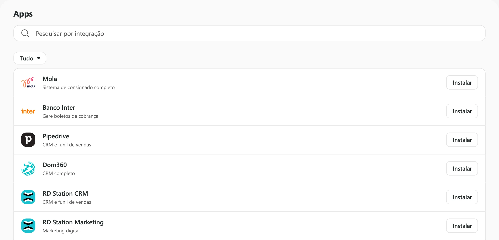

**Apps** é a tela onde você liga a Kinbox a sistemas externos prontos — como CRMs, marketing, ERP e cobrança — sem precisar programar.

Na maioria das integrações, depois de configurada e habilitada, ela aparece como um quadro com o nome do sistema no painel **Detalhes** da conversa. Ali, o membro consulta ou cria registros no sistema externo sem sair da Kinbox. Cada integração tem as próprias ações.

## Onde fica e quem pode usar

- **Configurar apps:** vá em **Configurações** → **Integrações** → **Apps**. Só o proprietário do workspace e membros com a permissão **Integrações** veem esse menu e abrem o painel de cada app (veja [Referência de permissões](/docs/administracao/referencia-de-permissoes)).
- **Usar na conversa:** quem atende não precisa da permissão **Integrações** para usar o quadro na conversa. O quadro aparece para todo membro, exceto quem tem a restrição **Esconder informações de integração** no papel ou está no modo de treino da Academia.

## A tela Apps

Na tela **Apps**, você encontra o campo **Pesquisar por integração** (busca pelo nome) e o filtro com as opções **Tudo**, **Instalado** e **Não instalado**.

Cada linha traz o logo, o nome, uma descrição curta e o botão **Instalar** (ou **Instalado**, quando a integração está habilitada). Os apps instalados aparecem primeiro.

<Frame caption="Tela Apps com busca, filtro e lista de integrações">
  
</Frame>

| Categoria | Integrações |
| --- | --- |
| **CRM e vendas** | [HubSpot](/docs/integracoes/hubspot) (**Hubspot**), [Pipedrive](/docs/integracoes/pipedrive), [RD Station CRM](/docs/integracoes/rdstation-crm), [Zoho CRM](/docs/integracoes/zoho), [Bitrix24](/docs/integracoes/bitrix24), [NectarCRM](/docs/integracoes/nectarcrm), Dom360 |
| **Marketing** | [RD Station Marketing](/docs/integracoes/rdstation-marketing); [Meta Ads](/docs/marketing/meta-ads), [Google Ads](/docs/marketing/google-ads) e [Tracking](/docs/marketing/tracking) quando liberados no workspace |
| **Cobrança e financeiro** | Banco Inter, Asaas |
| **ERP e gestão** | Tiny ERP, Sensedata, Smarters, Gestor Premium, Hinova, Anycar |
| **Outros** | Mola (sistema de consignado completo) |

A lista pode variar entre workspaces, porque a Kinbox também pode liberar outros apps do catálogo para um workspace específico.

Para receber leads do RD Station Marketing na Kinbox (em vez de enviar da Kinbox para o RD), veja [Receber leads do RD Station Marketing por webhook](/docs/integracoes/rdstation-marketing-webhook).

## Instalar e desligar

Cada workspace mantém uma conta por tipo de integração.

- **Para instalar:** clique na linha do app (ou em **Instalar**) e preencha o que o painel pede (token, chave ou ID, conforme o sistema). Nos apps que usam esse painel, ligue **Habilitar integração** e clique em **Salvar**: aparece "Salvo" e o app passa a mostrar **Instalado**. Alguns apps têm sequência própria, como o [RD Station Marketing](/docs/integracoes/rdstation-marketing), que conecta pelo botão **Conectar**; siga a página de cada integração.
- **Para desligar:** abra o app na lista, desligue **Habilitar integração** e clique em **Salvar**. A tela não tem botão de excluir; os dados preenchidos ficam guardados no painel.

## Usar na conversa

Com **Habilitar integração** ligado, abra uma conversa na **Caixa de entrada** e olhe o painel **Detalhes**, à direita (veja [Caixa de entrada: visão geral](/docs/conversas/caixa-de-entrada-do-kinbox)). Cada integração habilitada que tem quadro próprio aparece como uma seção recolhível com o nome dela — por exemplo, **Hubspot**, **Pipedrive**, **RD Station CRM** ou **Zoho** (o Zoho CRM usa o título **Zoho** no quadro). Clique no título para abrir.

O quadro não aparece quando a integração está desligada, quando o membro tem a restrição **Esconder informações de integração** no papel ou quando a conversa está no modo de treino da Academia.

## No bot e no agente de IA

- **Bot:** algumas integrações têm ações prontas no bloco **Integração** do bot, no grupo **Outros**, entre elas HubSpot, Bitrix24, RD Station Marketing e Pipedrive. Elas usam a conexão configurada em **Apps**. Veja [Chamar um sistema externo no bot](/docs/bot/integracoes-do-bot).
- **Agente de IA:** o app **HubSpot** dentro das ferramentas do agente de IA usa uma conexão própria, feita por login no HubSpot, separada da integração de **Apps**. Veja [Dar ferramentas ao agente: Agenda, Google Calendar e HubSpot](/docs/agente-de-ia/ferramentas).

## Apps, plugins, API, cenários e Funis

- **Funis:** os CRMs desta seção são sistemas externos. O CRM próprio da Kinbox é **Funis** (veja [Contatos, organizações e negociações](/docs/conceitos/contatos-e-negocios)).
- **Plugins:** servem para abrir uma página do seu próprio sistema dentro do painel da conversa (veja [Criar um plugin para o painel da conversa](/docs/desenvolvedor/criando-plugin-integracao)).
- **API pública:** serve para o seu sistema ler e gravar dados na Kinbox com um token de API (veja [Criar um token de API](/docs/desenvolvedor/tokens-de-api) e [Para desenvolvedores: API, plugins, MCP e links](/docs/desenvolvedor/visao-geral)).
- **Cenários:** montam fluxos de integração por webhook e requisições HTTP (veja [Cenários: visão geral](/docs/cenarios/visao-geral) e [Bot, automações, cenários e agentes de IA: qual usar](/docs/conceitos/automacao-e-ia)).

## Problemas comuns

- **Apps não aparece no menu.** Seu papel não tem a permissão **Integrações**. Peça ao proprietário ou a um administrador para liberar essa permissão.
- **O sistema que eu uso não está na lista.** A Kinbox não tem integração pronta para ele (ou o app não está liberado no seu workspace). Você pode integrar pela [API pública](/docs/desenvolvedor/tokens-de-api), por [plugins](/docs/desenvolvedor/criando-plugin-integracao), pelo bloco **Integração** do bot (**Chamar endpoint**, veja [Chamar um sistema externo no bot](/docs/bot/integracoes-do-bot)) ou por **Cenários** (veja [Bot, automações, cenários e agentes de IA: qual usar](/docs/conceitos/automacao-e-ia)).
- **O quadro da integração não aparece na conversa.** Confira se **Habilitar integração** está ligado, se o seu papel não tem a restrição **Esconder informações de integração** e se você não está no modo de treino da Academia.
- **Instalei o app, mas ele não funciona.** Reabra o app em **Apps**, confira as credenciais preenchidas e se **Habilitar integração** está ligado, e veja os problemas comuns na página daquela integração.
