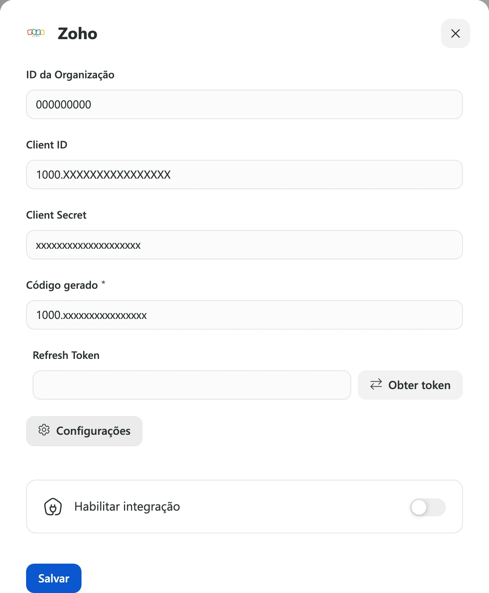

Com a integração do Zoho CRM ligada, cada conversa exibe o quadro **Zoho** no painel **Detalhes** para buscar leads ou contatos pelo telefone, criar leads, converter leads em contatos e criar ou editar negócios. A integração funciona apenas no quadro da conversa — não há ações do Zoho CRM no bot nem nas automações, e a consulta acontece na hora em que você abre a conversa.

<Note>
  Quem pode configurar: proprietário do workspace ou membros com a permissão **Integrações** (veja [Referência de permissões](/docs/administracao/referencia-de-permissoes)). Você precisa de uma conta no Zoho CRM e das credenciais de um cliente do Zoho.
</Note>

## Antes de começar

Tenha em mãos, a partir de um cliente configurado na sua conta do Zoho com acesso ao Zoho CRM (leads, contatos, negócios, layouts e usuários):

- **Client ID** e **Client Secret** do cliente.
- Um **código gerado** recente para autorizar o acesso.
- O **ID da Organização** do seu Zoho CRM (usado para montar o link **Ver no Zoho** ao editar um negócio).

## Passo a passo

<Steps>
  <Step title="Abra o app Zoho CRM">
    Vá em **Configurações** → **Integrações** → **Apps** e clique em **Zoho CRM**. O painel abre com o título **Zoho**.
  </Step>

  <Step title="Preencha as credenciais e obtenha o token">
    Preencha **ID da Organização**, **Client ID**, **Client Secret** e **Código gerado** (obrigatório). Em seguida, clique em **Obter token**.

    Quando a troca dá certo, o campo **Refresh Token** aparece preenchido e o botão **Configurações** é liberado. Se **Refresh Token** não aparecer, gere um código novo no Zoho, cole em **Código gerado** e clique em **Obter token** novamente.

    <Frame caption="Painel de configuração do Zoho">
      
    </Frame>
  </Step>

  <Step title="Escolha os layouts e campos em Configurações">
    Clique em **Configurações** para abrir **Ajustes do Zoho** e preencha os três campos obrigatórios:

    - **Layout dos Leads:** layout do Zoho usado ao criar um lead pelo quadro.
    - **Layout dos Negócios:** layout do Zoho usado ao criar ou editar um negócio.
    - **Campos de Negócios:** seleção múltipla dos campos desse layout que vão aparecer no formulário de negócio.

    Clique em **Salvar** dentro de **Ajustes do Zoho** para devolver a configuração ao painel.
  </Step>

  <Step title="Habilite e salve no painel do app">
    Ligue **Habilitar integração** e clique em **Salvar** no painel **Zoho** (tanto o token obtido quanto os ajustes de **Configurações** só são gravados quando você clica em **Salvar** no painel do app). Aparece "Salvo".
  </Step>
</Steps>

## Usar na conversa

Com **Habilitar integração** ligado, abra uma conversa e localize o quadro **Zoho** no painel **Detalhes** (veja [Caixa de entrada: visão geral](/docs/conversas/caixa-de-entrada-do-kinbox)). O quadro não aparece para membros com a restrição **Esconder informações de integração** nem no modo de treino da Academia.

O quadro procura sempre pelo **telefone** do contato (apenas dígitos): primeiro em Leads e, se não achar, em Contatos.

- **Contato sem telefone:** o botão **Criar Lead** fica desativado com a dica "Contato não possui número de telefone".
- **Nada encontrado:** clique em **Criar Lead** para abrir **Adicionar Lead** com os campos do **Layout dos Leads** (nome, sobrenome, e-mail e telefone vêm do contato quando o layout tem esses campos). Clique em **Cadastrar Lead**; ao concluir, aparece "Lead criado no Zoho".
- **Lead encontrado:** o quadro mostra **Tipo** como Lead e o botão **Converter para contato**. Clicar converte o lead em contato no Zoho, exibe uma confirmação e passa a mostrar o contato no quadro.
- **Contato encontrado:** o quadro mostra **Tipo** como Contato, a seção **Negócios:** com os negócios dele e o botão **Negócio** para criar um novo. Passar o mouse em um negócio mostra o cartão **Negócio Zoho** com **Responsável**, **Valor**, **Funil**, **Etapa**, **Fechamento**, **Criado há** e **Criado por**.
- **Criar ou editar negócio:** clique em **Negócio** ou em um negócio da lista para abrir **Adicionar Negócio** / **Editar Negócio**, com **Proprietário** e os campos escolhidos em **Campos de Negócios** (campos de data e de pesquisa não aparecem). Clique em **Cadastrar Negócio** ou **Salvar**; ao editar, use **Ver no Zoho** para abrir o negócio no Zoho CRM.
- **Erros no quadro:** se a busca falhar, aparece "Erro ao buscar informações de contato do Zoho." com o botão **Recarregar**. Erros devolvidos pelo Zoho aparecem com o prefixo "Zoho:".

## Desligar a integração

Para desligar, abra **Zoho CRM** em **Apps**, desligue **Habilitar integração** e clique em **Salvar**. As credenciais permanecem salvas no painel.

## Problemas comuns

- **Botão Configurações desativado.** Ainda não há token obtido. Preencha **Client ID**, **Client Secret** e **Código gerado** e clique em **Obter token**.
- **Refresh Token não aparece depois de clicar em Obter token.** O código gerado expirou ou já foi usado, ou **Client ID** / **Client Secret** estão incorretos. Gere um novo código no Zoho e tente novamente.
- **O quadro mostra "Erro ao buscar informações de contato do Zoho."** O token expirou e não pôde ser renovado. Clique em **Recarregar**; se o erro continuar, gere um novo código no Zoho e clique em **Obter token** e **Salvar**.
- **Adicionar Lead abre sem campos.** Falta escolher o **Layout dos Leads** em **Configurações**, clicar em **Salvar** nos ajustes e clicar em **Salvar** no painel **Zoho**.
- **Aviso "Zoho: …" ao cadastrar.** Algum campo obrigatório no Zoho não está no formulário (como um campo de data). Inclua o campo em **Campos de Negócios** ou faça o cadastro direto no Zoho CRM.
- **O quadro não encontra um lead que já existe no Zoho.** A busca usa apenas o telefone: confira se o número salvo no Zoho corresponde ao telefone do contato na Kinbox.
