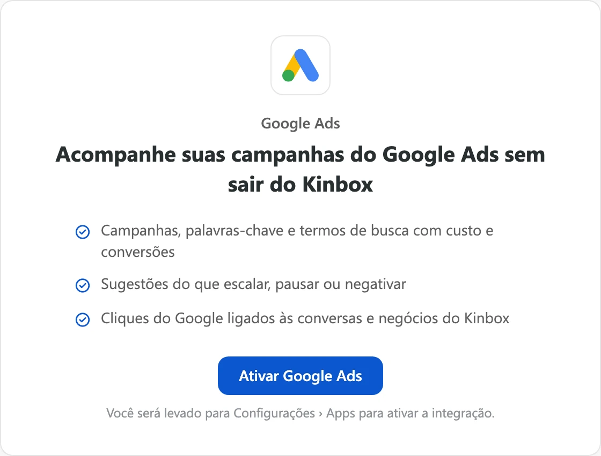

Conecte a conta Google que administra seus anúncios para acompanhar investimento, conversões, ROAS (retorno sobre o investimento em anúncios), palavras-chave, termos de busca e sugestões em **Relatórios** → **Marketing** → **Google Ads** (título **Visão do Gestor** na tela).

A Kinbox só lê os dados do Google Ads: não altera campanhas, não gasta verba e as sugestões do relatório são apenas recomendações. O relatório Google Ads não mostra leads, CPL (custo por lead) nem métricas de funil e pipeline — ele exibe métricas do Google e a aba **Atribuição no Kinbox** com as conversas que chegaram por clique do Google (e a negociação, quando houver).

<Note>
  Quem pode: ativar o app, conectar, escolher contas, definir a padrão, trocar de conta e desconectar exigem a permissão **Integrações**; abrir o relatório exige a permissão **Gerenciar relatórios**. O proprietário do workspace pode fazer tudo. Veja [Referência de permissões](/docs/administracao/referencia-de-permissoes).
</Note>

## Antes de começar

- O app **Google Ads** precisa aparecer em **Configurações** → **Integrações** → **Apps** (veja [Visão geral das integrações](/docs/integracoes/visao-geral)). Se o app não aparecer lá, ele ainda não foi liberado para o seu workspace: fale com o suporte.
- Você precisa de uma conta Google com acesso à conta do Google Ads da empresa.

<Tip>
  Para que a aba **Atribuição no Kinbox** liste as conversas que chegaram por clique do Google, o identificador de clique do Google (`gclid`) precisa chegar na conversa — por exemplo, usando o [Redirecionador de WhatsApp](/docs/desenvolvedor/redirecionador-via-whatsapp) ou a captura de campanha do [widget](/docs/canais/widget/configuracoes). Mantenha a marcação automática ligada no Google Ads para que o Google adicione o `gclid` ao endereço dos anúncios.
</Tip>

## Passo a passo

<Steps>
  <Step title="Abra o app Google Ads">
    Vá em **Configurações** → **Integrações** → **Apps** e clique em **Google Ads**. Se preferir, abra **Relatórios** → **Marketing** → **Google Ads** e clique em **Ativar Google Ads** na tela de apresentação.

    <Frame caption="Tela de apresentação exibida quando o app Google Ads está desligado">
      
    </Frame>
  </Step>
  <Step title="Ative a integração">
    Ligue o interruptor **Habilitar integração** e clique em **Salvar**. Antes de salvar, aparece o aviso "Salve a ativação para iniciar a conexão." Depois de salvar, a gaveta continua aberta e mostra **Conexão Google Ads**.
  </Step>
  <Step title="Autorize sua conta Google">
    Clique em **Conectar com Google** e conclua o login na janela do Google. O Google solicita acesso ao Google Ads além do nome e do e-mail da conta, que aparecem depois na gaveta.

    Enquanto a janela estiver aberta, a tela mostra "Aguardando autorização" com o botão **Abrir login novamente**. Se o navegador bloquear a janela, aparece "Não foi possível abrir a janela do Google. Habilite pop-ups e tente novamente."
  </Step>
  <Step title="Escolha as contas de anúncios e defina a padrão">
    Em **Escolha as contas do workspace**, marque uma ou mais contas de cliente e clique em **Salvar contas selecionadas**. Se ainda não houver conta padrão (ou se a padrão foi desmarcada), a Kinbox já define uma das contas marcadas como padrão. Confira a etiqueta **Padrão** e, só se quiser trocar, clique em **Definir padrão** na conta que o relatório deve abrir primeiro.

    Contas de administrador — MCC (conta gerenciadora) — aparecem apenas como título do grupo e não podem ser marcadas.
  </Step>
  <Step title="Abra o relatório">
    Clique em **Abrir dashboard**, se o botão aparecer. Ele só aparece quando há uma conta padrão definida e você tem a permissão **Gerenciar relatórios**.

    Se o botão não aparecer, salve as contas selecionadas primeiro (confira a etiqueta **Padrão**), ou peça a permissão **Gerenciar relatórios** ao administrador. Você também pode abrir o relatório pelo menu **Relatórios** → **Marketing** → **Google Ads**.
  </Step>
</Steps>

## Depois de conectar

Na gaveta do app, a Kinbox mostra **Conta Google Ads conectada**, o nome e o e-mail da conta Google autorizada, a linha **Conta Ads padrão** e os botões **Desconectar**, **Trocar de conta** e **Abrir dashboard** (este último quando há conta padrão e permissão **Gerenciar relatórios**).

Cada workspace mantém uma única conta Google conectada por vez, que pode listar várias contas de anúncios sob a mesma autorização. Conectar outra conta Google substitui a anterior.

A primeira abertura do relatório consome 1 das **3 consultas por dia** disponíveis para o workspace no Google Ads; trocar para outra conta no relatório pela primeira vez também consome 1 consulta (no Meta Ads são 10 por dia; o Tracking não tem limite). Veja como interpretar os blocos e sugestões em [Ler os relatórios de marketing](/docs/marketing/relatorios-de-marketing) ou conheça os outros apps em [Medir anúncios e o site com a Kinbox](/docs/marketing/visao-geral).

## Trocar de conta e desconectar

- **Trocar de conta:** abra **Configurações** → **Integrações** → **Apps** → **Google Ads** e clique em **Trocar de conta**, se o botão aparecer (ele aparece quando há uma conta conectada ou expirada; se não aparecer, clique em **Conectar com Google**). Se você autorizar outra conta Google, as contas escolhidas e os dados salvos do relatório são apagados.
- **Desconectar:** na mesma gaveta, clique em **Desconectar** e confirme em "Desconectar Google Ads?".
- **Desligar o app:** desligar **Habilitar integração** e clicar em **Salvar** mostra a tela de apresentação no lugar do relatório; a conta continua conectada e os dados salvos ficam guardados. Para encerrar o acesso, use **Desconectar**.

<Warning>
  **Desconectar** revoga o acesso na conta Google e apaga as contas escolhidas e os dados salvos do relatório neste workspace. O relatório deixa de receber dados até alguém conectar novamente.
</Warning>

## Problemas comuns

- **"Autorização não concluída" ou janela fechada antes do fim.** Clique em **Fazer login com Google** para tentar novamente.
- **"A autorização Google Ads foi cancelada ou não concedeu acesso." ou "A permissão do Google Ads não foi concedida."** Inicie a conexão novamente e aceite o acesso ao Google Ads na janela do Google.
- **"A conta Google foi autorizada, mas nenhuma conta Google Ads foi identificada ainda…"** Clique em **Tentar carregar contas** ou use **Trocar de conta** escolhendo uma conta Google que tenha acesso ao Google Ads.
- **"Reconecte o Google Ads" ou "A autorização do Google expirou. Reconecte a conta."** Clique em **Trocar de conta** na gaveta do app e autorize novamente; usando a mesma conta Google, as contas escolhidas são mantidas.
