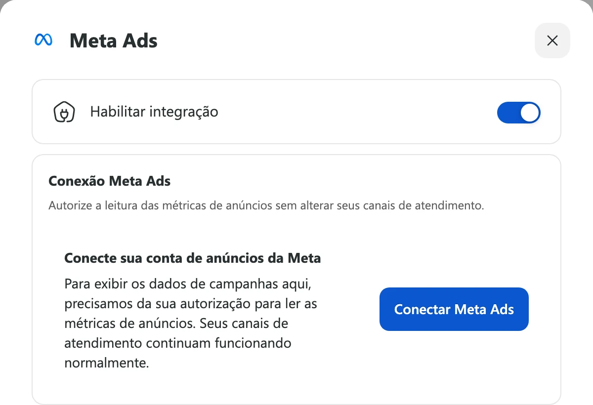

Conecte sua conta de anúncios da Meta (Facebook e Instagram) para acompanhar investimento, leads, CPL (custo por lead), ROAS (retorno sobre o investimento em anúncios) e negociações em **Relatórios** → **Marketing** → **Meta Ads** (título **Visão do Gestor** na tela).

A Kinbox só lê as métricas de anúncios: não cria, pausa nem altera campanhas, não gasta verba e não mexe nos seus canais de atendimento. Essa conexão é própria do app **Meta Ads** e não usa o canal de WhatsApp oficial, Instagram ou Facebook já ligado ao workspace.

<Note>
  Quem pode: ativar o app, conectar, escolher a conta padrão, trocar de conta e desconectar exigem a permissão **Integrações**; abrir o relatório exige a permissão **Gerenciar relatórios**. O proprietário do workspace pode fazer tudo. Veja [Referência de permissões](/docs/administracao/referencia-de-permissoes).
</Note>

## Antes de começar

- O app **Meta Ads** precisa aparecer em **Configurações** → **Integrações** → **Apps** (veja [Visão geral das integrações](/docs/integracoes/visao-geral)). Se o app não aparecer lá, ele ainda não foi liberado para o seu workspace: fale com o suporte.
- Você precisa de um perfil do Facebook com acesso à conta de anúncios da empresa.

## Passo a passo

<Steps>
  <Step title="Abra o app Meta Ads">
    Vá em **Configurações** → **Integrações** → **Apps** e clique em **Meta Ads**. Se preferir, abra **Relatórios** → **Marketing** → **Meta Ads** e clique em **Ativar Meta Ads** na tela de apresentação.
  </Step>
  <Step title="Ative a integração">
    Ligue o interruptor **Habilitar integração** e clique em **Salvar**. Antes de salvar, a gaveta mostra o aviso "Salve a ativação para iniciar a conexão." Depois de salvar, a gaveta continua aberta para você conectar a conta.
  </Step>
  <Step title="Conecte sua conta de anúncios">
    Em **Conexão Meta Ads**, clique em **Conectar Meta Ads**. Na janela da Meta que abrir, entre com seu perfil, escolha as empresas e contas de anúncios e aceite todas as permissões pedidas (ler anúncios e gerenciar negócios).

    A tela exibe "Conectando sua conta de anúncios..." e depois "Conta de anúncios conectada." Se você fechar a janela antes de terminar, nada muda: clique em **Conectar Meta Ads** novamente.

    <Frame caption="Gaveta do app Meta Ads ativada, pronta para iniciar a conexão">
      
    </Frame>
  </Step>
  <Step title="Escolha a conta de anúncios padrão">
    No bloco **Conta de anúncios padrão**, clique na conta que o relatório deve abrir para todos os membros do workspace e clique em **Salvar conta padrão**.

    Nenhuma conta é escolhida automaticamente. Sem uma conta padrão salva, o relatório pede "Selecione uma conta de anúncios". As contas ficam agrupadas por portfólio; quando há mais de 8 contas, use o campo **Buscar por nome, ID ou portfólio**. Se uma conta recém-liberada não aparecer, clique em **Atualizar lista**, se o botão aparecer (ele exige a permissão **Integrações**). Se o botão não aparecer, peça a quem tem essa permissão que atualize a lista.
  </Step>
  <Step title="Abra o relatório">
    Clique em **Abrir dashboard**, se o botão aparecer. Ele só aparece quando há uma conta padrão salva e você tem a permissão **Gerenciar relatórios**.

    Se o botão não aparecer, salve uma conta padrão primeiro ou peça a permissão **Gerenciar relatórios** ao administrador do workspace. Você também pode abrir o relatório pelo menu **Relatórios** → **Marketing** → **Meta Ads**.
  </Step>
</Steps>

## Depois de conectar

Na gaveta do app, a Kinbox mostra **Conta Meta Ads conectada**, a linha **Conta de anúncios padrão** e os botões **Desconectar**, **Trocar de conta** e **Abrir dashboard** (este último quando há conta padrão e permissão **Gerenciar relatórios**).

A primeira abertura do relatório consome 1 das **10 consultas por dia** disponíveis para o workspace no Meta Ads (no Google Ads o limite é de 3 por dia; o Tracking não tem limite). Quem conectou a conta vê a apresentação do Kin uma vez ao abrir o relatório; depois, qualquer membro pode revê-la clicando em **Ver apresentação**.

Veja o significado de cada cartão, gráfico e etapa do funil em [Ler os relatórios de marketing](/docs/marketing/relatorios-de-marketing) ou conheça os demais apps em [Medir anúncios e o site com a Kinbox](/docs/marketing/visao-geral).

## Trocar de conta e desconectar

- **Trocar de conta:** abra **Configurações** → **Integrações** → **Apps** → **Meta Ads** e clique em **Trocar de conta**, se o botão aparecer (ele aparece enquanto há uma conta conectada). A janela da Meta abre de novo para você autorizar outro perfil ou outras contas ("Trocando sua conta de anúncios..." e "Conta de anúncios atualizada."). Se o botão **Trocar de conta** não aparecer, clique em **Conectar Meta Ads**.
- **Desconectar:** na mesma gaveta, clique em **Desconectar** e confirme em "Desconectar Meta Ads?".
- **Desligar o app:** desligar **Habilitar integração** e clicar em **Salvar** mostra a tela de apresentação no lugar do relatório; a conta continua conectada e os dados salvos ficam guardados. Para encerrar o acesso, use **Desconectar**.

<Warning>
  **Desconectar** remove a autorização da conta deste workspace e apaga as contas salvas e os dados salvos do relatório. O relatório deixa de receber dados até você conectar novamente.
</Warning>

## Problemas comuns

- **"A Meta ainda não liberou a leitura dos seus anúncios para o Kinbox. A liberação está em andamento: tente conectar de novo em alguns dias."** Tente conectar novamente mais tarde; se o aviso continuar, fale com o suporte.
- **"Permissões não concedidas pela Meta: … Conecte de novo e aceite todas as permissões."** Clique para conectar novamente e aceite todas as permissões solicitadas na janela da Meta.
- **"A conexão com a Meta não devolveu nenhuma conta de anúncios. Confira se o perfil conectado tem acesso a uma conta."** Verifique se o perfil do Facebook usado tem acesso à conta de anúncios. Se o acesso foi liberado agora, clique em **Atualizar lista** (se o botão aparecer) ou use **Trocar de conta** com outro perfil.
- **"A autorização da Meta expirou ou foi removida…" ou o relatório voltou a pedir conexão.** A Kinbox não avisa antes de a autorização vencer. Abra **Configurações** → **Integrações** → **Apps** → **Meta Ads** e clique em **Trocar de conta** (se o botão aparecer) ou em **Conectar Meta Ads** para autorizar novamente.
