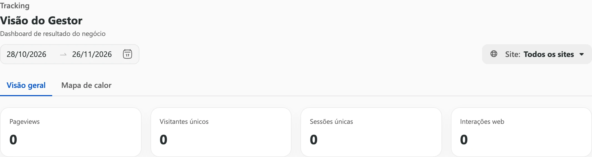

Os três relatórios de marketing ficam em **Relatórios** → **Marketing**: **Meta Ads**, **Google Ads** e **Tracking**. Na tela, cada relatório abre com o cabeçalho **Visão do Gestor**. Veja também [Como funcionam os relatórios](/docs/relatorios/como-funcionam) e [Medir anúncios e o site com a Kinbox](/docs/marketing/visao-geral).

<Note>
  Quem pode: ver os relatórios exige a permissão **Gerenciar relatórios** e o app correspondente ligado em **Configurações** → **Integrações** → **Apps** (ativar o app e conectar contas exigem a permissão **Integrações**; o proprietário pode tudo). Se o app não aparecer em **Apps**, ele ainda não foi liberado para o seu workspace: fale com o suporte.
</Note>

## Período, Atualizar e consultas

O seletor de datas usa o formato `DD/MM/AAAA`, com os atalhos **Hoje**, **Ontem**, **Últimos 7 dias**, **Últimos 30 dias**, **Esse mês** e **Mês passado**. O período vale assim que você fecha o calendário. Por padrão, **Meta Ads** e **Google Ads** abrem nos últimos 30 dias até ontem; o **Tracking** abre nos últimos 30 dias até hoje. No **Meta Ads**, cada bloco tem seu próprio seletor de datas.

Nos relatórios **Meta Ads** e **Google Ads**, a Kinbox exibe uma foto salva dos dados ("Atualizado em DD/MM HH:mm"). Toda busca nova na plataforma consome 1 **consulta** da cota diária do workspace (separada por app):

- Primeira abertura de uma conta ou período;
- Período que ainda não foi consultado;
- Foto salva com mais de 48 horas;
- Clique no botão **Atualizar**.

Escolher um período dentro de uma foto já consultada não gasta consulta. A cota vira à meia-noite (horário de Brasília), e passar o mouse sobre **Atualizar** mostra quantas consultas restam hoje.

| Relatório | Consultas por dia (por workspace) | Intervalo mínimo entre dois Atualizar |
| --- | --- | --- |
| **Meta Ads** | 10 consultas por dia | 5 minutos |
| **Google Ads** | 3 consultas por dia | 15 minutos |

O relatório **Tracking** não tem botão **Atualizar** nem limite de consultas, porque os dados são da própria Kinbox.

Nos relatórios **Meta Ads** e **Google Ads**, quem conectou a conta vê a apresentação do Kin uma vez ao abrir; qualquer membro pode revê-la clicando em **Ver apresentação**, ao lado de **Atualizar**.

## Trocar de conta de anúncios

No **Meta Ads** e no **Google Ads**, clique no botão **Conta de anúncios: …** no topo do relatório para abrir **Contas de anúncio**, selecione o que quer ver e clique em **Salvar**. A escolha fica lembrada naquele navegador.

Se você tem a permissão **Integrações** e escolher **uma** conta, clicar em **Salvar** também altera a conta padrão do workspace para todos os membros.

No **Meta Ads**, você pode marcar várias contas ou **Todas as contas** para somar os resultados (apenas contas na mesma moeda). No **Google Ads**, o relatório exibe uma conta por vez.

## Relatório Meta Ads

Antes de abrir o relatório, conecte a conta em [Conectar o Meta Ads](/docs/marketing/meta-ads). Os blocos aparecem nesta ordem: **Visão do Gestor** (5 cartões e gráfico), **Conversão e Pipeline - Meta Ads**, **Visão Geral das Campanhas**, **Criativos em Destaque**, **Distribuição por Regiões** e **Dados Demográficos**.

### Cartões e gráfico principal

Cada cartão compara o período escolhido com o período anterior de mesmo tamanho:

| Cartão | O que mostra |
| --- | --- |
| **Investimento** | Total gasto em anúncios da Meta no período selecionado. |
| **Leads Gerados** | Resultados das campanhas da Meta contados pelo evento de conversão do objetivo de cada campanha (lead, conversa, registro, contato, agendamento ou solicitação; não conta cliques nem compras). |
| **Custo por Lead** | CPL (custo por lead): investimento dividido pela quantidade de leads gerados. |
| **ROAS** | ROAS (retorno sobre o investimento em anúncios): **Faturamento (Meta)** dividido pelo investimento (por exemplo, `1,5x`). |
| **Faturamento (Meta)** | Valor de compras registrado pelo pixel da Meta. Não inclui negociações da Kinbox. |

Abaixo dos cartões, o gráfico mostra **Leads**, **Investimento** ou **Faturamento (Meta)** por dia, com um filtro de campanha que altera apenas o gráfico.

### Conversão e Pipeline - Meta Ads

Este bloco acompanha as negociações da Kinbox criadas no período a partir de conversas que vieram de anúncios desta conta (veja [Visão geral do CRM](/docs/crm/visao-geral)).

- **Funil de Vendas e Conversão:** mostra **Cliques** → **Leads** → **Negócios** → **Ganhos**, com cada percentual calculado sobre a etapa anterior. **Cliques** e **Leads** vêm da Meta; **Negócios** e **Ganhos** vêm da Kinbox.
- **Resumo do Pipeline:** traz **Valor em negociação**, **Negócios em aberto** e **Tempo médio no funil**.
- **Status dos negócios:** distribui as negociações criadas no período pelo status atual (**Em andamento**, **Ganhos** e **Perdidos**).

### Demais blocos do Meta Ads

- **Visão Geral das Campanhas:** mostra **Impressões**, **Alcance**, **Frequência**, **CPM** (custo por mil impressões) e **CPC** (custo por clique), além da tabela **Campanhas em Destaque** com até 8 campanhas de maior gasto (**Objetivo**, **Status**, **Orçamento**, **Gasto**, **Resultados**, **CPR** — custo por resultado — e **CPM**).
- **Criativos em Destaque:** exibe os 4 anúncios com melhor resultado no período, com os selos **Mais Leads**, **Melhor CTR** (taxa de cliques) e **Menor CPL**.
- **Distribuição por Regiões:** mostra o mapa do Brasil por leads (ou por alcance, quando a Meta não informa leads por região).
- **Dados Demográficos:** exibe a distribuição por idade e gênero do público alcançado.

Diferenças em relação ao Gerenciador de Anúncios da Meta costumam vir de fuso horário, período selecionado, foto salva antiga (clique em **Atualizar**) ou do fato de **Leads Gerados** seguir o objetivo de cada campanha.

## Relatório Google Ads

Antes de abrir o relatório, conecte a conta em [Conectar o Google Ads](/docs/marketing/google-ads). Este relatório não tem funil, leads, CPL nem negociações: todas as métricas de mídia vêm do Google.

Os blocos aparecem nesta ordem: 5 cartões principais, gráfico **Conversões por dia** / **Investimento por dia**, **Conversões por tipo**, **Valor por campanha**, **Indicadores de mídia**, **Detalhamento das melhores campanhas**, **Palavras-chave e custo**, **De onde vêm seus cliques**, **Sugestões em Destaque**, tabela **Campanhas** e **Mídia e atribuição** (com as abas **Palavras-chave**, **Anúncios**, **Termos de busca** e **Atribuição no Kinbox**).

Escolher uma campanha no filtro do topo filtra o relatório inteiro. Quando o período selecionado inclui o dia de hoje, a tela avisa "Os dados de hoje ainda são parciais."

### Métricas principais e de mídia

| Métrica | O que mostra |
| --- | --- |
| **Investimento** | Total investido nas campanhas do Google Ads no período. |
| **Conversões** | Ações de conversão registradas no Google Ads (podem aparecer com casas decimais). |
| **Custo por conversão** | Investimento dividido pelas conversões. |
| **Valor de conversão** | Soma do valor de conversão informado pelo Google Ads. |
| **ROAS** | Valor de conversão dividido pelo investimento. |
| **Impressões** | Quantas vezes seus anúncios foram exibidos. |
| **Cliques** | Quantos cliques seus anúncios receberam. |
| **CTR** | Taxa de cliques (cliques divididos por impressões). |
| **CPC médio** | Custo médio por clique. |
| **CPM médio** | Custo médio por mil impressões. |

### Sugestões em Destaque

O bloco **Sugestões em Destaque** compara o desempenho das campanhas, palavras-chave e termos de busca ao custo por conversão médio da conta no período, agrupando os avisos em **Desperdício**, **Oportunidade**, **Atenção** e **Configuração**.

Entre os alertas mostrados estão "Revise ou pause a campanha", "Aumente o orçamento", "Negative o termo …", "Pause a palavra-chave …", "Revise a página de destino", "O custo por clique subiu", "Configure o acompanhamento de conversões" e "Configure o valor das conversões". A Kinbox apenas sugere: nenhuma alteração é feita na sua conta do Google Ads.

### Atribuição no Kinbox

Na seção **Mídia e atribuição**, a aba **Atribuição no Kinbox** lista cada clique do Google que chegou numa conversa ou virou negociação do workspace, com o identificador do clique mascarado, a campanha, o tipo (**Conversa** ou **Negócio**) e o motivo do vínculo.

Se a aba aparecer vazia, confira se o identificador do clique (`gclid`) está chegando até a conversa (veja a dica em [Conectar o Google Ads](/docs/marketing/google-ads)). Você também pode filtrar conversas vindas do Google Ads usando [Criar filtros de conversa](/docs/conversas/criar-filtros-de-conversa).

## Relatório Tracking

O relatório **Tracking** exibe os dados do script instalado no seu site (veja [Instalar o Tracking no site](/docs/marketing/tracking)). Ele só conta visitantes que deram consentimento de analytics, mede visitantes anônimos (sem identificar o contato) e não tem limite de consultas.

No topo, use o seletor **Site:** para ver um site específico ou **Todos os sites**, e alterne entre as abas **Visão geral** e **Mapa de calor**.

<Frame caption="Relatório Tracking com seletor de período, seletor de site e abas Visão geral e Mapa de calor">
  
</Frame>

### Visão geral

- **Cartões:** **Pageviews** (visualizações de página), **Visitantes únicos**, **Sessões únicas** e **Interações web** (soma de formulário enviado, widget aberto, link do WhatsApp clicado e conversa solicitada).
- **Gráfico Pageviews e interações:** evolução por dia, ou por hora quando o período selecionado é de 1 dia.
- **Páginas visitadas:** até 20 páginas mais vistas, sem a página inicial.
- **Eventos:** contagem de cada tipo de evento recebido no período.
- **Referrers:** origem das visitas (mostra **Direto** quando não há site de origem).
- **Campanhas:** exibe **Origem / mídia**, **Campanha**, **Visitantes**, **Sessões**, **Pageviews** e **Interações** para visitas com UTM (parâmetros de rastreamento no link).

### Mapa de calor

Na aba **Mapa de calor**, escolha a página em **Selecione uma página**, a versão do layout e **Desktop** ou **Mobile**. A tela mostra os cartões **Cliques**, **Sessões**, **Profundidade média** e **Atenção por sessão**, seguidos de **Mapa de cliques**, **Elementos mais clicados** e **Scroll e atenção**.

Clique em **Recapturar** para descartar a foto atual da página e gerar uma nova na próxima visita consentida; os cliques já registrados não são apagados.

### Retenção dos dados

O relatório **Tracking** mantém no máximo os últimos **90 dias** de eventos e os últimos **30 dias** no mapa de calor.
