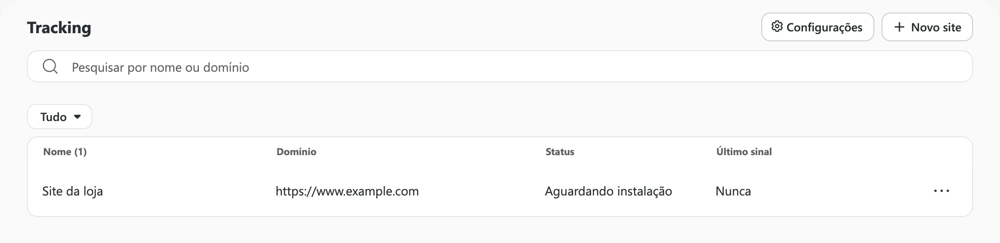
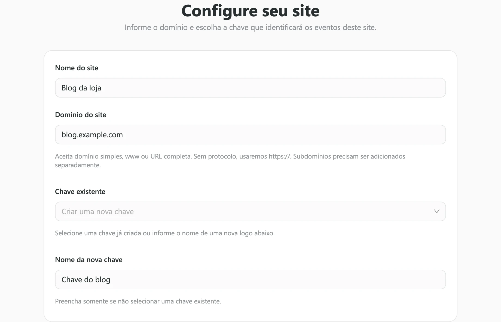
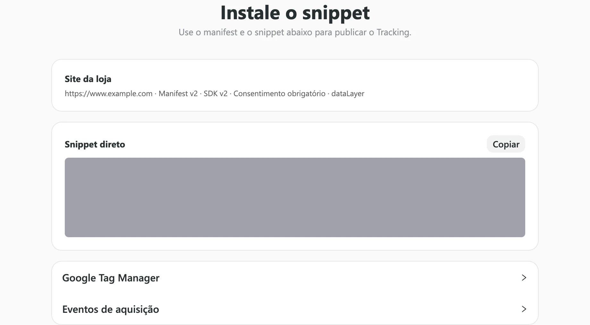
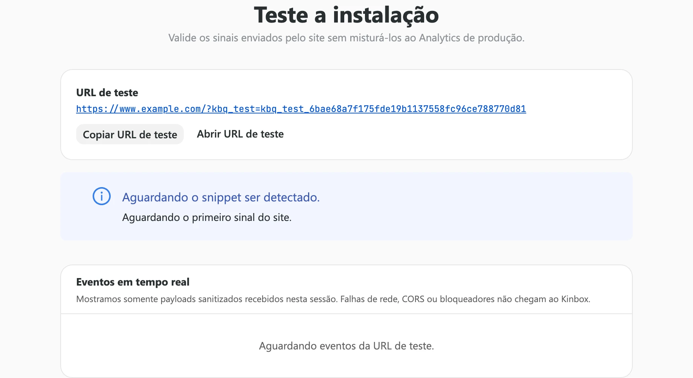

O **Tracking** é um código (snippet) que você instala no seu site para a Kinbox contar visitas, origens de campanha — UTMs (parâmetros de rastreamento no endereço do link) — e interações, além de montar o mapa de calor. Os dados aparecem em **Relatórios** → **Marketing** → **Tracking** (título **Visão do Gestor** na tela), sem limite de consultas (diferente de Meta Ads, com 10 por dia, e Google Ads, com 3 por dia).

O Tracking só conta visitantes que deram consentimento de analytics no site e mede visitantes anônimos: ele não identifica o contato nem liga a visita a uma conversa ou negociação.

<Note>
  Quem pode: ativar o app, cadastrar sites, gerenciar chaves e testar a instalação exigem a permissão **Integrações**; ver o relatório exige a permissão **Gerenciar relatórios**. O proprietário do workspace pode fazer tudo. Veja [Referência de permissões](/docs/administracao/referencia-de-permissoes).
</Note>

## Antes de começar

- Ative o app **Tracking** em **Configurações** → **Integrações** → **Apps** (veja [Visão geral das integrações](/docs/integracoes/visao-geral)): clique em **Tracking**, ligue **Habilitar integração**, clique em **Salvar** e depois em **Gerenciar sites**. Se o app não aparecer em **Apps**, ele ainda não foi liberado para o seu workspace: fale com o suporte.
- Você precisa de acesso para editar o código do site ou o GTM (Google Tag Manager), ou apoio de quem cuida do site.
- Seu site precisa de um banner ou gerenciador de cookies e consentimento que avise o Tracking quando o visitante aceitar analytics. Sem esse aviso, nenhuma visita é contada.

## Passo a passo

<Steps>
  <Step title="Abra a tela de sites">
    Vá em **Configurações** → **Marketing** → **Tracking** (ou clique em **Gerenciar sites** na gaveta do app) e clique em **Novo site**.

    <Frame caption="Lista de sites do Tracking com os botões Configurações e Novo site">
      
    </Frame>
  </Step>
  <Step title="Configure seu site">
    Na etapa **Configure seu site**, preencha:

    - **Nome do site:** um nome para identificar o site na Kinbox (por exemplo, **Blog da loja**).
    - **Domínio do site:** o endereço do site (por exemplo, `blog.example.com`). Sem protocolo, a Kinbox usa `https://`. Subdomínios precisam ser adicionados separadamente.
    - **Chave existente** e **Nome da nova chave:** escolha uma chave já criada ou mantenha **Criar uma nova chave** e preencha **Nome da nova chave** (por exemplo, **Chave do blog**).

    Endereços com e sem `www.` (como `https://www.example.com` e `https://example.com`) contam como sites diferentes: cadastre cada endereço que seus visitantes usam. Depois, clique em **Continuar**.

    <Frame caption="Etapa Configure seu site com domínio e nome da nova chave">
      
    </Frame>
  </Step>
  <Step title="Instale o snippet no site">
    Na etapa **Instale o snippet**, clique em **Copiar** no bloco **Snippet direto** e cole o código em todas as páginas do site (o `<head>` é o lugar comum).

    Se você usa o Google Tag Manager, abra o painel **Google Tag Manager** na mesma tela e adicione o mesmo snippet em uma tag HTML personalizada.

    <Frame caption="Etapa Instale o snippet (o código do snippet aparece com tarja neste print)">
      
    </Frame>
  </Step>
  <Step title="Ligue o consentimento de analytics">
    Configure o banner ou gerenciador de cookies do site para executar o comando de consentimento assim que o visitante escolher:

    ```js
    // Quando o visitante aceitar analytics:
    window.kbq.push(["consent", "granted"]);

    // Quando o visitante recusar ou revogar o consentimento:
    window.kbq.push(["consent", "denied"]);
    ```

    Até o site enviar `granted`, o Tracking não grava nada no navegador e não envia visitas.
  </Step>
  <Step title="Teste a instalação">
    Na etapa **Teste a instalação**, clique em **Iniciar teste**. Depois, clique em **Abrir URL de teste** (ou **Copiar URL de teste** para abrir manualmente) e aceite o consentimento de analytics na página que abrir.

    Acompanhe o aviso na tela:
    1. "Aguardando o snippet ser detectado."
    2. "Snippet detectado. Aguarde o consentimento de analytics para receber o pageview."
    3. "Instalação validada: snippet e pageview foram recebidos."

    A sessão de teste vale por 15 minutos ("A sessão expirou após 15 minutos. Inicie um novo teste."). Os eventos do teste não entram no relatório.

    <Frame caption="Etapa Teste a instalação (a URL de teste aparece com tarja neste print)">
      
    </Frame>
  </Step>
  <Step title="Revise e conclua">
    Na etapa **Revise antes de concluir**, confira os dados do site e clique em **Concluir**. Você pode concluir sem rodar o teste (a revisão mostra **Ainda não realizado**) e testar depois.
  </Step>
</Steps>

## Depois de instalar

- **Status na lista:** cada site exibe **Aguardando instalação**, **Ativo** ou **Com erro**, além de **Último sinal** (ou **Nunca**). **Ativo** significa que a Kinbox recebeu algum sinal do site; isso não garante que já há visitas contadas, pois as visitas só entram depois do consentimento.
- **Editar, testar e copiar:** clique na linha do site para abrir **Editar site**, ou use o menu da linha para **Testar instalação**, **Copiar snippet** ou **Excluir**. Trocar o domínio ou a chave de um site volta o status para **Aguardando instalação**.
- **Interações web:** formulários, abertura de widget, cliques no WhatsApp e pedidos de conversa não são captados sozinhos — o site precisa enviar cada evento (veja os modelos em **Eventos de aquisição**, na etapa **Instale o snippet**). Exemplo ao enviar um formulário:

  ```js
  window.kbq.push(["track", { event: "form_submitted", properties: { form_id: "contato" } }]);
  ```

- **Campanhas (UTMs):** adicione UTMs aos links dos seus anúncios (por exemplo, `utm_source=instagram&utm_medium=paid_social&utm_campaign=black-friday`). Como o Tracking não identifica o contato, para levar a campanha do site até a conversa use o [Redirecionador de WhatsApp](/docs/desenvolvedor/redirecionador-via-whatsapp) ou a captura de campanha do [widget](/docs/canais/widget/configuracoes).
- **Mapa de calor:** começa sozinho depois do consentimento, sem configuração extra. Para esconder uma área do site (como dados de cliente) da foto e dos cliques, marque o elemento HTML com `data-kbq-private`.

Veja como ler os números e o mapa de calor em [Ler os relatórios de marketing](/docs/marketing/relatorios-de-marketing) ou volte para [Medir anúncios e o site com a Kinbox](/docs/marketing/visao-geral).

## Chaves

Na lista de sites, clique em **Configurações** para ver e criar chaves (**Criar chave**). As chaves do Tracking são exclusivas do Tracking, e uma mesma chave pode servir vários sites. Para pegar o snippet de novo, use **Copiar snippet** no menu da linha do site. Se a chave for antiga, **Copiar snippet** pede para regenerá-la: confirmar **Regenerar e abrir snippet** invalida a chave antiga na hora, em todos os sites que a usam, e todos eles precisam do snippet novo.

Para trocar de chave: crie a nova, selecione-a em **Chave existente** em cada site, instale e teste o snippet novo em **todos** os sites que usavam a chave antiga e só então clique em **Revogar** na chave antiga.

<Warning>
  **Revogar** uma chave é definitivo: os sites que ainda usam essa chave deixam de enviar eventos.
</Warning>

## Excluir um site

<Warning>
  No menu da linha, **Excluir** apaga o site e todos os dados coletados dele (visitas, mapa de calor e testes), sem como desfazer. A chave não é apagada.
</Warning>

## Problemas comuns

- **Teste parado em "Aguardando o snippet ser detectado."** Confira se o snippet está publicado na página aberta, se a URL aberta corresponde ao domínio cadastrado e se não há bloqueador de anúncios ou falha de rede impedindo o envio ("Falhas de rede, CORS ou bloqueadores não chegam ao Kinbox.").
- **"A URL aberta não corresponde ao domínio configurado." ou "O domínio não está autorizado para esta chave."** Cadastre o endereço exato que o visitante acessa, incluindo `www.` ou sem `www.` e o protocolo (`http` ou `https`).
- **"O evento foi rejeitado porque o consentimento de analytics não foi concedido." ou teste parado em "Snippet detectado. Aguarde o consentimento de analytics para receber o pageview."** O site ainda não executou `window.kbq.push(["consent", "granted"]);` após o aceite do visitante.
- **Site como Ativo, mas relatório zerado.** Confira se os visitantes estão aceitando o consentimento de analytics, se a chave usada no site não foi revogada e se o período escolhido está dentro dos últimos 90 dias.
