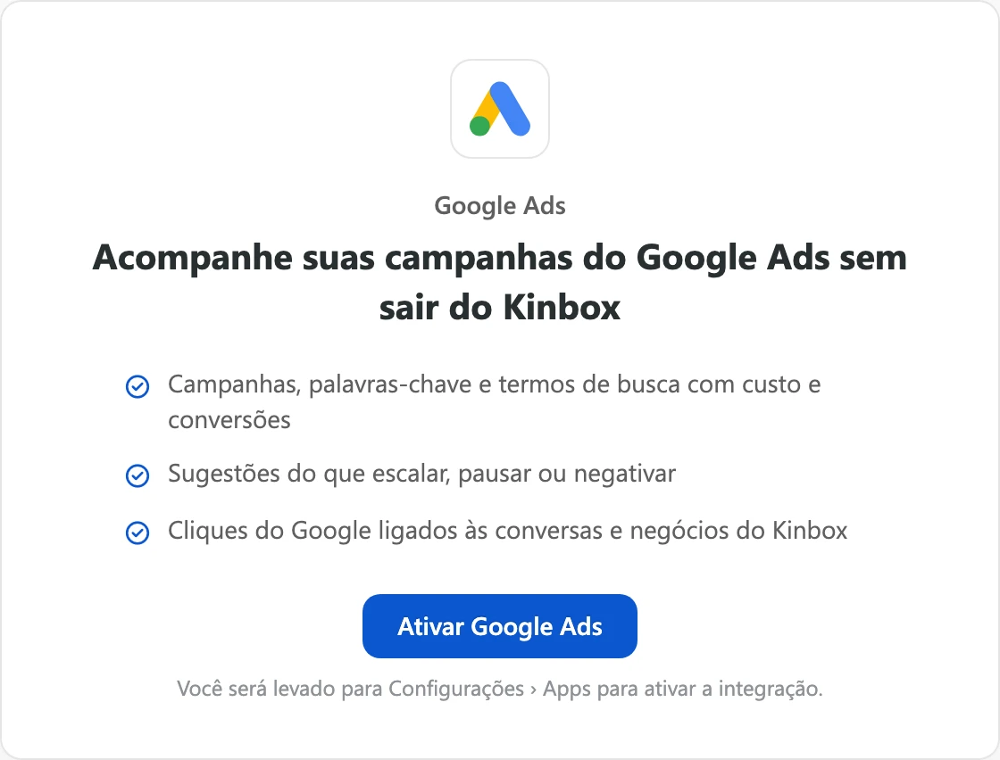

Os apps de marketing da Kinbox reúnem em um só lugar o resultado dos seus anúncios e do seu site: **Meta Ads** (anúncios no Facebook e no Instagram), **Google Ads** (anúncios no Google) e **Tracking** (visitas ao seu site). Cada um tem um relatório próprio em **Relatórios** → **Marketing**, com o título **Visão do Gestor** na tela.

## O que cada app mostra

| App | O que você acompanha | Limites e observações |
| --- | --- | --- |
| **Meta Ads** | Investimento, leads, CPL (custo por lead), ROAS (retorno sobre o investimento em anúncios) e faturamento informados pela Meta; criativos, regiões e públicos; e o funil do clique no anúncio até a negociação ganha na Kinbox. | 10 consultas por dia por workspace. |
| **Google Ads** | Investimento, conversões, custo por conversão, valor de conversão e ROAS informados pelo Google; campanhas, palavras-chave e termos de busca; sugestões do que revisar; e a aba **Atribuição no Kinbox** com os cliques do Google que chegaram como conversa ou negociação. | 3 consultas por dia por workspace. Este relatório não tem leads, CPL nem métricas de funil e pipeline. |
| **Tracking** | Visitas, visitantes únicos, sessões, páginas vistas, origem das visitas e campanhas por UTM (parâmetros de rastreamento no endereço do link), interações enviadas pelo site e mapa de calor. | Sem limite de consultas. Só conta visitantes que deram consentimento de analytics e mede visitantes anônimos, sem identificar o contato. |

## De onde vêm os números

No **Meta Ads** e no **Google Ads**, quase todos os números vêm direto da plataforma de anúncios. Da Kinbox entram apenas as negociações ligadas aos anúncios de clique para o WhatsApp (no Meta Ads) e as conversas com clique do Google, com a negociação quando houver (no Google Ads).

No **Tracking**, todos os dados vêm do script instalado no seu site.

## Antes de começar

<Note>
  Quem pode usar: ver os relatórios em **Relatórios** → **Marketing** exige a permissão **Gerenciar relatórios**; ativar os apps, conectar contas de anúncios e cadastrar sites exige a permissão **Integrações**. O proprietário do workspace pode fazer tudo. Veja [Referência de permissões](/docs/administracao/referencia-de-permissoes) e [Configurar permissões dos usuários](/docs/configuracoes-no-workspace/configurar-permissoes-dos-usuarios).
</Note>

- Os três apps ficam em **Configurações** → **Integrações** → **Apps** (veja [Visão geral das integrações](/docs/integracoes/visao-geral)). Se algum app não aparecer em **Apps**, ele ainda não foi liberado para o seu workspace: fale com o suporte.
- Os apps não consomem [saldo da carteira](/docs/conceitos/saldo-e-creditos). A Kinbox só lê os dados das contas de anúncios: não cria, pausa nem altera anúncios e não gasta verba.
- Enquanto o app estiver desligado, o relatório mostra uma tela de apresentação com o botão **Ativar Meta Ads**, **Ativar Google Ads** ou **Ativar Tracking**, que leva para **Configurações** → **Integrações** → **Apps**. Sem a permissão **Integrações**, o botão fica desabilitado e a tela pede para um administrador ativar o app.

<Frame caption="Tela de apresentação exibida quando o app está desligado no workspace">
  
</Frame>

## Como a Kinbox sabe de onde veio o contato

Quando um contato inicia conversa a partir de um anúncio de clique para o WhatsApp (no [WhatsApp](/docs/canais/whatsapp/visao-geral) oficial ou por QR Code) ou por um link com parâmetros de campanha — usando o [Redirecionador de WhatsApp](/docs/desenvolvedor/redirecionador-via-whatsapp) ou a captura de campanha do [widget](/docs/canais/widget/configuracoes) —, a sessão guarda a origem e o contato acumula essas origens no painel **Anúncios** do perfil (veja [Clientes, contatos e organizações](/docs/conversas/clientes-contatos-e-organizacoes)).

Na conversa, a origem aparece no painel **Detalhes** da sessão como **Meta Ads**, **Google Ads** ou **Campanha**, e você pode filtrar as conversas por **Criado por Meta Ads** e **Criado por Google Ads** (veja [Criar filtros de conversa](/docs/conversas/criar-filtros-de-conversa)). Ao criar uma negociação (veja [Contatos e negócios](/docs/conceitos/contatos-e-negocios)), ou ao ligá-la a uma conversa se ela ainda não tiver origem, a Kinbox busca a origem nas sessões dos últimos 90 dias (negociações importadas ou de funil operacional não recebem essa origem). Só chega à negociação a origem com identificação do anúncio da Meta (como o ID do anúncio de clique para o WhatsApp) ou do clique do Google (como o `gclid`); parâmetros de UTM sozinhos não são suficientes.

O **Tracking** do site mede visitantes anônimos e não identifica o contato nem liga uma visita a uma conversa ou negociação. Para levar a campanha do site até a conversa, use o [Redirecionador de WhatsApp](/docs/desenvolvedor/redirecionador-via-whatsapp) ou a captura de campanha do [widget](/docs/canais/widget/configuracoes).

## Próximos passos

<CardGroup cols={2}>
  <Card title="Conectar o Meta Ads" href="/docs/marketing/meta-ads">
    Ative o app, autorize sua conta de anúncios do Facebook e do Instagram e escolha a conta padrão.
  </Card>
  <Card title="Conectar o Google Ads" href="/docs/marketing/google-ads">
    Ative o app, autorize sua conta Google e selecione as contas de anúncios do workspace.
  </Card>
  <Card title="Instalar o Tracking no site" href="/docs/marketing/tracking">
    Cadastre seus domínios, instale o snippet, ligue o consentimento de analytics e valide os sinais.
  </Card>
  <Card title="Ler os relatórios de marketing" href="/docs/marketing/relatorios-de-marketing">
    Entenda cada métrica, o limite de consultas e a leitura de Meta Ads, Google Ads e Tracking.
  </Card>
</CardGroup>
