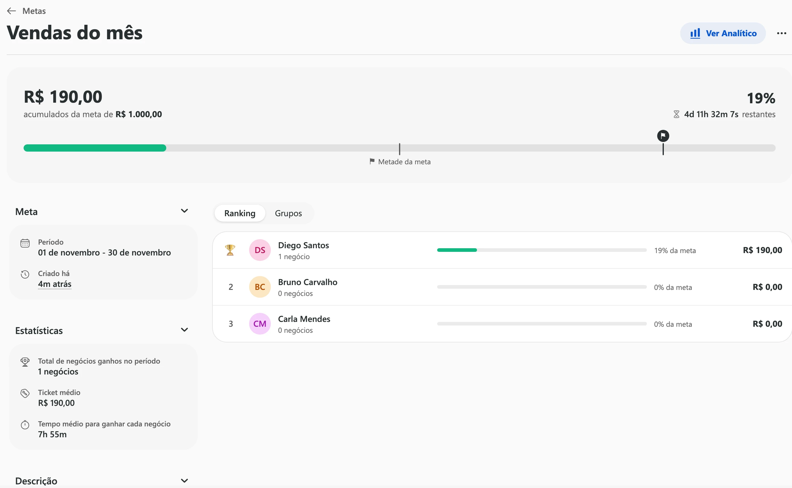
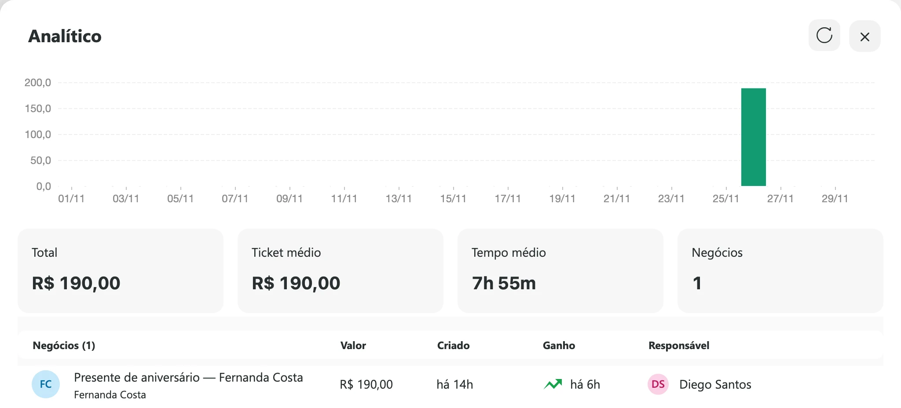

Esta página explica quais negociações entram no cálculo de uma meta na Kinbox e como são calculados o total, o percentual, o ranking, os grupos, os milestones (marcos) e o **Analítico**. Para criar ou editar metas, veja [Criar metas para a equipe](/docs/metas/criando-metas-no-kinbox).

## Quais negociações contam

Todas as regras abaixo valem ao mesmo tempo:

| Critério | Regra |
| --- | --- |
| **Status e período** | Só contam negociações [ganhas](/docs/conceitos/contatos-e-negocios) cuja **data de ganho** cai dentro do período da meta, do primeiro ao último dia, inclusive. A data de criação não importa: uma negociação criada antes do período e ganha dentro dele conta. |
| **Reabrir, perder ou ganhar de novo** | A data de ganho é gravada quando a negociação é marcada como ganha (ou criada já ganha). Reabrir a negociação apaga a data de ganho e ela sai da meta; marcar como perdida depois de ganha também a retira da meta. Se ela for marcada como ganha novamente, grava a data de **agora** e passa a contar no período de hoje. |
| **Participantes** | O filtro usa o **responsável atual** da negociação na hora do cálculo. Em **Todos**, não há filtro de responsável — negociações sem responsável também entram no total (mas não aparecem no ranking). Em **Membros específicos**, só contam negociações cujo responsável está na lista. Em **Grupo**, só contam negociações cujo responsável é membro do grupo escolhido **e** que estão nesse grupo. Trocar o responsável muda para quem a negociação conta, inclusive em metas passadas. |
| **Valor do negócio** | Soma o campo valor de cada negociação que contou. |
| **Quantidade de produto** | Só contam negociações ganhas que têm ao menos um dos produtos escolhidos; soma a **quantidade** apenas desses produtos (outros produtos da mesma negociação não entram). |
| **Condições** | Somam-se às regras acima e **só restringem** — não incluem negociações abertas ou perdidas nem datas fora do período. Por exemplo, uma condição de funil faz contar só as ganhas daquele funil; uma condição "Status é Perdido" deixa a meta zerada. Dentro das condições valem os grupos "todas" e "qualquer". |
| **Quando calcula** | O resultado é calculado na hora em que a meta é aberta (e atualizado automaticamente a cada 5 minutos com a aba aberta). Mudar período, participantes, produtos ou condições ao editar altera o resultado na hora, inclusive em metas já encerradas. |

## Exemplo

Considere a meta **Vendas do mês**: tipo **Valor do negócio**, valor alvo de `R$ 1.000,00`, período de 1º a 30 de novembro e participantes **Membros específicos** Bruno Carvalho, Carla Mendes e Diego Santos.

- **Conta na meta:** a negociação "Presente de aniversário — Fernanda Costa" (`R$ 190,00`, responsável Diego Santos), ganha em 26 de novembro. A meta soma `R$ 190,00` (19%), com Diego em 1º lugar no ranking.
- **Não conta na meta:**
  - Uma negociação ganha em 31 de outubro (data de ganho fora do período).
  - Uma negociação ganha em novembro e depois reaberta (reabrir apaga a data de ganho).
  - Uma negociação ganha em novembro por um membro fora da lista de participantes.

## Os números da tela

<Frame caption="Tela da meta Vendas do mês com total, percentual, barra com milestone e progresso esperado, estatísticas e ranking">
  
</Frame>

| Indicador | Como é calculado |
| --- | --- |
| **Total acumulado** | Soma do valor das negociações (em **Valor do negócio**) ou da quantidade dos produtos escolhidos (em **Quantidade de produto**). |
| **Percentual** | Total dividido pelo valor alvo, em pontos inteiros (aproximado). Pode passar de `100%`; o preenchimento da barra para em `100%`. Como **Meta atingida** usa o total exato, pode aparecer `100%` com "Meta não atingida" quando o total fica um pouco abaixo do alvo. |
| **Progresso esperado** | Marca na barra que mostra quanto já deveria ter sido atingido seguindo uma progressão linear ao longo do período (proporcional ao tempo passado). |
| **Encerrado** | Ao terminar o período, exibe "Encerrado" com "Meta atingida" (total maior ou igual ao valor alvo) ou "Meta não atingida". A meta continua aberta para consulta. |
| **Estatísticas** | **Total de negócios ganhos no período**: quantas negociações contaram. **Ticket médio**: média do valor das que contaram (na meta de produto, aparece **Média de produtos por negócio**). **Tempo médio para ganhar cada negócio**: média do tempo entre a criação e o ganho de cada negociação que contou. |
| **Período anterior** | Quando há dados para comparar, pode aparecer ao lado do total a variação "em relação ao período anterior": a comparação usa o mesmo número de dias já decorridos da meta, contados no período imediatamente anterior ao início dela. |

## Ranking e grupos

- **Ranking:** exibe cada participante do maior para o menor, com a soma das negociações de que ele é o responsável atual, o número de negociações e o percentual **"da meta"** (o resultado dele dividido pelo valor alvo da meta inteira). Quem está com zero também aparece. Com **Todos**, todos os membros do workspace aparecem no ranking (negociações sem responsável entram no total da meta, mas ficam de fora do ranking). O troféu aparece apenas no 1º lugar quando há valor acumulado.
- **Grupos:** exibe cada grupo com a soma dos membros dele e o percentual **"do total"** (parte do total acumulado na meta, não do valor alvo). Se um membro pertence a dois grupos, o resultado dele conta nos dois.

## Milestones

- **Global:** aparece como bandeira com o nome na barra de progresso principal.
- **Individual para todos os membros**, **Para um membro específico** e **Para um grupo específico:** aparecem como traço na linha do ranking ou do grupo correspondente.
- Não há aviso nem marca de "atingido" quando um milestone é alcançado.

## Analítico

Clique em **Ver Analítico** para abrir a gaveta **Analítico**, que reúne gráfico, indicadores e uma lista de negociações:

- gráfico do valor (ou quantidade) ganho por dia;
- cartões **Total**, **Ticket médio** (ou **Média de produtos por negócio**), **Tempo médio** e **Negócios**;
- tabela ordenável **Negócios** com **Produtos** (na meta de produto), **Valor**, **Criado**, **Ganho** e **Responsável**;
- botão **Atualizar** para recalcular os dados.

Clicar num participante na aba **Ranking** ou num grupo na aba **Grupos** abre a mesma gaveta filtrada, com o título **Negócios de** e o nome.

<Frame caption="Gaveta Analítico com gráfico por dia, cartões de resumo e lista de negociações">
  
</Frame>

## Moeda

Os valores das metas seguem a configuração **Moeda** do workspace (quando vazia, usa real) — veja [Configurações gerais do workspace](/docs/configuracoes-no-workspace/configuracoes-gerais).

## Problemas comuns

- **Uma venda não contou na meta.** Confira se a negociação está **ganha** (e não foi reaberta), se a **data de ganho** cai dentro do período, se o **responsável atual** faz parte dos participantes (e, em metas por **Grupo**, se a negociação também está nesse grupo) e se ela passa nas condições e nos produtos selecionados.
- **A meta ficou zerada com uma condição configurada.** As condições só restringem as negociações ganhas no período; uma condição que contradiz a regra base (como exigir status perdido) deixa a meta sem resultados.
- **O resultado mudou depois de editar.** O cálculo é feito na hora em que a meta é aberta. Editar a meta, trocar o responsável de uma negociação ou reabrir e ganhar de novo muda os números imediatamente.
- **A soma dos grupos passa do total da meta.** Membros que pertencem a mais de um grupo contam em cada grupo de que participam. Além disso, a aba **Grupos** mostra o percentual **do total** acumulado, não do valor alvo.
