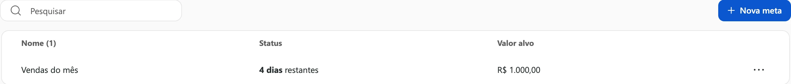
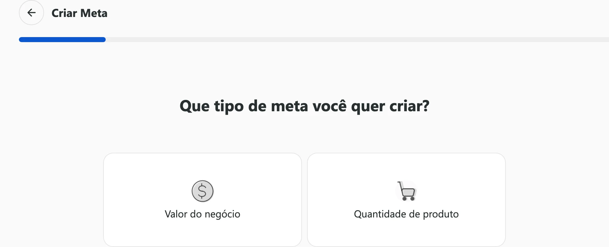
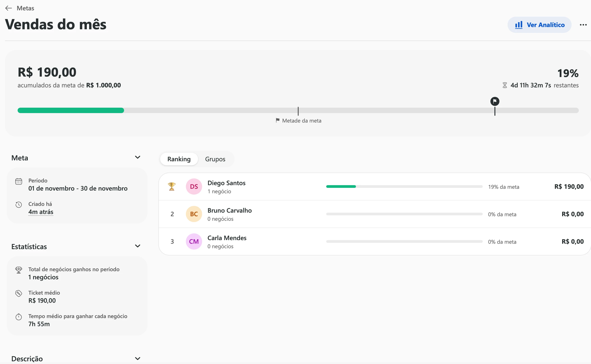

Use **Metas** para definir quanto a equipe precisa vender em um período — um valor em negociações ganhas ou uma quantidade de produtos vendidos — com participantes, milestones (marcos), condições e ranking.

<Note>
  Quem pode: membros com a permissão **Metas** (na seção **Gerenciamento do Ambiente**, em **Configurações** → **Ambiente** → **Permissões**) ou o proprietário. Se **Metas** não aparecer no menu lateral, falta essa permissão. Veja [Criar papéis e permissões](/docs/configuracoes-no-workspace/configurar-permissoes-dos-usuarios) e [Referência de permissões](/docs/administracao/referencia-de-permissoes).
</Note>

## Onde ficam as metas

Clique no ícone **Metas** no menu lateral (o nome aparece ao passar o mouse). A lista mostra o campo **Pesquisar**, o botão **Nova meta** e as colunas **Nome**, **Status** (quantos dias faltam; quando faltam menos de 24 horas ou a meta já terminou, aparece um ✓ verde), **Valor alvo** (valor monetário ou quantidade de produtos) e o menu **⋯** (**Visualizar** e **Excluir**).

Enquanto uma meta está em andamento, o ícone **Meta atual** aparece no topo da tela para os participantes e para quem criou a meta (numa meta de **Membros específicos** sem nenhum membro escolhido, para todos). Ele abre a meta em uma gaveta, com opção de alternar entre metas quando há mais de uma.

<Frame caption="Lista de metas com busca, botão Nova meta, status e valor alvo">
  
</Frame>

## Criar uma meta

Em toda meta, só contam negociações **ganhas** com **data de ganho dentro do período** escolhido, pelo **responsável atual** da negociação.

<Steps>
  <Step title="Escolha o tipo de meta">
    Em **Metas**, clique em **Nova meta** para abrir o assistente **Criar Meta**. Em **Que tipo de meta você quer criar?**, clique em **Valor do negócio** (soma o valor das negociações ganhas) ou em **Quantidade de produto** (soma a quantidade dos produtos escolhidos). Ao clicar, o assistente avança para o próximo passo.

    <Frame caption="Primeiro passo do assistente Criar Meta para escolher Valor do negócio ou Quantidade de produto">
      
    </Frame>
  </Step>

  <Step title="Defina o valor alvo ou os produtos">
    Em **Qual vai ser a meta?**, informe o valor alvo na moeda do workspace (veja [Configurações gerais do workspace](/docs/configuracoes-no-workspace/configuracoes-gerais)) — por exemplo, `R$ 1.000,00`. Na meta por produto, informe a **Quantidade** e escolha um ou mais itens em **Produtos** (veja [Cadastrar produtos](/docs/crm/criar-e-gerenciar-produtos)). Clique em **Próximo**.
  </Step>

  <Step title="Dê nome e descrição à meta">
    Em **Como vai se chamar sua meta?**, preencha **Nome** (obrigatório; por exemplo, `Vendas do mês`) e, se quiser, use **Descrição** para registrar regras ou premiações. Clique em **Próximo**.
  </Step>

  <Step title="Escolha o período">
    Em **Escolha um período para a meta**, selecione **Esse Mês**, **Próximo Mês**, **Esse Ano** ou **Personalizado** (preenchendo **De** e **Até**, em dias inteiros). Clique em **Próximo**.
  </Step>

  <Step title="Defina os participantes">
    Em **Quem vai participar?**, escolha **Todos**, **Membros específicos** (e selecione os **Membros**, como Bruno Carvalho, Carla Mendes e Diego Santos) ou **Grupo** (e selecione os **Grupos** — veja [Criar grupos de atendimento](/docs/configuracoes-no-workspace/criar-e-gerenciar-grupos)). Os participantes definem quais negociações contam pelo responsável atual e quem aparece no ranking. Clique em **Próximo**.
  </Step>

  <Step title="Adicione milestones (opcional)">
    Em **Milestones**, clique em **+ Milestone** se quiser dividir a meta em etapas (por exemplo, `Metade da meta`). Escolha o **Tipo** (**Global**, **Para um membro específico**, **Individual para todos os membros** ou **Para um grupo específico**), selecione o **Membro** ou o **Grupo** quando o tipo pedir, informe o **Nome** e ajuste o **Valor** (ou **Quantidade**), entre 1 e o valor alvo. Para adicionar milestones, o valor alvo precisa estar preenchido. Clique em **Próximo**.
  </Step>

  <Step title="Adicione condições e finalize">
    Em **Condições** (opcional), clique em **+ Condição** para filtrar quais negociações entram, usando os mesmos critérios do funil (funil, etapa, valor, produto, tag, campos personalizados e outros) em grupos "todas" ou "qualquer". As condições só restringem — veja [Como as metas são calculadas](/docs/metas/como-as-metas-sao-calculadas).

    Confira se tipo, valor alvo e período estão preenchidos e clique em **Finalizar** para salvar e abrir a meta.
  </Step>
</Steps>

Você pode usar **Voltar** para revisar qualquer passo; ao sair do assistente com alterações não salvas, a Kinbox pede confirmação antes de descartar.

## Acompanhar a meta

Clique na meta na lista (ou em **⋯** → **Visualizar**) para abrir o acompanhamento. Para renomear a meta, clique diretamente no nome no topo da tela.

<Frame caption="Tela da meta Vendas do mês com barra de progresso, milestone, painéis laterais e ranking dos participantes">
  
</Frame>

- **Quadro de progresso:** mostra o total acumulado, o valor alvo, o percentual atingido, a contagem regressiva do período e a barra com os milestones **Global** e a marca de **Progresso esperado** (projeção linear pelo tempo decorrido). Quando o período termina, exibe "Encerrado" com "Meta atingida" ou "Meta não atingida".
- **Painéis laterais:** à esquerda ficam **Meta** (**Período** e **Criado há**), **Estatísticas** ("Total de negócios ganhos no período", **Ticket médio** — ou "Média de produtos por negócio" na meta de produto — e "Tempo médio para ganhar cada negócio") e **Descrição**.
- **Ranking e Grupos:** a aba **Ranking** ordena os participantes do maior para o menor, com número de negociações, percentual em relação à meta, valor, troféu no 1º lugar com valor e **Mostrar Mais** a cada 10 participantes; a aba **Grupos** mostra a soma por grupo. Clique num participante ou num grupo para abrir o **Analítico** filtrado. Veja os detalhes de cálculo em [Como as metas são calculadas](/docs/metas/como-as-metas-sao-calculadas).
- **Ver Analítico:** abre a gaveta **Analítico**, que reúne gráfico, indicadores e uma lista de negociações — veja [Como as metas são calculadas](/docs/metas/como-as-metas-sao-calculadas).
- **Dashboard:** para acompanhar a meta ao lado de outros indicadores, use o modelo **Meta x Realizado** num dashboard (veja [Criar dashboards](/docs/relatorios/dashboard)).
- **Modo tela cheia:** no menu **⋯** do topo, clique em **Modo tela cheia** para exibir a meta em TV ou reunião (clique de novo ou pressione `Esc` para sair).
- **Atualização e comemoração:** com a aba aberta, a tela atualiza sozinha a cada 5 minutos e, quando entra uma nova negociação ganha, comemora com confete, som e o aviso "Nova negociação ganha!" (ou o total de novos negócios ganhos).

## Editar ou excluir

- **Editar:** dentro da meta, clique em **⋯** → **Editar** para abrir a gaveta **Editar Meta** com o mesmo assistente. Você pode alterar todos os campos, inclusive tipo, participantes, condições e período (no passo do período aparecem os campos **De** e **Até**; ao editar, confira **De** e **Até** antes de salvar). Como o resultado é calculado na hora em que a meta é aberta, editar período, participantes, produtos ou condições muda o resultado imediatamente, inclusive para trás.
- **Excluir:** na lista de **Metas**, clique em **⋯** na linha da meta, escolha **Excluir** e confirme em **Excluir**.

<Warning>
  Excluir uma meta não tem volta ("Essa operação não poderá ser desfeita."). As negociações do funil não são apagadas.
</Warning>

## Problemas comuns

- **Não vejo Metas no menu lateral.** Falta a permissão **Metas** no seu papel. Peça ao proprietário ou a quem gerencia papéis.
- **A meta está zerada ou uma venda não contou.** Só contam negociações **ganhas** com **data de ganho dentro do período**, cujo **responsável atual** participa da meta e que passam nas condições. Veja [Como as metas são calculadas](/docs/metas/como-as-metas-sao-calculadas) e confira o **Analítico**.
- **Um membro não aparece no ranking.** Ele não está entre os participantes da meta. Abra a meta, clique em **⋯** → **Editar** e ajuste os participantes.
- **Meta por produto está sem resultado.** As negociações ganhas no período não têm nenhum dos produtos selecionados. Confira os produtos da meta e os produtos adicionados às negociações (veja [Trabalhar com negociações no funil](/docs/crm/gerenciando-funil-de-vendas)).
- **Não sei onde excluir a meta.** Exclua pela lista: em **Metas**, clique em **⋯** na linha da meta, escolha **Excluir** e confirme.
