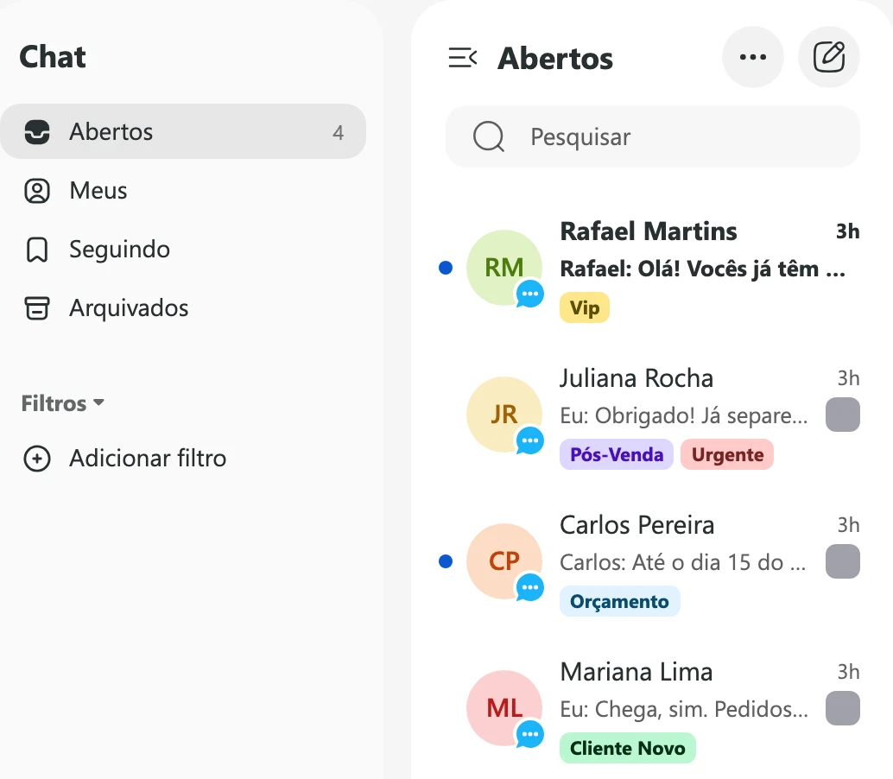
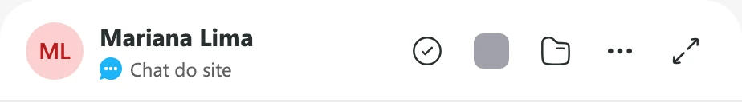

Com um canal conectado, envie uma mensagem de teste e percorra um atendimento completo na **Caixa de entrada**, da chegada até resolver a conversa. Para conhecer todas as opções de atendimento, veja [Caixa de entrada: visão geral](/docs/conversas/caixa-de-entrada-do-kinbox) e [Atender uma conversa: responder, notas, resolver e reabrir](/docs/conversas/gerenciar-conversas).

<Note>
  Quem pode: o proprietário do workspace pode fazer todas as ações. Para membros, responder, enviar notas, atribuir e resolver dependem das permissões do papel — veja [Criar papéis e permissões](/docs/configuracoes-no-workspace/configurar-permissoes-dos-usuarios).
</Note>

## Passo a passo

<Steps>
  <Step title="Envie uma mensagem de teste">
    Se apareceu uma conversa de teste na sua **Caixa de entrada** (o onboarding com o Kin pode criar uma pelo chat do site), use-a. Se não, envie uma mensagem pelo canal usando outro aparelho (por exemplo, do seu celular pessoal para o número de WhatsApp da empresa) ou pelo chat instalado no seu site.
  </Step>
  <Step title="Encontre a conversa na Caixa de entrada">
    Clique em **Caixa de entrada** (primeiro item da barra lateral). A conversa aparece na visão **Abertos**. No painel à esquerda ficam também **Meus** (atribuídas a você), **Seguindo** e **Arquivados** (resolvidas).

    <Frame caption="Caixa de entrada com o painel Chat à esquerda e a lista Abertos">
      
    </Frame>
  </Step>
  <Step title="Abra e assuma a conversa">
    Clique na conversa para abrir. No cabeçalho, clique em **Atribuir** e selecione o seu nome na lista para ficar responsável (ou escolha outro membro). Assim ela passa a aparecer também em **Meus**. No mesmo cabeçalho ficam **Resolver** e **Mover para grupo**, um ícone de pasta (com um grupo escolhido, ele mostra o nome do grupo). Veja mais em [Atribuir, mover para um grupo ou transferir uma conversa](/docs/conversas/atribuir-e-transferir).

    <Frame caption="Cabeçalho da conversa com os botões Resolver e Atribuir e o ícone de pasta Mover para grupo">
      
    </Frame>
  </Step>
  <Step title="Responda e deixe uma nota para o time">
    Escreva a resposta no editor na parte de baixo e pressione `Enter` ou clique em **Enviar** (`Shift + Enter` cria uma nova linha e `/` abre as [frases rápidas](/docs/conversas/criar-frases-rapidas-para-suas-conversas)). Se quiser registrar uma anotação que só a equipe vê, clique em **Nota pro time** antes de enviar — o contato não recebe essa nota.
  </Step>
  <Step title="Resolva a conversa">
    Ao encerrar o atendimento, clique em **Resolver** no cabeçalho. A sessão é finalizada e a conversa vai para **Arquivados**; se o contato escrever novamente, ela volta para **Abertos** (em geral como uma nova sessão — veja [Conversas, sessões e status](/docs/conceitos/conversas-e-sessoes)). Para voltar atrás, clique em **Reabrir**.
  </Step>
</Steps>

<Note>
  **Só no WhatsApp oficial:** passadas 24 horas da última mensagem do contato, só dá para responder usando um template aprovado pela Meta. Veja [Janela de 24 horas: quando é preciso usar um template](/docs/canais/whatsapp/whatsapp-cloud-api/janela-de-24-horas).
</Note>

Se o teste grátis ou a assinatura tiver vencido há mais de 3 dias, o editor de mensagens some e não dá para responder até regularizar em [Minha assinatura venceu ou o pagamento falhou](/docs/assinatura/assinatura-vencida).

## Se algo não aparecer

Se você não conseguir ver a conversa, responder ou usar alguma ação do cabeçalho, veja [Não consigo responder ou ver uma conversa](/docs/conversas/problemas-comuns).

## Próximos passos

- [Criar frases rápidas](/docs/conversas/criar-frases-rapidas-para-suas-conversas)
- [Distribuir as conversas automaticamente](/docs/configuracoes-no-workspace/criar-atribuicoes-automaticas)
- [Iniciar uma conversa com um contato](/docs/conversas/iniciar-conversa)
- [Continuar aprendendo: Academia e vídeos](/docs/primeiros-passos/videos-para-comecar) (a trilha **Atendimento** treina esse fluxo em modo treino)
