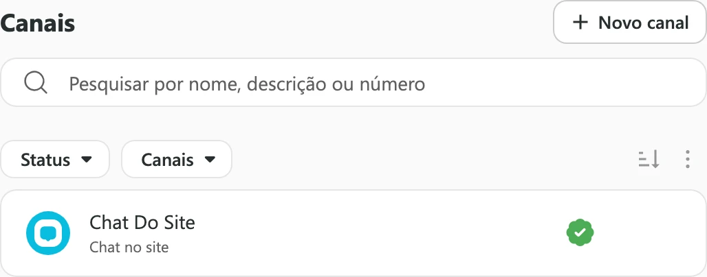

Um canal é uma conta de mensagem ligada ao seu workspace. Depois de conectar um canal, as conversas dele chegam na **Caixa de entrada** para a sua equipe atender — veja os detalhes em [Canais: conectar e gerenciar](/docs/canais/visao-geral).

<Note>
  Quem pode: o proprietário do workspace ou quem tem a permissão **Gerenciar Canais**. Se **Canais** não aparecer em **Configurações** → **Chat**, peça a permissão a quem administra o workspace — veja [Criar papéis e permissões](/docs/configuracoes-no-workspace/configurar-permissoes-dos-usuarios).
</Note>

## Onde ficam os canais

Vá em **Configurações** → **Chat** → **Canais** e clique em **Novo canal** para abrir **Conectar novo canal**. Enquanto o workspace ainda não tiver nenhum canal, a **Caixa de entrada** também mostra o cartão **Primeiros passos** ("Conecte um canal para começar a receber mensagens dos seus clientes") com o botão **Conectar canal**, que leva à mesma tela.

<Frame caption="Tela Canais com o botão Novo canal, a busca e os filtros">
  
</Frame>

## Qual canal conectar

Escolha abaixo o primeiro canal e siga o guia correspondente:

| Canal | Quando usar | Guia de conexão |
| --- | --- | --- |
| **WhatsApp** | Principal canal de atendimento. Disponível em **API Oficial** (cadastro da Meta, com templates e sem grupos) ou **Modo QRCode** (número do celular, conexão **Express**, com risco de bloqueio). | Comece por [Qual WhatsApp usar: oficial ou QR Code](/docs/canais/whatsapp/visao-geral). Depois veja [Antes de conectar o WhatsApp oficial](/docs/canais/requisitos-para-se-ter-uma-api-oficial) e [Conectar o WhatsApp oficial](/docs/canais/whatsapp-api-oficial-padrao), ou [Conectar o WhatsApp pelo QR Code](/docs/canais/conectar-whatsapp-app) e [Como evitar que o número seja bloqueado](/docs/canais/whatsapp/whatsapp-app/como-nao-ter-numero-bloqueado-whatsapp). |
| **Instagram** | Mensagens do Direct da conta profissional. Não conecta no teste grátis. | [Conectar o Instagram](/docs/canais/instagram) |
| **Facebook** | Mensagens da página no Messenger. | [Conectar o Facebook Messenger](/docs/canais/facebook/conectar) |
| **Widget** (chat no site) | Chat instalado no seu site; não tem limite de quantidade e serve para testar sem precisar de um número. | [Instalar o chat no seu site](/docs/canais/widget) |
| **E-mail** | Atendimento por e-mail dentro da Kinbox. | [Conectar o e-mail: qual opção escolher](/docs/canais/e-mail/visao-geral) |
| **Telegram** | Atendimento via bot do Telegram. | [Conectar o Telegram](/docs/canais/telegram) |
| **SMS** | Envio e recebimento por SMS (usa créditos de SMS). | [Usar SMS: criar o canal e comprar créditos](/docs/canais/sms) |

## No teste grátis

Durante o teste grátis você pode conectar até **1 canal de WhatsApp** (oficial ou por QR Code), **1 página do Facebook**, **1 canal de Telegram** e **3 canais de e-mail**, além de canais de **Widget** sem limite de quantidade. O Instagram não pode ser conectado no teste grátis. Acima do limite, a Kinbox exibe "Seu plano atual não permite adicionar o novo canal" — para liberar mais canais, escolha um plano em [Assinar ou mudar o plano](/docs/assinatura/assinar-ou-mudar-plano).

## Se você passou pelo Kin

No onboarding com o Kin você já pode conectar WhatsApp (QR Code **Express** ou API oficial), Instagram (fora do teste grátis), Messenger e chat do site (que o Kin sempre cria); Telegram, e-mail e SMS ficam para conectar por aqui — veja [Configurar o workspace com o Kin](/docs/primeiros-passos/configurar-com-o-kin).

## Depois de conectar

As conversas do canal já chegam na **Caixa de entrada**: siga para [Atender a primeira conversa](/docs/primeiros-passos/atender-a-primeira-conversa). Quando quiser automatizar ou definir o expediente do canal, veja [Ligar o agente aos canais e passar para um humano](/docs/agente-de-ia/conectar-canais), [Bot: visão geral](/docs/bot/visao-geral) e [Definir os horários de atendimento](/docs/configuracoes-no-workspace/criar-e-gerenciar-horarios).
