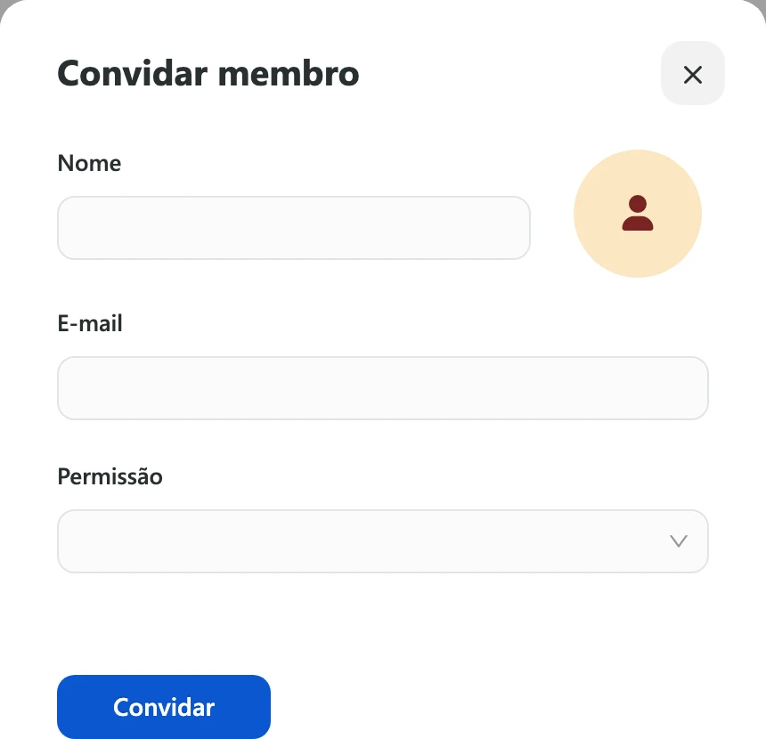

Convide as pessoas da empresa para o workspace (na tela, **ambiente**) e escolha o papel de cada membro. Cada pessoa recebe um convite por e-mail com o link para entrar.

<Note>
  Quem pode: o proprietário do workspace ou quem tem a permissão **Membros**. Se **Membros** não aparecer em **Configurações** → **Ambiente**, peça a permissão a quem administra o workspace — veja [Criar papéis e permissões](/docs/configuracoes-no-workspace/configurar-permissoes-dos-usuarios).
</Note>

## Antes de convidar

Decida qual papel (na tela, **Permissão**) cada membro vai receber. Todo workspace novo já vem com três papéis padrão:

| Papel | Descrição |
| --- | --- |
| **Administrador** | Acesso total, inclusive cobrança e configurações. |
| **Supervisor** | Acompanha a equipe, relatórios e filas. |
| **Atendente** | Atende conversas e gerencia negociações. |

Para montar outro conjunto de acessos, crie um papel antes em [Criar papéis e permissões](/docs/configuracoes-no-workspace/configurar-permissoes-dos-usuarios) (veja cada opção em [Referência de permissões](/docs/administracao/referencia-de-permissoes)). Para dividir as conversas por área, crie grupos em [Criar grupos de atendimento](/docs/configuracoes-no-workspace/criar-e-gerenciar-grupos).

## Convidar

<Steps>
  <Step title="Abra a tela de membros">
    Vá em **Configurações** → **Ambiente** → **Membros** e clique em **Convidar membro**.
  </Step>
  <Step title="Preencha os dados e escolha o papel">
    Digite **Nome** e **E-mail** (por exemplo, `ana@example.com`), adicione uma foto opcional se quiser e escolha o papel em **Permissão**.

    <Frame caption="Painel Convidar membro com os campos Nome, E-mail e Permissão">
      
    </Frame>
  </Step>
  <Step title="Envie o convite">
    Clique em **Convidar**. A tela mostra **Convite enviado** com o nome e o e-mail informados. Envie um convite por pessoa.
  </Step>
</Steps>

A pessoa aparece na lista como **Convidado** até concluir o cadastro. Cada convite já ocupa uma licença do plano — no teste grátis são até **10 licenças** contando você — e, sem licença livre, aparece um aviso de limite e o convite não sai (veja [Licenças, desativar membros e transferir a propriedade](/docs/administracao/licencas-e-propriedade)). Para reenviar o convite, editar ou gerenciar membros depois, veja [Gerenciar membros](/docs/configuracoes-no-workspace/gerenciar-membros).

## O que o convidado vê

O convidado recebe o e-mail "Convite para se juntar ao workspace [nome do workspace]".

- **Quem ainda não tem conta na Kinbox:** clica no link do e-mail para abrir **Complete seu cadastro**, preenche **Nome** e **Senha** (**E-mail de trabalho** já vem preenchido), marca "Li e aceito os **Termos e Condições**" e clica em **Finalizar cadastro**. Em seguida, a tela **Proteja sua conta** oferece ativar a [verificação em duas etapas](/docs/conta/verificacao-em-duas-etapas) (**Ativar agora** ou **Agora não**).
- **Quem já participa de outro workspace com o mesmo e-mail:** entra direto no novo workspace (o e-mail só avisa) e o encontra na lista ao entrar ou no botão do ambiente no topo — veja [Trocar de workspace ou criar outro](/docs/conta/trocar-de-workspace).

Quem foi convidado não deve usar a tela **Inicie seu teste grátis**, pois isso cria outro workspace em vez de entrar no seu.

## Convidar pelo Kin

No onboarding inicial, que só abre para o proprietário de um workspace novo, a etapa **Seu time** também envia convites (com os papéis **Admin**, **Supervisor** ou **Atendente** e equipes opcionais) — veja [Configurar o workspace com o Kin](/docs/primeiros-passos/configurar-com-o-kin). O nome do convidado nasce com a parte do e-mail antes do `@` e pode ser corrigido depois em [Gerenciar membros](/docs/configuracoes-no-workspace/gerenciar-membros).

## Próximos passos

- [Conectar o primeiro canal](/docs/primeiros-passos/conectar-o-primeiro-canal)
- [Distribuir as conversas automaticamente](/docs/configuracoes-no-workspace/criar-atribuicoes-automaticas)
- [Continuar aprendendo: Academia e vídeos](/docs/primeiros-passos/videos-para-comecar) (para atribuir treinamentos com prazo à equipe)

## Problemas comuns

Se o e-mail de convite não chegou, se não foi possível convidar ou se o membro não encontra alguma tela, veja [O convite não chegou ou o membro não consegue entrar](/docs/administracao/problemas-com-membros).
