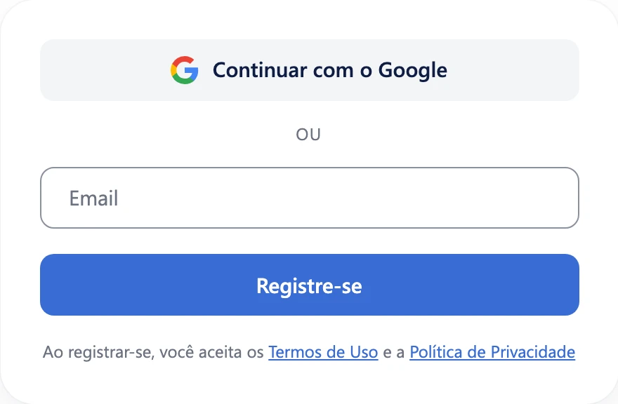

Ao criar sua conta na Kinbox, você já cria o seu primeiro workspace (na tela, **ambiente**) e começa o teste grátis de **7 dias**, sem precisar de cartão de crédito. Quem faz o cadastro vira o **proprietário** desse workspace.

<Note>
  Recebeu um link de cadastro de um parceiro da Kinbox? Crie a conta a partir desse link.

  Foi convidado por uma empresa? Não use o cadastro: abra o link do e-mail de convite para entrar no workspace dela. Veja o passo a passo do convidado em [Convidar sua equipe](/docs/primeiros-passos/convidar-sua-equipe).
</Note>

## Passo a passo

<Steps>
  <Step title="Abra o cadastro e digite seu e-mail">
    Na tela de entrada da Kinbox, clique em **Criar conta grátis**. Na tela **Inicie seu teste grátis**, digite seu endereço no campo **Email** (por exemplo, `ana@example.com`) e clique em **Registre-se**. **Ao registrar-se**, você aceita os Termos de Uso e a Política de Privacidade.

    <Frame caption="Formulário de cadastro com o botão Continuar com o Google, o campo Email e o botão Registre-se">
      
    </Frame>
  </Step>
  <Step title="Confirme o e-mail com o código">
    Na tela **Confirme seu e-mail**, digite ou cole no campo **Código** os 6 dígitos enviados para o seu e-mail (a mensagem chega de "Kinbox" com o assunto "Seu código de confirmação do Kinbox: [código]"). Ao preencher os 6 dígitos, a tela confirma sozinha, ou clique em **Continuar**. Se precisar, clique em **Reenviar código** quando o contador acabar, ou em **Usar outro e-mail** para voltar ao primeiro passo. Se o código não chegar, veja [Problemas comuns](#problemas-comuns).
  </Step>
  <Step title="Complete seus dados">
    Na tela **Crie a sua conta**, preencha **Nome completo**, **Celular** (com o seletor de país; por exemplo, `+55 11 90000-0001`) e **Senha**, e clique em **Continuar**. A senha precisa cumprir os três requisitos exibidos ao clicar no campo:

    - Mínimo de 8 caracteres.
    - Pelo menos uma letra.
    - Pelo menos um número.
  </Step>
  <Step title="Informe o nome da sua empresa">
    Na tela **Qual é o nome da sua empresa?**, preencha **Nome da empresa** (por exemplo, `Loja Exemplo`) e clique em **Criar conta** (ou em **Voltar** para revisar seus dados). Esse nome vira o nome do seu workspace e pode ser alterado depois em [Configurações gerais do workspace](/docs/configuracoes-no-workspace/configuracoes-gerais).
  </Step>
</Steps>

Quando o cadastro termina, a tela mostra **Conta criada!** e você entra direto no workspace novo, sem passar pelo login.

## Entrar com o Google

Se o botão **Continuar com o Google** aparecer na tela **Inicie seu teste grátis**, você pode se cadastrar com a sua conta do Google sem precisar de código por e-mail nem senha. Depois de conectar o Google, confirme **Nome completo** (já preenchido) e **Celular**, informe o **Nome da empresa** e entre direto no workspace. Se o botão **Continuar com o Google** não aparecer, cadastre-se com e-mail no passo a passo acima.

## Já tenho conta na Kinbox

Quem já tem conta não precisa se cadastrar de novo para ter outro workspace. Entre com o seu e-mail e a sua senha (ou com o Google), escolha um dos seus workspaces na lista ou clique em **Criar novo ambiente**. Veja [Trocar de workspace ou criar outro](/docs/conta/trocar-de-workspace). Se esqueceu a senha, use **Esqueceu a senha?** na tela de entrada, como em [Trocar a senha, recuperar o acesso e sair da conta](/docs/conta/senha-e-sessoes).

## Seu teste grátis

Todo workspace novo começa no teste grátis de **7 dias**, sem cartão de crédito. O teste inclui até **10 licenças** de membro (contando você) e **1 canal de WhatsApp** (oficial ou por QR Code), além dos limites de outros canais descritos em [Canais: conectar e gerenciar](/docs/canais/visao-geral). O Instagram não pode ser conectado e as campanhas ficam bloqueadas até você assinar um plano.

Nos últimos dias, uma faixa no topo da tela avisa quantos dias faltam para acabar a degustação. Se o teste acabar sem assinatura, o bloqueio vem alguns dias depois: com o teste vencido há mais de 3 dias, o editor de mensagens some das conversas e não dá para responder nem adicionar canais ou membros até escolher um plano em [Assinar ou mudar o plano](/docs/assinatura/assinar-ou-mudar-plano).

## O que já vem pronto

O cadastro cria o workspace com você como proprietário, os papéis padrão (**Administrador**, **Supervisor** e **Atendente**) e a sala **Geral**. Canais, membros da equipe e demais ajustes você configura em seguida.

## Próximo passo

Siga para [Configurar o workspace com o Kin](/docs/primeiros-passos/configurar-com-o-kin) para conhecer a configuração guiada que abre logo depois do cadastro.

## Problemas comuns

- **O código de confirmação não chegou.** Confira se o e-mail exibido na tela **Confirme seu e-mail** está correto, procure a mensagem de "Kinbox" na pasta de spam ou lixo eletrônico e clique em **Reenviar código** quando o contador terminar. Se o endereço estiver errado, clique em **Usar outro e-mail**.
- **"Código incorreto." ou "Este código não vale mais. Peça um novo."** Clique em **Reenviar código** e digite sempre o último código enviado.
- **"Digite um celular válido".** Confira o código do país escolhido e o número com DDD (por exemplo, `+55 11 90000-0001`).
- **Não consigo entrar na Kinbox depois do cadastro.** Veja [Não consigo entrar na Kinbox](/docs/conta/problemas-de-acesso).
