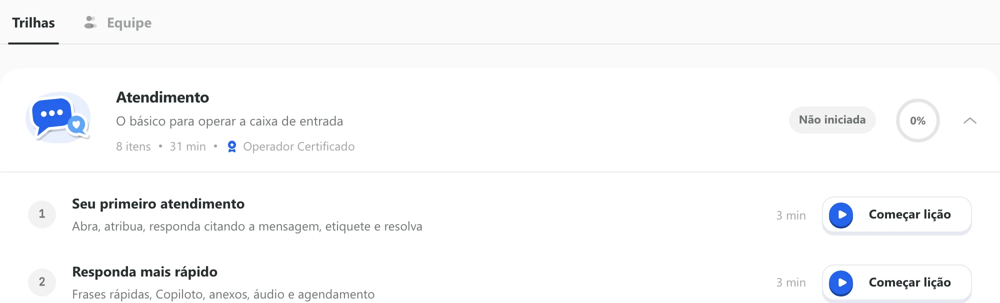

A **Kinbox Academia** ensina você e sua equipe a operar a plataforma com lições práticas na sua própria **Caixa de entrada**, em modo treino com dados fictícios, e emite um certificado para quem passa no exame. Ela é gratuita para todo membro do workspace (inclusive no teste grátis), não exige permissão especial e não consome saldo.

## Abrir a Academia

Você pode abrir a Academia de duas formas:

- Clique no ícone de capelo **Academia** no rodapé da barra lateral.
- Se o ícone não aparecer na barra lateral (ou se estiver no celular), clique na foto do seu perfil no topo → **Ajuda e documentação** → **Academia** (no celular, pelo menu **Ajuda & Documentação**).

## Fazer uma trilha

Na aba **Trilhas**, escolha a trilha que faz sentido para o seu trabalho:

| Trilha | Para quem | Certificado |
| --- | --- | --- |
| **Atendimento** (7 lições + exame, 31 min) | Todo membro que opera a [Caixa de entrada](/docs/conversas/caixa-de-entrada-do-kinbox). | **Operador Certificado** |
| **CRM e Vendas** (6 lições + exame, 26 min) | Quem trabalha com [Funis e negociações](/docs/crm/visao-geral). | **Vendedor Certificado** |

A trilha **CRM e Vendas** fica **Bloqueada** se o seu papel não tiver as permissões **Gerenciar negociações** e **Pode gerenciar as negociações da conversa.** — se precisar, peça a quem administra o workspace para liberar (veja [Criar papéis e permissões](/docs/configuracoes-no-workspace/configurar-permissoes-dos-usuarios)). O proprietário tem acesso às duas trilhas.

<Frame caption="Aba Trilhas da Academia com a trilha Atendimento e as primeiras lições">
  
</Frame>

Clique em **Começar lição** (ou em **Refazer** para repetir). A lição abre na sua própria **Caixa de entrada** em **Modo treino**, com destaques na tela, narração em áudio (**Silenciar narração** / **Ligar narração**) e conversas, negociações e tarefas fictícias — nada é enviado para contatos reais. Você pode fazer as lições em qualquer ordem (ou ir direto ao exame), ganha pontos (XP) a cada lição e pode sair quando quiser pelo **X** no topo.

## Exame e certificado

Clique em **Fazer exame** (ou **Refazer exame**). O exame é prático, na caixa de entrada em modo treino, com situações e missões sem dicas: passa quem cumprir todas as missões, sem limite de tentativas e sem espera para clicar em **Tentar de novo**. Passar da meta de tempo afeta a pontuação e as estrelas, mas não reprova por si só.

Na primeira aprovação, a Kinbox já cria o certificado daquela trilha, válido por **1 ano**. Clique em **Emitir certificado** para ver o resultado e o certificado. O nome no certificado vem do seu **Perfil** e acompanha mudanças feitas depois. Depois, você acessa o certificado na seção **Insígnias**: clique na insígnia conquistada para abrir **Verificação do certificado** e usar **Baixar PDF**, **LinkedIn** ou **Copiar link**.

## Treinar a equipe

<Note>
  Quem pode: o proprietário do workspace ou quem tem a permissão **Membros** vê a aba **Equipe**. Se a aba não aparecer, peça a permissão **Membros** a quem administra o workspace — veja [Criar papéis e permissões](/docs/configuracoes-no-workspace/configurar-permissoes-dos-usuarios).
</Note>

Na aba **Equipe**, você acompanha a **Prontidão da equipe**, os indicadores **Certificados**, **Em treinamento** e **Prazo vencido**, e a situação de cada membro ativo.

<Steps>
  <Step title="Abra o painel de atribuição">
    Na aba **Equipe**, clique em **Atribuir treinamento** (ou em **Atribuir** na linha de uma pessoa).
  </Step>
  <Step title="Escolha a trilha, as pessoas e o prazo">
    Selecione a **Certificação**, marque os membros em **Para quem** (aparecem só as pessoas que podem fazer a trilha e ainda não têm o certificado) e escolha o **Prazo para o exame** (**7**, **14** ou **30** dias).
  </Step>
  <Step title="Envie o treinamento">
    Clique em **Enviar para N pessoa(s)**.
  </Step>
</Steps>

Se quiser reforçar o aviso depois, clique em **Lembrar** na linha do membro (o botão fica **Lembrado** por 1 hora). O membro recebe uma notificação no sino da Kinbox — não por e-mail (veja [Receber notificações no navegador e no celular](/docs/conta/notificacoes)) — e vê na aba **Trilhas** uma faixa com o prazo do exame. A atribuição só avisa e não bloqueia o uso da Kinbox.

## Assinatura vencida

A Academia continua abrindo com a assinatura ou o teste grátis vencido. Quando a Kinbox mostrar o aviso de assinatura expirada, as lições e o exame ficam bloqueados até regularizar em [Minha assinatura venceu ou o pagamento falhou](/docs/assinatura/assinatura-vencida).

## Vídeos e outras ajudas

Os tutoriais em vídeo ficam no canal do YouTube da Kinbox. Para abrir os vídeos e as demais opções de ajuda, clique na foto do seu perfil no topo → **Ajuda e documentação**:

- **Academia**: trilhas práticas e certificação.
- **Central de ajuda**: artigos passo a passo sobre a plataforma.
- **Canal no YouTube**: tutoriais e novidades em vídeo.
- **Documentação da API**: referência para integrar seus sistemas.
- **Falar com o suporte no WhatsApp**: no rodapé do painel.

No mesmo menu do perfil, **Novidades** mostra o que mudou recentemente na plataforma.
