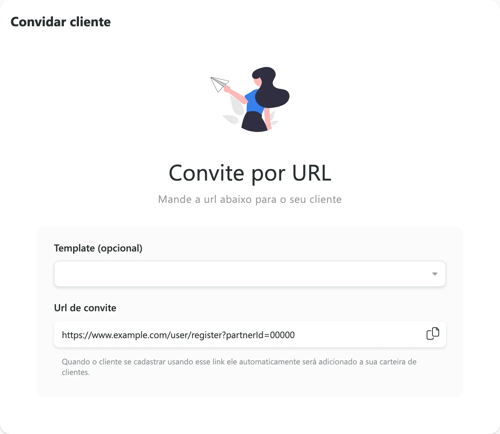

O link de convite adiciona automaticamente o novo workspace do cliente (na tela, **ambiente**) à sua carteira de clientes assim que ele se cadastrar.

<Note>
  Quem pode: qualquer membro com acesso ao painel **Parceria** (permissão **Pode acessar painel de parceria** ou proprietário do workspace). O convite funciona para parceiros de indicação e para parceiros que cuidam dos clientes.
</Note>

## Passo a passo

<Steps>
  <Step title="Abra a tela Convidar cliente">
    Vá em **Parceria** → **Convidar cliente**.
  </Step>
  <Step title="Escolha um template de workspace (opcional)">
    Se quiser oferecer uma configuração pronta ao cliente no primeiro acesso, selecione um modelo em **Template (opcional)** (um template de workspace, diferente de template de mensagem do WhatsApp; veja [Criar e aplicar templates de workspace](/docs/programa-de-parceiros/templates)). Escolher um template atualiza automaticamente o endereço em **Url de convite**.
  </Step>
  <Step title="Copie o link de convite">
    Clique no botão de copiar ao lado do campo **Url de convite**. A tela mostra "Url copiada para a área de transferência.".

    <Frame caption="Tela Convidar cliente com Template (opcional) e o campo Url de convite">
      
    </Frame>
  </Step>
  <Step title="Envie o link ao cliente">
    Mande o link copiado ao cliente pelo canal que preferir. A tela gera o link e não envia e-mail ao cliente.
  </Step>
</Steps>

## O que acontece depois

O cliente abre o link, cria a conta e cria o novo workspace na Kinbox (veja [Criar sua conta e o workspace](/docs/primeiros-passos/criar-seu-workspace-no-kinbox)). O workspace nasce ligado ao seu workspace de parceiro, começa em teste grátis de 7 dias (veja [Assinatura: como o plano é montado](/docs/assinatura/visao-geral)) e passa a aparecer em **Parceria** → **Clientes**.

Se você incluiu um template de workspace no convite, no primeiro acesso o cliente vê a janela **Aplicar template** e decide se aplica as configurações. Essa janela aparece uma única vez: se o cliente cancelar, ela não volta a ser exibida (veja **Problemas comuns** abaixo).

## Problemas comuns

- **O cliente se cadastrou, mas não apareceu em Clientes.** Isso acontece quando o cliente cria o workspace sem abrir o seu link de convite ou quando o workspace já existia antes. Não há opção no painel para vincular um workspace que já existe: para ligar um workspace já criado, fale com a Kinbox.
- **O cliente não viu ou cancelou o template do convite.** A janela **Aplicar template** só aparece uma vez no primeiro acesso. Se a opção **Aplicar template** aparecer no menu **⋯** do cliente em **Parceria** → **Clientes**, aplique o modelo por lá (veja [Criar e aplicar templates de workspace](/docs/programa-de-parceiros/templates)); se não aparecer, a sua parceria naquele cliente é só de indicação ou o seu papel não tem permissão para inspecionar clientes.
