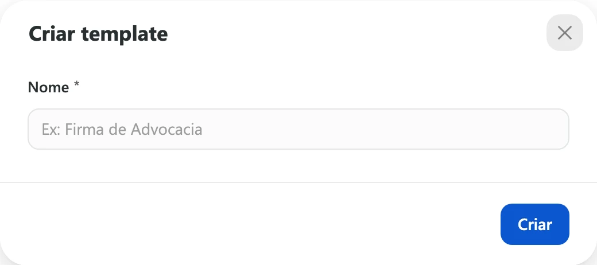

Um **template de workspace** é um workspace modelo (na tela, **ambiente**) que você configura uma vez e copia para o workspace de cada cliente. Ele serve para padronizar a implantação e é diferente de um template de mensagem do WhatsApp.

<Note>
  Quem pode: qualquer membro com acesso ao painel **Parceria** pode criar, editar, excluir e incluir templates no link de convite. Para aplicar um template diretamente pelo menu **⋯** do cliente em **Clientes**, a sua parceria naquele cliente precisa permitir inspeção e o seu papel precisa ter **Pode inspecionar clientes (Básico)** ou **Pode inspecionar clientes (Avançado)**.
</Note>

## Criar o template

<Steps>
  <Step title="Crie o template no painel">
    Vá em **Parceria** → **Templates** e clique em **Novo Template**. Na janela **Criar template**, digite um **Nome** e clique em **Criar**. A Kinbox cria um workspace modelo chamado `[TEMPLATE] <nome>` e abre a tela **Template**.

    <Frame caption="Janela Criar template com o campo Nome e o botão Criar">
      
    </Frame>
  </Step>
  <Step title="Configure o workspace modelo">
    Na tela **Template**, clique em **Abrir ambiente template** (você também pode abrir depois pelo menu **⋯** da lista, em **Abrir ambiente do template**). Configure no workspace modelo tudo o que deseja copiar para os clientes.
  </Step>
  <Step title="Preencha a descrição (opcional)">
    Na tela **Template**, escreva a **Descrição**. Na hora de aplicar, esse texto aparece como dica de ajuda ao lado do nome do modelo.
  </Step>
  <Step title="Adicione variáveis para textos que mudam por cliente (opcional)">
    Em **Variáveis**, clique em **Variável**. Na janela **Editar variável**, preencha **Nome**, confira a **Chave (placeholder)** (gerada automaticamente a partir do nome), adicione uma **Descrição** para orientar quem preencher, marque **Obrigatório** se o campo não puder ficar vazio e clique em **Salvar**.

    Clique em **Copiar variável** para colar a chave no formato `[%=chave=%]` dentro dos textos do workspace modelo — por exemplo, usar `[%=nome_da_empresa=%]` em uma mensagem automática. Na hora de aplicar, a Kinbox substitui a chave pelo valor informado para aquele cliente.
  </Step>
  <Step title="Escolha as etapas a aplicar">
    Em **Etapas a aplicar**, marque o que o template deve copiar ou clique em **Selecionar todos**. Pelo menos uma etapa precisa estar marcada.
  </Step>
  <Step title="Salve o template">
    Clique em **Salvar**. Se você fechar a tela sem salvar, as alterações se perdem; a tela pede confirmação antes de fechar.
  </Step>
</Steps>

## O que o template copia

Você pode incluir até 19 etapas no template (para entender a diferença entre os recursos de automação, veja [Bot, automações, cenários e agentes de IA: qual usar](/docs/conceitos/automacao-e-ia)):

| Etapas | O que copiam |
| --- | --- |
| **Grupos**, **Horário comercial**, **Permissões** | Estrutura da equipe, horários e papéis do workspace. |
| **Campos personalizados**, **Tags**, **Frases rápidas**, **Segmentos** | Organização de contatos e respostas prontas. |
| **Produtos**, **Funis**, **Dashboards** | Catálogo, funis e painéis. |
| **Salas**, **Plugins**, **Widget** | Salas internas, plugins e configuração do widget. |
| **Atribuição automática**, **Agents**, **Bots**, **Automações**, **Cenários** | Regras de atribuição, agentes de IA (**Agents** na tela), bots, automações e cenários. |
| **Configurações gerais** | As configurações gerais do workspace. |

Canais, contatos, conversas, membros, assinatura e saldo não são copiados. A aplicação faz uma cópia única: alterações futuras no workspace modelo não modificam clientes onde o template já foi aplicado.

## Aplicar num cliente

Você pode aplicar um template em um cliente que já está na carteira se a opção **Aplicar template** aparecer no menu do cliente. Se ela não aparecer, a sua parceria naquele cliente é só de indicação ou o seu papel não tem a permissão **Pode inspecionar clientes (Básico)** ou **(Avançado)** (veja [Inspecionar o workspace de um cliente](/docs/programa-de-parceiros/inspecionar-cliente)).

<Warning>
  Aplicar um template cria itens no workspace do cliente e não tem como desfazer pela tela. Aplicar de novo repete os itens. Um grupo com nome igual a um que já existe no cliente também é criado, com um código entre parênteses no fim do nome. **Widget** e **Configurações gerais** substituem a configuração atual. Confira bots, agentes de IA, automações e cenários no cliente depois de aplicar.
</Warning>

<Steps>
  <Step title="Selecione o cliente e o template">
    Vá em **Parceria** → **Clientes**, abra o menu **⋯** do cliente e clique em **Aplicar template**. Na janela **Aplicar Template**, escolha o modelo no campo **Template** e clique em **Aplicar**.
  </Step>
  <Step title="Confirme a aplicação">
    O workspace do cliente abre em uma nova aba com a janela **Aplicar template**. Confira o nome e a descrição do modelo e clique em **Continuar** (ou em **Cancelar** se quiser desistir sem alterar nada).
  </Step>
  <Step title="Preencha as variáveis, se houver">
    Informe o valor de cada variável para aquele cliente e clique em **Aplicar**.
  </Step>
  <Step title="Acompanhe e conclua">
    Acompanhe o andamento das etapas em **Aplicando template...**. Se uma etapa falhar, ela fica marcada com a mensagem de erro e as outras continuam. Ao final, o título muda para **Template aplicado!**, com ou sem erro: confira a lista de etapas antes de clicar em **Concluir**. Sem erro, **Concluir** recarrega a página do cliente.
  </Step>
</Steps>

## Aplicar pelo convite

Qualquer parceiro — inclusive parceiro de indicação — pode escolher um template ao gerar o link em **Parceria** → **Convidar cliente** (veja [Convidar clientes para a sua carteira](/docs/programa-de-parceiros/convidar-clientes)). No primeiro acesso ao novo workspace, o cliente vê a janela **Aplicar template** e decide se aplica o modelo.

## Excluir um template

Para remover um template da lista, vá em **Parceria** → **Templates**, abra o menu **⋯** da linha, clique em **Excluir** e confirme na mensagem "Tem certeza que deseja excluir esse template?".
