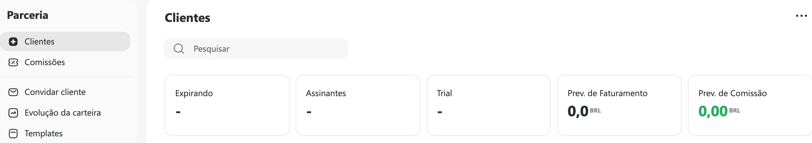

O painel **Parceria** reúne, no seu workspace de parceiro, os workspaces dos clientes (na tela, **ambientes**) ligados à sua conta, as comissões, o link de convite, a evolução da carteira e os templates de workspace. Ao abrir o painel, você cai direto na tela **Clientes**.

## Onde fica e quem pode

Vá em **Parceria** (ícone de coroa) no menu lateral principal. Para acessar o painel, o seu workspace precisa fazer parte do programa de parceiros e o seu papel precisa ter a permissão **Pode acessar painel de parceria** (o proprietário do workspace sempre tem acesso; veja [Workspace, membros e papéis](/docs/conceitos/workspace-membros-e-papeis), [Referência de permissões](/docs/administracao/referencia-de-permissoes) e [Criar papéis e permissões](/docs/configuracoes-no-workspace/configurar-permissoes-dos-usuarios)).

<Note>
  Se o item **Parceria** não aparecer no menu lateral, o seu workspace ainda não está no programa de parceiros ou o seu papel não tem a permissão **Pode acessar painel de parceria**. Para receber a permissão, peça ao proprietário do workspace. Para entrar no programa de parceiros, fale com a Kinbox.
</Note>

<Frame caption="Menu Parceria e topo da tela Clientes com a busca e os primeiros cartões de resumo">
  
</Frame>

## Dois jeitos de ser parceiro

A Kinbox define o tipo de parceria para cada vínculo com o cliente. Isso determina quais ações aparecem no menu **⋯** de cada linha em **Clientes**.

| Tipo de parceria | O que você faz no menu do cliente |
| --- | --- |
| Parceiro de indicação | Convida clientes e recebe comissão. No menu **⋯** do cliente aparece apenas **Ver**. |
| Parceiro que cuida dos clientes | Além de **Ver**, pode usar **Inspecionar Ambiente**, **Aplicar template** e **Resetar senha**, conforme as permissões do seu papel e as opções do cliente. |

## O menu do painel

Quem tem acesso ao painel vê os cinco itens no menu interno de **Parceria**:

- **Clientes**: lista os workspaces da sua carteira, os cartões de resumo e o detalhe de cada cliente (descrita abaixo).
- **Comissões**: exibe as comissões recebidas e a receber e os recibos (veja [Pagamento das comissões](/docs/programa-de-parceiros/pagamento-das-comissoes)).
- **Convidar cliente**: gera o link de convite para novos clientes entrarem na sua carteira (veja [Convidar clientes para a sua carteira](/docs/programa-de-parceiros/convidar-clientes)).
- **Evolução da carteira**: mostra os gráficos mensais de novos clientes e comissões (descrita abaixo).
- **Templates**: permite criar templates de workspace (modelos de configuração, diferentes de templates de mensagem do WhatsApp) para aplicar nos clientes (veja [Criar e aplicar templates de workspace](/docs/programa-de-parceiros/templates)).

## A tela Clientes

No topo de **Clientes**, você pode buscar clientes pelo nome e acompanhar cinco cartões de resumo:

| Cartão | O que mostra |
| --- | --- |
| **Expirando** | Clientes com assinatura perto de vencer ou vencida recentemente. |
| **Assinantes** | Clientes com plano pago ainda dentro da validade. |
| **Trial** | Clientes em teste grátis ainda dentro da validade. |
| **Prev. de Faturamento** | Soma do total da assinatura dos clientes com plano pago ativo ou vencido há poucos dias. |
| **Prev. de Comissão** | Estimativa da comissão calculada sobre esses mesmos clientes. |

**Prev. de Comissão** é apenas uma estimativa. O valor que vale para o pagamento é o lançado em [Pagamento das comissões](/docs/programa-de-parceiros/pagamento-das-comissoes).

A lista de clientes mostra, entre outras colunas, **Nome**, **Assinatura**, membros, canais de WhatsApp e Instagram, **Expira**, **Dono**, **Total** e **Comissão**.

Quando aparece um cadeado ao lado do nome do cliente com o aviso "Conversas restritas pelo cliente", significa que o cliente desligou a opção que permite ao parceiro ver as conversas (veja o lado do cliente em [Controlar o que o parceiro vê no seu workspace](/docs/administracao/acesso-do-parceiro)).

No menu **⋯** de cada cliente, as ações disponíveis dependem do seu tipo de parceria e das permissões do seu papel:

- **Ver**: abre a tela **Ambiente**, com o resumo do **Plano** (membros, WhatsApp e Instagram), o vencimento, o percentual e o valor estimado em **Comissão**, o **Desconto** e o **Total da assinatura**. Quem tem a permissão **Pode visualizar faturas** também vê **Últimas faturas**, com atalhos para abrir a fatura, ver ou copiar o boleto e baixar a nota fiscal quando disponível.
- **Inspecionar Ambiente**: abre o workspace do cliente em uma nova aba, se a opção aparecer no menu do cliente (disponível apenas para parceiro que cuida dos clientes, com a permissão **Pode inspecionar clientes (Básico)** ou **(Avançado)**; veja [Inspecionar o workspace de um cliente](/docs/programa-de-parceiros/inspecionar-cliente)).
- **Aplicar template**: aplica um template de workspace no cliente, se a opção aparecer no menu do cliente (mesmas condições de **Inspecionar Ambiente**; veja [Criar e aplicar templates de workspace](/docs/programa-de-parceiros/templates)).
- **Resetar senha**: aparece apenas para parceiro que cuida dos clientes, com a permissão **Pode resetar senha de membros** e quando o cliente não restringiu as conversas (veja [Inspecionar o workspace de um cliente](/docs/programa-de-parceiros/inspecionar-cliente)).

Se **Inspecionar Ambiente**, **Aplicar template** ou **Resetar senha** não aparecerem no menu do cliente, a sua parceria naquele cliente é só de indicação ou o seu papel não tem a permissão necessária (no caso de **Resetar senha**, o cliente também pode ter restringido as conversas).

No menu **⋯** no canto superior direito da tela **Clientes**, você pode clicar em **Esconder valores** (útil para ocultar números ao mostrar a tela a alguém), **Copiar e-mails** e **Exportar** para baixar os dados da carteira.

## Evolução da carteira

Em **Parceria** → **Evolução da carteira**, você acompanha dois gráficos de colunas por mês: **Novos ambientes** (clientes criados em cada mês) e **Comissões** (soma das comissões registradas em cada mês). Os gráficos exibem todo o histórico, sem filtro de período.

## Clientes que não aparecem

Entram na lista os workspaces criados pelo seu link de convite ou vinculados pela Kinbox. Não existe botão no painel para incluir um workspace que já existia: para isso, fale com a Kinbox. Se você vê apenas parte dos clientes da carteira, o seu papel pode ter a opção **Limitar ambientes que pode visualizar** ligada, com só alguns clientes escolhidos (o proprietário sempre vê todos).

## Próximos passos

<CardGroup cols={2}>
  <Card title="Convidar clientes para a sua carteira" href="/docs/programa-de-parceiros/convidar-clientes">
    Gere e envie o link de convite para novos clientes entrarem na sua carteira, com ou sem template.
  </Card>
  <Card title="Criar e aplicar templates de workspace" href="/docs/programa-de-parceiros/templates">
    Monte um workspace modelo com variáveis e copie as configurações para os clientes.
  </Card>
  <Card title="Inspecionar o workspace de um cliente" href="/docs/programa-de-parceiros/inspecionar-cliente">
    Abra o workspace de um cliente para dar suporte e entenda os níveis Básico e Avançado.
  </Card>
  <Card title="Percentual de comissão e níveis do programa" href="/docs/programa-de-parceiros/niveis-do-programa-de-comissionamento">
    Veja onde consultar o percentual de comissão de cada cliente e com quem falar sobre níveis.
  </Card>
  <Card title="Pagamento das comissões" href="/docs/programa-de-parceiros/pagamento-das-comissoes">
    Acompanhe valores a receber, status das comissões, recibos e exportações.
  </Card>
</CardGroup>
