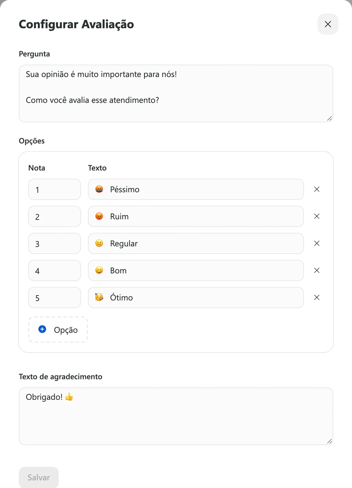

O relatório de **Avaliação** mostra a nota média que os contatos deram aos atendimentos em um período e permite ajustar a pergunta e as opções da pesquisa.

<Note>Para ver este relatório, seu papel precisa da permissão **Gerenciar relatórios** (o proprietário do workspace sempre vê). Se o seu papel tiver **Restringir relatórios ao membro**, você vê só as avaliações registradas para você; se tiver **Restringir relatórios aos grupos do membro**, você vê só as sessões dos seus grupos.</Note>

## Como a avaliação chega ao relatório

A pesquisa de satisfação usa o bot de avaliação do workspace. Ela só é enviada ao contato por uma automação com a ação **Avaliar atendimento**, criada em **Configurações** → **Automação** → **Automações** (seu papel precisa da permissão **Automações**). Sem essa automação, os contatos não recebem a pesquisa. O passo a passo está em [Pedir avaliação no fim do atendimento](/docs/atendimento/pesquisa-de-satisfacao).

O contato avalia respondendo com a **Nota** ou o **Texto** de uma das opções.

O relatório considera apenas as sessões **resolvidas no período** que têm avaliação. No agrupamento **Por Dia**, cada sessão avaliada aparece no dia em que foi resolvida.

## Ler o relatório

<Steps>
  <Step title="Abra o relatório">
    No menu lateral, vá em **Relatórios** → **Avaliação** (o título da página aparece como **Relatório de Avaliação**). Por padrão, a tela abre nos últimos 7 dias, sem hoje, agrupada **Por Membro**.
  </Step>
  <Step title="Ajuste período, filtros e agrupamento">
    Troque as datas no seletor à esquerda. Para recortar os dados, clique em **Filtrar**, escolha os critérios e clique em **Aplicar filtros**. Para mudar o agrupamento, alterne entre **Por Membro**, **Por Dia**, **Por Grupo**, **Por Tag** e **Por Canal**.
  </Step>
  <Step title="Leia as colunas">
    A tabela exibe a **Nota Média** (em estrelas, com uma casa decimal) e o número de **Avaliadores** (total de sessões avaliadas naquela linha). Em **Por Membro**, a avaliação conta para o membro registrado nela; em **Por Grupo**, **Por Tag** e **Por Canal**, conta conforme o grupo, as tags e o canal da sessão.
  </Step>
  <Step title="Abra as sessões">
    Clique em **Ver sessões** para listar as sessões avaliadas no período.

    Para ver as avaliações de uma linha, clique no número da tabela: a lista mostra só as sessões daquela linha.
  </Step>
  <Step title="Exporte a tabela">
    Clique em **...** → **Exportar** e escolha **CSV (.csv)** ou **Excel (.xlsx)**.
  </Step>
  <Step title="Exporte a lista de sessões (opcional)">
    Dentro da lista de sessões, use o **Exportar** da lista. Se o seu papel tiver **Não pode exportar relatórios**, esse botão fica desativado.
  </Step>
</Steps>

## Ajustar a pergunta

No topo do relatório, clique em **Configurar**. A janela **Configurar Avaliação** muda só o texto da pesquisa; quem envia é a automação.

- **Pergunta**: o texto enviado ao contato para pedir a avaliação.
- **Opções**: cada linha combina uma **Nota** (número de `0` a `5`) e um **Texto**. Clique em **Opção** para adicionar outra opção ou no **x** para remover.
- **Texto de agradecimento**: a mensagem enviada depois que o contato responde.

Clique em **Salvar** para guardar as mudanças (a tela confirma com "Avaliação Atualizada.").

<Frame caption="Janela Configurar Avaliação com pergunta, opções de nota e texto de agradecimento">
  
</Frame>

Veja também [Como os relatórios contam sessões e tempos](/docs/relatorios/como-funcionam) e o [Relatório de produtividade](/docs/relatorios/produtividade).
