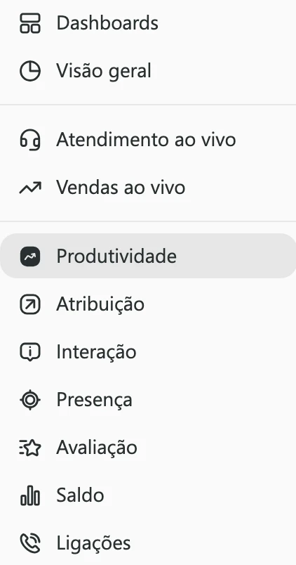

Os relatórios de atendimento da Kinbox medem as [sessões](/docs/conceitos/conversas-e-sessoes) (atendimentos) das conversas do workspace, em tempo real ou em um período escolhido.

## Onde ficam

No menu lateral, clique em **Relatórios**.

<Note>Para ver os relatórios, seu papel precisa da permissão **Gerenciar relatórios** (o proprietário do workspace sempre vê). Nos papéis padrão, **Administrador** e **Supervisor** já vêm com essa permissão, e **Atendente** não.</Note>

<Frame caption="Submenu de Relatórios na barra lateral">
  
</Frame>

## Qual relatório usar

| Relatório | Para que serve | Período |
| --- | --- | --- |
| [**Visão geral**](/docs/relatorios/visao-geral) | Sessões abertas agora, por estado e por membro, grupo, tag ou canal | Tempo real |
| [**Atendimento ao vivo**](/docs/relatorios/ao-vivo) | Mapa animado das conversas abertas e da equipe, com fila e atrasos | Tempo real |
| [**Vendas ao vivo**](/docs/relatorios/ao-vivo) | Mapa animado das negociações abertas de um funil (exige também a permissão **Gerenciar negociações**) | Tempo real |
| [**Produtividade**](/docs/relatorios/produtividade) | TME, TMP, TMA, sessões novas, resolvidas, leads e mensagens | Período |
| [**Atribuição**](/docs/relatorios/atribuicao) | Quantas vezes cada membro ou grupo recebeu uma sessão por dia | Período |
| [**Interação**](/docs/relatorios/interacao) | Em quantas sessões cada membro interagiu por dia (mensagem ou ação na conversa) | Período |
| [**Presença**](/docs/relatorios/presenca) | Quanto tempo cada membro ficou online por dia | Período |
| [**Avaliação**](/docs/relatorios/avaliacao) | Nota média dada pelos contatos aos atendimentos | Período |

O submenu de **Relatórios** também inclui **Dashboards**, **Copiloto** (quando algum recurso do copiloto está ligado), **Saldo**, **Ligações** e a seção **Marketing**, que acompanham outros indicadores fora dos relatórios de atendimento.

## Como os números são contados

Os relatórios de atendimento contam **sessões**, e não conversas nem contatos. Se o mesmo contato abre dois atendimentos em dias diferentes, cada atendimento entra como uma sessão (veja [Conversas, sessões e status](/docs/conceitos/conversas-e-sessoes)).

| Métrica | Mede | Começa | Termina |
| --- | --- | --- | --- |
| **TME** | Tempo médio de espera | Criação da sessão | Primeira resposta de um membro |
| **TMP** | Tempo médio pós-atribuição | Primeira atribuição a um membro | Primeira resposta de um membro |
| **TMA** | Tempo médio de atendimento | Primeira resposta de um membro | Resolução da sessão |

- **Primeira resposta e bot:** apenas mensagens enviadas por um membro marcam a primeira resposta; mensagens do [bot](/docs/bot/visao-geral) e mensagens automáticas do sistema não contam. O tempo com o bot antes da primeira resposta entra no **TME**.
- **Sessões fora dos tempos:** sessões iniciadas pela equipe pelo botão **Enviar mensagem** (veja [Iniciar uma conversa com um contato](/docs/conversas/iniciar-conversa)) ficam fora do **TME** e do **TMP**. Sessões resolvidas sem nenhuma resposta de membro não têm nenhum dos três tempos.
- **Horário comercial:** quando o workspace (na tela, **ambiente**) tem um **Horário comercial** escolhido em **Configurações** → **Ambiente** → **Geral**, os três tempos contam apenas os minutos dentro desse horário. Sem horário escolhido, contam todos os minutos corridos.
- **Responsável atual:** ao agrupar por membro ou por grupo na **Visão geral** e na **Produtividade**, a sessão inteira conta para quem é o responsável atual (ou era ao ser resolvida). Uma sessão transferida (veja [Atribuir e transferir](/docs/conversas/atribuir-e-transferir)) conta para o último responsável; para ver quem recebeu a sessão antes, use o relatório de [Atribuição](/docs/relatorios/atribuicao).

## Ações comuns nos relatórios

Nos relatórios por período (**Produtividade**, **Atribuição**, **Interação**, **Presença** e **Avaliação**):

- **Escolher o período:** o padrão são os últimos 7 dias, sem hoje. Você pode escolher data e hora ou usar os atalhos **Hoje**, **Ontem**, **Últimos 7 dias**, **Últimos 30 dias**, **Esse mês** e **Mês passado**.
- **Filtrar:** clique em **Filtrar**, escolha os critérios e clique em **Aplicar filtros**. Para tirar todos os filtros, clique em **Limpar filtros**. Na **Presença**, os filtros são só de membro e de grupo.
- **Agrupar:** use o botão **Por ...** para trocar entre os agrupamentos que cada relatório aceita (**Por Dia**, **Por Membro**, **Por Grupo**, **Por Tag** ou **Por Canal**).
- **Ver as sessões:** clique em **Ver sessões** para listar as sessões do relatório. Para investigar um número, clique no cartão ou na célula da tabela e abra uma lista de sessões ligada a ele; a lista pode não reproduzir o total. Na **Presença**, o botão é **Ver presenças** e abre a grade de horários.
- **Exportar:** clique no menu **...** no canto superior direito → **Exportar** e escolha **CSV (.csv)** ou **Excel (.xlsx)**.

A **Visão geral** não tem período: mostra as sessões abertas agora. Ela tem **Filtrar**, o agrupamento, **Ver sessões** e **Atualizar**; para exportar, abra **Ver sessões** e use o **Exportar** da lista.

O **Atendimento ao vivo** e o **Vendas ao vivo** não têm esses controles: veja [Atendimento e vendas ao vivo](/docs/relatorios/ao-vivo).

## Quem vê o quê

Além da permissão **Gerenciar relatórios**, o papel do membro em **Configurações** → **Ambiente** → **Permissões** pode aplicar restrições (veja [Workspace, membros e papéis](/docs/conceitos/workspace-membros-e-papeis) e a [Referência de permissões](/docs/administracao/referencia-de-permissoes)):

- **Restringir relatórios ao membro:** na **Visão geral**, **Produtividade**, **Atribuição** e **Interação**, você vê só as sessões em que é o responsável atual; na **Avaliação**, só as avaliações registradas para você; na **Presença**, só a sua presença.
- **Restringir relatórios aos grupos do membro:** na **Visão geral**, **Produtividade**, **Interação** e **Avaliação**, você vê só as sessões dos seus grupos; na **Atribuição**, as sessões que estão ou já estiveram nos seus grupos. Se você não pertencer a nenhum grupo, o relatório não abre e aparece um aviso de que você não pertence a nenhum grupo.
- As duas restrições acima não podem ficar marcadas ao mesmo tempo.
- **Não pode exportar relatórios:** desativa o botão **Exportar** dentro da lista de sessões (**Ver sessões**).
- **Atendimento ao vivo:** o mapa e a fila seguem o **Acesso as Conversas** do seu papel, e não as restrições de relatório. Os números do conjunto **Tempo médio** (**resolvidas hoje** e **TM 1ª resposta**) seguem as restrições de relatório.
- O proprietário do workspace vê todos os dados e não sofre restrições.

## Próximos passos

<CardGroup cols={2}>
  <Card title="Relatório Visão geral (tempo real)" href="/docs/relatorios/visao-geral">
    Veja agora quantas sessões estão em espera, em atendimento, pendentes, sem responsável ou com o bot.
  </Card>
  <Card title="Atendimento e vendas ao vivo" href="/docs/relatorios/ao-vivo">
    Acompanhe a fila, os atrasos, a equipe online e as negociações de um funil num mapa animado.
  </Card>
  <Card title="Relatório de produtividade" href="/docs/relatorios/produtividade">
    Consulte TME, TMP, TMA, sessões novas, resolvidas, leads e mensagens no período escolhido.
  </Card>
  <Card title="Relatório de atribuição" href="/docs/relatorios/atribuicao">
    Acompanhe quantas vezes cada membro ou grupo recebeu sessões por dia, incluindo transferências.
  </Card>
  <Card title="Relatório de interação" href="/docs/relatorios/interacao">
    Veja, dia a dia, em quantas sessões cada membro interagiu.
  </Card>
  <Card title="Relatório de presença" href="/docs/relatorios/presenca">
    Consulte quanto tempo cada membro ficou online por dia e em quais horários esteve conectado.
  </Card>
  <Card title="Relatório de avaliação" href="/docs/relatorios/avaliacao">
    Veja a nota média dada pelos contatos aos atendimentos e ajuste a pergunta da pesquisa.
  </Card>
</CardGroup>
