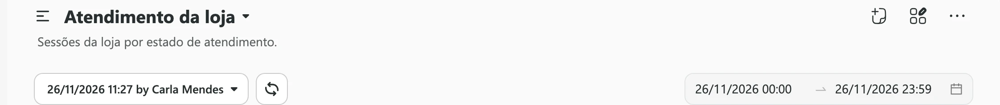
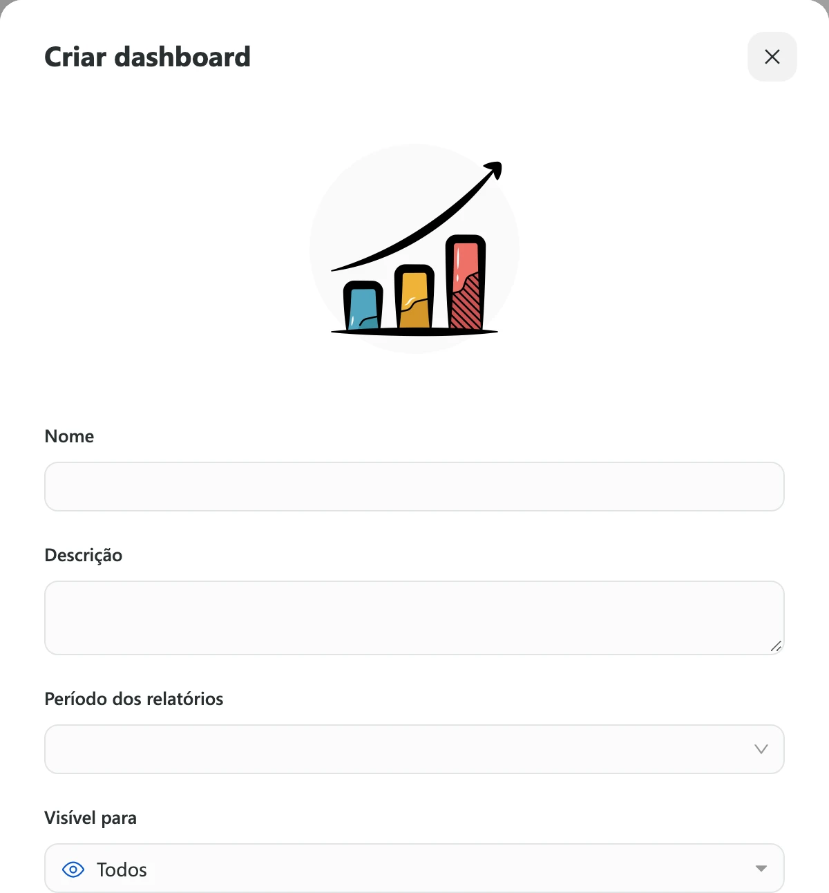
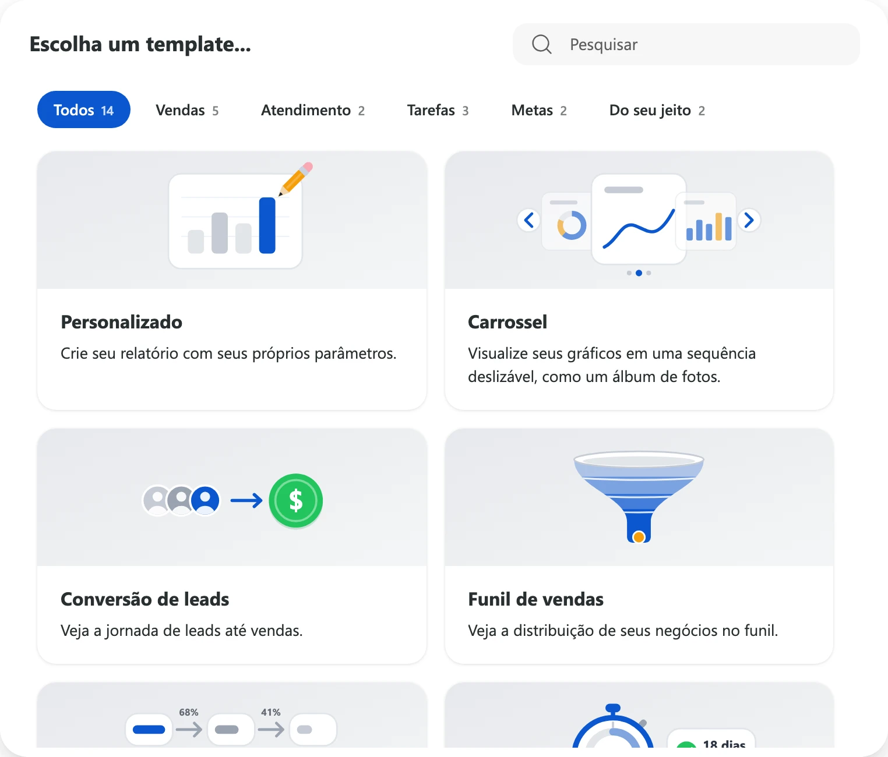

Um dashboard é um painel que reúne vários relatórios (cartões) em uma mesma tela, exibindo os números de um **snapshot** — uma foto dos dados calculada em um momento, e não dados ao vivo.

<Note>Para ver este relatório, seu papel precisa da permissão **Gerenciar relatórios** (o proprietário do workspace sempre vê). Com a restrição **Não pode criar ou excluir Dashboard**, você ainda vê os dashboards e pode atualizar os dados, mas não consegue criar, clonar, editar nem excluir dashboards (ao tentar, aparece um aviso de que não tem permissão). Cartões de negociações exigem também a permissão **Gerenciar negociações**.</Note>

## Abrir os dashboards

No menu lateral, vá em **Relatórios** → **Dashboards**.

Ao abrir, a Kinbox carrega o último dashboard aberto naquele navegador ou, se não houver, o primeiro da lista que você pode ver — não existe um dashboard padrão configurável. Quem tem **Gerenciar relatórios** pode escolher **Dashboard** como página inicial (**Home**) do papel (veja a [Referência de permissões](/docs/administracao/referencia-de-permissoes)).

Para trocar de dashboard, clique no **título** no topo da tela (dica **Mudar dashboard**). O menu traz uma busca pelos dashboards visíveis para você e a opção **Adicionar dashboard** no fim. A descrição do dashboard aparece logo abaixo do título.

<Frame caption="Topo de um dashboard: seletor de dashboard no título, descrição, seletor de snapshot, botão Obter dados atualizados, datas do dashboard compartilhado e ícones Adicionar relatório, Organizar cards e ...">
  
</Frame>

## Criar um dashboard

Todo dashboard nasce em branco. Os modelos prontos da Kinbox são de **cartões**, escolhidos depois que o dashboard está criado.

<Steps>
  <Step title="Abra o formulário de criação">
    Se ainda não houver nenhum dashboard no workspace, a tela já abre direto **Criar Dashboard**. Se já existirem dashboards, clique no título no topo da tela e escolha **Adicionar dashboard** para abrir o painel **Criar dashboard**.
  </Step>
  <Step title="Preencha os campos do dashboard">
    Informe **Nome** (opcional; se ficar em branco, o título aparece como `Dashboard`), **Descrição** (opcional, exibida abaixo do título), **Período dos relatórios** e **Visível para**.

    <Frame caption="Painel Criar dashboard com Nome, Descrição, Período dos relatórios e Visível para">
      
    </Frame>

    Escolha o comportamento de **Período dos relatórios**:

    | Opção | Como funciona |
    | --- | --- |
    | **Individual** | Cada cartão usa o próprio campo **Período**. Se você deixar **Período dos relatórios** vazio, o dashboard funciona como **Individual**. |
    | **Compartilhado** | O dashboard ganha um seletor de datas no topo para todos os cartões, e o campo **Período** de cada cartão mostra **Selecionado na dashboard**. |

    Em **Visível para**, escolha para quem o dashboard aparece: **Todos** (padrão: todos com acesso a relatórios), **Grupos** (abre o campo **Grupos**, onde você marca um ou mais grupos) ou **Apenas para mim** (apenas quem criou; o proprietário sempre vê todos).
  </Step>
  <Step title="Crie o dashboard">
    Clique em **Criar**. O dashboard abre pronto para receber cartões.
  </Step>
</Steps>

## Adicionar cartões

Você pode adicionar até **100** cartões em um mesmo dashboard. Cada mudança nos cartões é salva na hora — não existe um botão geral para salvar o dashboard.

<Steps>
  <Step title="Abra a galeria de modelos">
    Clique no ícone **Adicionar relatório** no canto superior direito (ou na faixa **Adicionar relatório** no fim da grade) para abrir a janela **Escolha um template...**.

    <Frame caption="Janela Escolha um template... com busca, filtro por categoria e modelos de cartão">
      
    </Frame>
  </Step>
  <Step title="Escolha um modelo">
    Use a busca ou filtre pelas categorias (**Todos**, **Vendas**, **Atendimento**, **Tarefas**, **Metas** e **Do seu jeito**) e clique no modelo desejado.
  </Step>
  <Step title="Configure e salve o cartão">
    Alguns modelos entram direto no dashboard, sem abrir formulário: **Ciclo médio de vendas**, **Pipeline Atendimento** (cria 5 cartões: **Não atribuído**, **Em espera**, **Em atendimento**, **Pendente** e **Atribuído**), **Melhor horário de resposta** e **Tarefas** (cria 3 cartões: **A fazer**, **Completas** e **Atrasadas**). Os demais abrem o painel do cartão para preencher os campos e salvar.
  </Step>
</Steps>

### Modelos de cartão disponíveis

| Categoria | Modelo | O que mostra |
| --- | --- | --- |
| **Vendas** | **Conversão de leads** | Veja a jornada de leads até vendas. |
| **Vendas** | **Funil de vendas** | Veja a distribuição de seus negócios no funil. |
| **Vendas** | **Progressão do funil** | Acompanhe por quais etapas os negócios passaram, a conversão entre elas e os retornos. |
| **Vendas** | **Ciclo médio de vendas** | Veja o tempo médio até ganhar um negócio. |
| **Vendas** | **Taxa de recompra** | Acompanhe quantos clientes voltam a comprar dentro de uma janela de tempo. |
| **Atendimento** | **Pipeline Atendimento** | Adicione KPIs de atendimento com variação percentual. |
| **Atendimento** | **Melhor horário de resposta** | Descubra os horários com resposta mais rápida do cliente. |
| **Tarefas** | **Tarefas** | Acompanhe volume, conclusão e prazos das tarefas. |
| **Tarefas** | **Calendário de tarefas** | Veja tarefas, prazos e reuniões do período organizados num calendário. |
| **Tarefas** | **Feed operacional** | Acompanhe negócios ganhos, perdidos e tarefas vencidas num feed cronológico, agrupado por dia. |
| **Metas** | **Necessidade de leads** | Estime quantos leads faltam para bater uma meta. |
| **Metas** | **Meta x Realizado** | Acompanhe o progresso de uma meta em relação ao realizado. |
| **Do seu jeito** | **Personalizado** | Crie seu relatório com seus próprios parâmetros. |
| **Do seu jeito** | **Carrossel** | Visualize seus gráficos em uma sequência deslizável, como um álbum de fotos. |

## Montar um relatório Personalizado

Ao escolher **Personalizado**, o painel **Relatório** traz os campos nesta ordem:

1. **Nome** (obrigatório).
2. **Fonte dos dados:** **Negócios**, **Sessões de conversa** ou **Tarefas**.
3. **Período** (apenas em dashboards **Individual**). Nos cartões com fonte **Tarefas**, use **Essa semana**, **Esse mês** ou **Personalizado**.
4. **Por propriedade:** qual data encaixa o registro no período.
5. **Métrica** (e **Operação**, quando aplicável: **Soma**, **Média**, **Mínimo** ou **Máximo**). Em **Sessões de conversa**, é possível medir quantidade de sessões ou de mensagens.
6. **Agrupar por:** **Sem agrupamento** ou um campo da fonte escolhida.
7. **Visualização:** **Métrica única** (apenas com **Sem agrupamento**) ou **Barras**, **Rankings**, **Pizza** e **Linha** (com agrupamento).
8. **Condições** (filtros do cartão). Quando a fonte é **Tarefas**, aparece **Atribuído a** no lugar de **Condições**, e o cartão usa nome **Tarefas**, sem agrupamento e com visualização de métrica única.

**Exemplo:** para acompanhar o valor total de negociações por vendedor, selecione **Fonte dos dados** como **Negócios**, escolha o **Período**, marque **Por valor** em **Métrica** com **Operação** em **Soma**, selecione **Membro** em **Agrupar por** e escolha **Barras** em **Visualização**.

## Agrupar gráficos em Carrossel

O modelo **Carrossel** reúne dois ou mais relatórios compatíveis do dashboard (cartões de métrica única não entram) para alterná-los em um mesmo bloco.

Defina **Nome do gráfico** (até 100 caracteres), marque pelo menos dois relatórios e, se quiser alternância automática, configure **Ciclo automático** escolhendo **Duração** e **Unidade** (**Segundos**, **Minutos** ou **Horas**). Depois clique em **Adicionar carrossel** (ou **Salvar alterações** ao editar).

Se você excluir um carrossel, os relatórios que estavam dentro dele voltam para a grade do dashboard.

## Organizar e editar cartões

- **Editar, clonar ou excluir um cartão:** passe o mouse sobre o cartão para abrir o menu com **Editar**, **Clonar** (cria `<nome> (cópia)`) e **Excluir** (pede confirmação). Clicar sobre o cartão abre o detalhamento dos dados — por exemplo, as sessões por trás de um número no **Pipeline Atendimento**.
- **Mover e redimensionar:** clique no ícone **Organizar cards** no topo direito (ou arraste e redimensione diretamente um cartão) para abrir a barra **Organizando cards**. Arraste os cartões pela grade ou clique em **Auto-organizar** para redistribuí-los automaticamente. Clique em **Concluir** para salvar ou em **Cancelar** para sair (se houver mudanças não salvas, a tela pede confirmação entre **Sair sem salvar** e **Continuar editando**).

## Atualizar os dados (snapshots)

Os cartões do dashboard não mostram dados ao vivo: eles exibem um **snapshot** (uma foto dos dados de todos os cartões calculada em um momento). Sem nenhum snapshot gerado, os cartões ficam carregando. Os dados não atualizam sozinhos — gere um novo snapshot sempre que precisar de números atualizados.

Em um dashboard **Compartilhado**, escolha primeiro o intervalo de datas no seletor do topo antes de atualizar. Trocar as datas sem gerar um novo snapshot não altera os números exibidos.

<Steps>
  <Step title="Peça a atualização">
    Clique no ícone **Obter dados atualizados**, ao lado do seletor de snapshot (também disponível no fim do menu do seletor). O dashboard precisa ter pelo menos um cartão.
  </Step>
  <Step title="Confirme a geração do snapshot">
    Na janela **Atualizar dados**, clique em **Atualizar dados**. A tela já seleciona o novo snapshot enquanto ele processa.
  </Step>
  <Step title="Aguarde a notificação">
    O cálculo roda em segundo plano e pode levar vários minutos, conforme o tamanho do dashboard. Enquanto processa, os cartões ficam carregando e o seletor mostra um ícone girando. Quando terminar, você recebe uma notificação no ícone de sino no topo da tela para abrir os novos dados.
  </Step>
</Steps>

- **Ver snapshots anteriores:** ao abrir um dashboard, a Kinbox mostra sempre o snapshot mais recente. Para consultar fotos anteriores, abra o seletor abaixo do título — cada item exibe a data, a hora e quem gerou. Se os snapshots anteriores aparecerem desativados no seletor, peça ao administrador a permissão **Atribuir** no seu papel.
- **Falha ou cartão vazio:** se o processamento falhar, os cartões exibem o aviso de erro e o botão **Tentar novamente**, que gera um novo snapshot. Quando um cartão não tem registros no snapshot selecionado, a tela mostra **Sem dados**.

## Editar, clonar ou excluir o dashboard

Clique no menu **...** no canto superior direito do dashboard:

- **Editar:** abre o painel **Editar dashboard** para alterar **Nome**, **Descrição**, **Período dos relatórios** e **Visível para**, e clique em **Salvar**.
- **Clonar:** após confirmar em **Clonar dashboard**, cria `Cópia de <nome>` e abre a cópia.
- **Excluir dashboard:** remove o dashboard após confirmação.

<Warning>Excluir um dashboard apaga o dashboard e todos os cartões dele, sem como desfazer pela tela. Se quiser guardar uma cópia antes, use **Clonar**.</Warning>

## Cartões que pedem outras permissões

- **Negociações:** cartões com fonte **Negócios** e os modelos **Conversão de leads**, **Funil de vendas**, **Progressão do funil**, **Ciclo médio de vendas**, **Taxa de recompra**, **Necessidade de leads** e **Meta x Realizado** exigem **Gerenciar negociações** e respeitam o escopo de negociações do papel (veja [Visão geral do CRM](/docs/crm/visao-geral) e [Criar funil de vendas](/docs/crm/criar-funil-de-vendas)). Sem essa permissão, o cartão mostra **Sem permissão**.
- **Tarefas:** nos cartões **Tarefas** e **Calendário de tarefas**, quem não pode ver tarefas de outros membros vê apenas as próprias tarefas.
- **Metas:** os modelos **Necessidade de leads** e **Meta x Realizado** exigem uma meta cadastrada no workspace.
- **Pipeline Atendimento:** os estados **Não atribuído**, **Em espera**, **Em atendimento**, **Pendente** e **Atribuído** são os mesmos do relatório [Visão geral](/docs/relatorios/visao-geral). Ao clicar em um número, abre a lista das sessões por trás dele.

Para ver todas as permissões e regras de exportação do módulo, consulte [Exportar relatórios e quem pode ver cada um](/docs/relatorios/exportar-e-permissoes). Para acompanhar o atendimento sem depender de snapshot, veja o [Relatório Visão geral](/docs/relatorios/visao-geral) e o [Atendimento ao vivo](/docs/relatorios/ao-vivo).
