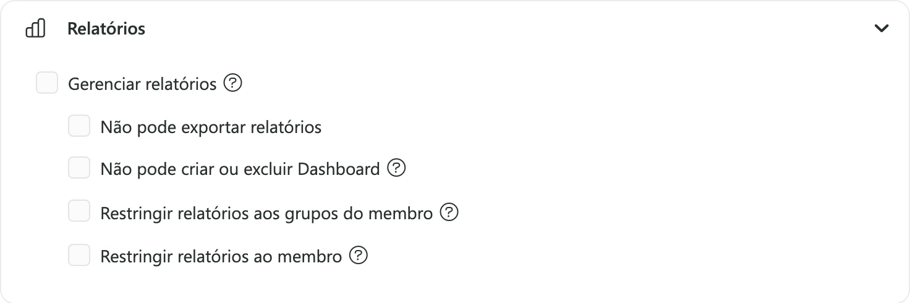

Esta referência reúne quem pode ver cada relatório da Kinbox, o que faz cada restrição de relatório no papel do membro e onde exportar dados em CSV ou Excel.

## Quem pode ver os relatórios

Para acessar **Relatórios**, o papel do membro precisa da permissão **Gerenciar relatórios** ("Ver e gerar relatórios."), configurada no workspace (na tela, **ambiente**) em **Configurações** → **Ambiente** → **Permissões** → abrir o papel (ou **Nova permissão**) → seção **Relatórios** (veja [Criar papéis e permissões](/docs/configuracoes-no-workspace/configurar-permissoes-dos-usuarios)).

- Sem **Gerenciar relatórios**, o item **Relatórios** não aparece no menu lateral.
- O proprietário não precisa dessa permissão no papel. As condições de cada relatório continuam valendo.
- Nos papéis padrão, **Administrador** e **Supervisor** já vêm com **Gerenciar relatórios**; **Atendente** não.

<Frame caption="Seção Relatórios do papel com Gerenciar relatórios e as quatro opções de restrição">
  
</Frame>

## Condições extras por relatório

| Relatório | Além de **Gerenciar relatórios** |
| --- | --- |
| [**Dashboards**](/docs/relatorios/dashboard) | Cada dashboard define em **Visível para** quem o encontra na lista de dashboards (menu do título, **Mudar dashboard**): **Todos**, **Grupos** ou **Apenas para mim**. Cartões de negociações exigem **Gerenciar negociações**. |
| [**Atendimento ao vivo**](/docs/relatorios/ao-vivo) | O mapa e a fila seguem o **Acesso as Conversas** do papel. |
| [**Vendas ao vivo**](/docs/relatorios/ao-vivo) | Exige **Gerenciar negociações**. |
| [**Copiloto**](/docs/relatorios/copiloto) | O item só aparece com pelo menos um recurso do copiloto ligado. |
| **Marketing** (**Meta Ads**, **Google Ads**, **Tracking**) | O aplicativo correspondente precisa estar ativo. |

## O que cada restrição faz

| Restrição | O que faz |
| --- | --- |
| **Restringir relatórios ao membro** | Em relatórios de sessões como [**Visão geral**](/docs/relatorios/visao-geral) e [**Produtividade**](/docs/relatorios/produtividade), e nas listas **Ver sessões**, mostra as sessões em que o membro é o responsável (na [**Avaliação**](/docs/relatorios/avaliacao), as avaliações registradas para ele). Na [**Presença**](/docs/relatorios/presenca), mostra a presença do próprio membro. |
| **Restringir relatórios aos grupos do membro** | Em relatórios de sessões como **Visão geral** e **Produtividade**, e nas listas **Ver sessões**, mostra as sessões dos grupos do membro (na [**Atribuição**](/docs/relatorios/atribuicao), as sessões que estão ou já estiveram nos grupos dele). Se o membro não pertencer a nenhum grupo, ao abrir esses relatórios aparece um aviso de que ele não pertence a nenhum grupo e a Kinbox volta para a tela inicial. |
| **Não pode exportar relatórios** | Na lista **Ver sessões**, o botão **Exportar** fica desativado. |
| **Não pode criar ou excluir Dashboard** | Ao tentar criar, clonar, editar (inclusive cartões e organização) ou excluir um dashboard, aparece um aviso de que não tem permissão. |

**Restringir relatórios ao membro** e **Restringir relatórios aos grupos do membro** se excluem mutuamente: marcar uma desmarca a outra (as duas podem ficar desmarcadas).

## Onde exportar

Todo relatório com exportação oferece **CSV (.csv)** e **Excel (.xlsx)**, gerados no navegador. Não há exportação em PDF nem em imagem.

| Onde | Caminho | O que entra no arquivo |
| --- | --- | --- |
| [**Produtividade**](/docs/relatorios/produtividade), [**Atribuição**](/docs/relatorios/atribuicao), [**Interação**](/docs/relatorios/interacao), [**Presença**](/docs/relatorios/presenca) e [**Avaliação**](/docs/relatorios/avaliacao) | **...** → **Exportar** | A tabela do agrupamento atual (a busca por nome não filtra o arquivo). |
| [**Copiloto**](/docs/relatorios/copiloto) (cada aba) | **...** → **Exportar** | A tabela agrupada da aba atual (em **Atendimento automático**, não inclui **Reaberturas evitadas**). |
| Lista **Ver sessões** (em qualquer relatório de sessões) | **...** da lista → **Exportar** | As colunas escolhidas na lista, para as sessões do filtro atual. |
| Lista **Ver presenças** (em [**Presença**](/docs/relatorios/presenca)) | **...** da lista → **Exportar** | A grade de horários por dia com status online e offline. |
| [**Saldo**](/docs/relatorios/saldo) | **...** → **Exportar extrato** ou **Exportar serviços** | **Exportar extrato**: os débitos do período. **Exportar serviços**: a tabela de serviços (respeita o filtro de categoria, não a busca por nome). |
| [**Ligações**](/docs/relatorios/ligacoes) | **...** → **Exportar** | As ligações do período e da origem escolhida. |

**Relatórios sem opção de exportar:** [**Visão geral**](/docs/relatorios/visao-geral) (exporte pela lista **Ver sessões** dela), [**Atendimento ao vivo**](/docs/relatorios/ao-vivo), [**Vendas ao vivo**](/docs/relatorios/ao-vivo), [**Dashboards**](/docs/relatorios/dashboard) e **Marketing**.

Veja também os guias de [Criar dashboards](/docs/relatorios/dashboard), [Relatório de saldo](/docs/relatorios/saldo), [Relatório de ligações](/docs/relatorios/ligacoes), [Relatório do copiloto](/docs/relatorios/copiloto) e a [Referência de permissões](/docs/administracao/referencia-de-permissoes).
