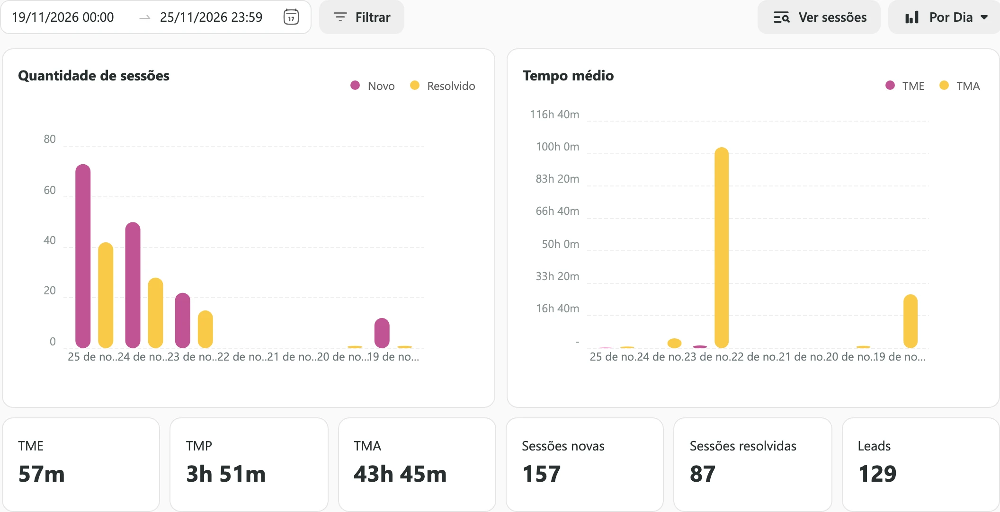

O relatório de **Produtividade** mostra os tempos médios de espera e atendimento (**TME**, **TMP** e **TMA**) e os volumes de sessões, leads e mensagens em um período.

<Note>Para ver este relatório, seu papel precisa da permissão **Gerenciar relatórios** (o proprietário do workspace sempre vê). Se o seu papel tiver **Restringir relatórios ao membro**, você vê só as sessões em que é o responsável; se tiver **Restringir relatórios aos grupos do membro**, você vê só as sessões dos seus grupos.</Note>

## Passo a passo

<Steps>
  <Step title="Abra o relatório">
    No menu lateral, vá em **Relatórios** → **Produtividade**. A tela traz os gráficos **Quantidade de sessões** (com **Novo** e **Resolvido**) e **Tempo médio** (com **TME** e **TMA**), os cartões de resumo e a tabela abaixo.

    <Frame caption="Produtividade agrupada por dia: período, botões Filtrar, Ver sessões e Por Dia, gráficos e cartões de resumo">
      
    </Frame>
  </Step>
  <Step title="Escolha o período">
    Por padrão, o relatório abre nos últimos 7 dias, sem hoje. Clique nas datas para escolher outro intervalo (com data e hora) ou use os atalhos **Hoje**, **Ontem**, **Últimos 7 dias**, **Últimos 30 dias**, **Esse mês** e **Mês passado**. Os números atualizam sozinhos ao mudar o período.
  </Step>
  <Step title="Aplique filtros se precisar">
    Clique em **Filtrar** para recortar por estado, membro, grupo, tag, canal, tipo de canal, campanha, bot, atribuição automática, automação, datas ou [campos personalizados](/docs/configuracoes-no-workspace/campos-personalizados-no-kinbox), e clique em **Aplicar filtros**. Para remover todos, clique em **Limpar filtros**.
  </Step>
  <Step title="Troque o agrupamento">
    Clique em **Por Dia** (padrão) para mudar para **Por Membro**, **Por Grupo**, **Por Tag** ou **Por Canal**. Em **Por Dia**, a tabela lista os dias do mais recente para o mais antigo; nos outros agrupamentos, aparecem primeiro as linhas com mais sessões novas. A primeira coluna muda conforme o agrupamento (**Período**, **Atendente**, **Grupo**, **Tag** ou **Canal**), e sessões sem membro ou sem grupo aparecem em **Sem atribuição** ou **Sem grupo**.
  </Step>
  <Step title="Abra a lista de sessões">
    Clique em **Ver sessões** para listar as sessões do relatório.

    Para investigar um número, clique no cartão ou na célula da tabela: abre uma lista de sessões ligada àquele número. A lista pode não reproduzir o total (por exemplo, a do cartão **TMA** não traz as sessões reabertas, e a coluna **Mensagens** só abre a lista em **Por Membro**, com as sessões da linha).
  </Step>
  <Step title="Exporte o relatório">
    Clique no menu **...** no canto superior direito → **Exportar** e escolha **CSV (.csv)** ou **Excel (.xlsx)**. O arquivo sai com as linhas do agrupamento atual.
  </Step>
  <Step title="Exporte a lista de sessões (opcional)">
    Dentro de **Ver sessões**, a lista tem o próprio **Exportar**. Se o seu papel tiver **Não pode exportar relatórios**, você não consegue exportar a lista de sessões.
  </Step>
</Steps>

## O que cada número quer dizer

| Indicador | O que conta |
| --- | --- |
| **TME** | Tempo médio de espera: da criação da sessão até a primeira resposta de um membro. |
| **TMP** | Tempo médio pós-atribuição: da primeira atribuição a um membro até a primeira resposta de um membro. |
| **TMA** | Tempo médio de atendimento: da primeira resposta de um membro até a resolução. |
| **Sessões novas** | Sessões criadas no período. |
| **Sessões resolvidas** (coluna **Resolvidas**) | Sessões resolvidas no período, mesmo que criadas antes. |
| **Leads** | Sessões novas de contatos criados junto com a sessão. |
| **Mensagens** (coluna) | Mensagens das sessões do período. Em **Por Membro**, as mensagens de membros nas sessões em que ele é o responsável atual; nos outros agrupamentos, o total, e o mouse mostra a divisão entre membros, bots e contatos. |

O relatório considera as sessões criadas ou resolvidas no período. Quando não há dado para um indicador, a tela mostra `-`. Os tempos seguem o **Horário comercial** do workspace, se houver um escolhido (veja [Definir os horários de atendimento](/docs/configuracoes-no-workspace/criar-e-gerenciar-horarios)), e cada sessão conta para o responsável atual nos agrupamentos **Por Membro** e **Por Grupo**: veja [Como os relatórios contam sessões e tempos](/docs/relatorios/como-funcionam).

Para ver quem recebeu cada sessão ao longo do período, use o [Relatório de atribuição](/docs/relatorios/atribuicao); para ver em quantas sessões cada membro interagiu, use o [Relatório de interação](/docs/relatorios/interacao).
