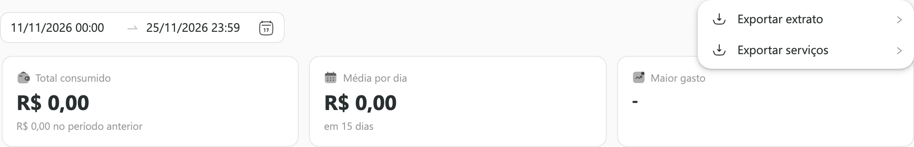

O relatório de **Saldo** mostra quanto do [saldo da carteira](/docs/conceitos/saldo-e-creditos) foi consumido no período escolhido, dividido por categoria, por dia e por serviço, até cada registro de débito. Compras e recargas de saldo não entram aqui: elas ficam no **Histórico de recargas**.

<Note>Para ver este relatório, seu papel precisa da permissão **Gerenciar relatórios** (o proprietário do workspace sempre vê).</Note>

## Onde fica

- No menu lateral, vá em **Relatórios** → **Saldo**.
- Outro caminho: **Configurações** → **Assinatura** → **Saldo disponível** (abre o **Histórico de recargas**) → **Ver relatório de uso**, se o botão aparecer (precisa de **Gerenciar relatórios**; veja [Adicionar saldo](/docs/assinatura/adicionar-saldo)). Se ele não aparecer, use o menu **Relatórios**.

## Período

Por padrão, o relatório abre nos últimos 15 dias, sem hoje. Clique nas datas para escolher outro intervalo (com data e hora) ou use os atalhos **Hoje**, **Ontem**, **Últimos 7 dias**, **Últimos 30 dias**, **Esse mês** e **Mês passado**.

Trocar o período atualiza juntos os cartões, os gráficos e a tabela. Os dias são contados no horário de Brasília.

## Os cartões

| Cartão | O que mostra |
| --- | --- |
| **Total consumido** | Soma dos débitos no período. Abaixo, mostra o valor gasto no período anterior (**R$ 0,00 no período anterior** quando não houve consumo) e, quando esse valor é maior que zero, a variação percentual (se subiu ou caiu). |
| **Média por dia** | Total consumido dividido pela quantidade de dias do período. |
| **Maior gasto** | Serviço que mais consumiu no período, com valor e porcentagem do total (`-` quando não há consumo). Clicar no cartão abre o detalhe desse serviço. |

O **período anterior** tem a mesma duração do período escolhido e termina imediatamente antes do início dele.

## Por categoria e por dia

- **Por categoria:** mostra o consumo em gráfico de rosca e lista com valor e porcentagem. Clique em uma categoria para filtrar os cartões, o gráfico **Consumo por dia**, a tabela **Serviços** e a opção **Exportar serviços** — os títulos passam a exibir o nome da categoria escolhida. Clique novamente na categoria ou em **Limpar filtro** para desfazer.
- **Consumo por dia:** exibe o valor consumido dia a dia em barras empilhadas por categoria.

## Categorias

| Categoria | Exemplos de serviços |
| --- | --- |
| **Copiloto** | Sugestões e chat do copiloto, **Avaliadores do copiloto** (usados na aba **Qualidade** do [Relatório do copiloto](/docs/relatorios/copiloto)) e **Revisor de mensagens** |
| **Agente de IA** | Uso do agente de IA e processamento da base de conhecimento |
| **Análises** | **Análise de sentimento**, **Lead score**, **Classificação de intenção**, **Cliente preso no bot** e outros avisos e sugestões automáticos |
| **Voz e áudio** | Ligações e gravações do WhatsApp, transcrições e resumos de chamadas, transcrição de áudio e ligações atendidas por IA |
| **Outros** | Débitos sem categoria própria, exibidos pela descrição |

Ligações por telefone (VoIP) e minutos além da franquia do plano de ligações do WhatsApp aparecem em **Outros**. Créditos de SMS usam outro saldo e não entram neste relatório.

## Serviços, detalhe e extrato

A tabela **Serviços** lista o consumo de cada serviço no período, com a quantidade de usos, o valor e a participação no total. Clique em um cabeçalho para mudar a ordenação ou use **Buscar serviço** para filtrar pelo nome.

- **Detalhe de um serviço:** clique em uma linha da tabela (ou no cartão **Maior gasto**) para abrir o painel do serviço com os cartões **Valor no período**, **Usos** (com a quantidade de registros), **Custo por uso** e **Período anterior**, o gráfico **Valor por dia** e a lista **Registros** (carregada aos poucos conforme você rola).
- **Extrato completo:** clique em **Ver extrato** acima da tabela para abrir o painel **Extrato do saldo**, com os débitos do período.
- **Detalhe de um registro:** clique em um item de **Registros** para abrir o painel **Detalhe**, com a descrição, a data, o valor e os identificadores ligados ao débito. Quando o débito vem de uma conversa, o botão **Ver conversa** abre a conversa.

Análises de custo muito pequeno são agrupadas antes de virar um débito na carteira. Por isso, **Usos** pode ser maior que a quantidade de registros e parte do consumo de um dia pode aparecer no dia seguinte.

## Exportar

Clique no menu **...** no canto superior direito e escolha entre **Exportar extrato** e **Exportar serviços**, nos formatos **CSV (.csv)** ou **Excel (.xlsx)**:

- **Exportar extrato:** baixa os débitos do período.
- **Exportar serviços:** baixa a tabela de serviços, com o valor do período anterior. Se você filtrou por uma categoria em **Por categoria**, o arquivo respeita esse filtro; a busca por nome não filtra o arquivo.

<Frame caption="Topo do relatório Saldo com seletor de período, os cartões Total consumido, Média por dia e Maior gasto e o menu ... aberto com Exportar extrato e Exportar serviços">
  
</Frame>

Para acompanhar a minutagem e o histórico das chamadas, veja o [Relatório de ligações](/docs/relatorios/ligacoes). Para receber aviso antes de o saldo acabar, configure o [Alerta de saldo](/docs/assinatura/alerta-de-saldo), e para ver quais análises do copiloto consomem saldo, consulte [Analisar conversas com IA](/docs/copiloto/analises-de-ia).
