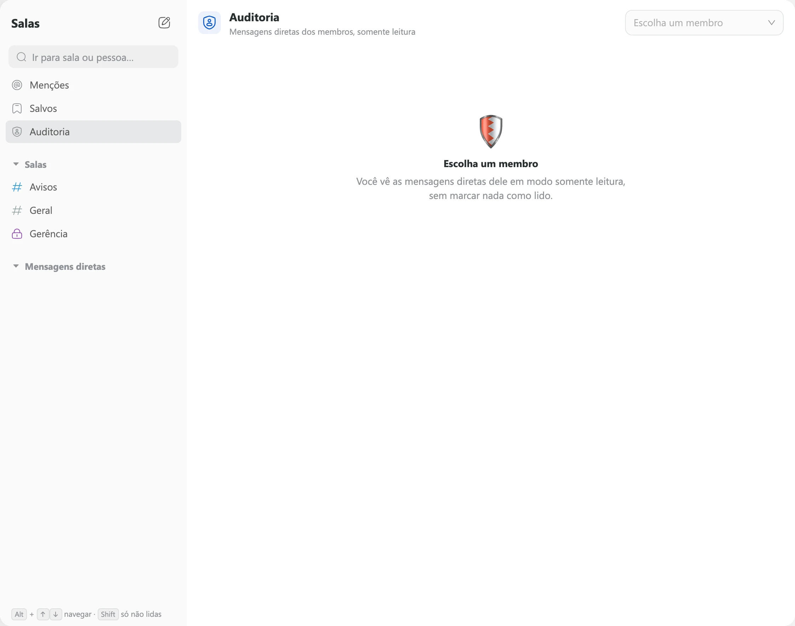

A **Auditoria** das **Salas** permite que quem administra o workspace leia, em modo somente leitura, as mensagens diretas trocadas entre os membros (por exemplo, para conferir uma combinação ou apurar uma reclamação interna). As mensagens diretas que envolvem o proprietário ficam de fora: o proprietário não aparece para escolher, e as conversas de qualquer membro com ele não entram na lista.

## Antes de começar

<Note>
  Quem pode: você precisa da permissão **Auditar mensagens diretas** (seção **Outros** do papel) ou ser o proprietário do workspace (na tela, **ambiente**), além de ter acesso às salas (sem a restrição **Não pode acessar as salas**). Nenhum papel pronto traz **Auditar mensagens diretas**: é preciso marcá-la em um papel (veja [Criar papéis e permissões](/docs/configuracoes-no-workspace/configurar-permissoes-dos-usuarios) e [Referência de permissões](/docs/administracao/referencia-de-permissoes)).

  O item **Auditoria** some da lista enquanto há texto no campo "Ir para sala ou pessoa…" (assim como **Menções** e **Salvos**). Se ele não aparecer com o campo vazio, falta a permissão **Auditar mensagens diretas**.
</Note>

## Passo a passo

<Steps>
  <Step title="Abra a Auditoria nas Salas">
    Clique no botão **Salas** (ícone **@**) no topo da tela, à direita, e depois em **Auditoria**, abaixo de **Menções** e **Salvos**. Se **Auditoria** não aparecer, limpe o campo "Ir para sala ou pessoa…" no topo da lista; se ainda assim não aparecer, falta a permissão **Auditar mensagens diretas**. A tela mostra o subtítulo "Mensagens diretas dos membros, somente leitura" e a mensagem "Escolha um membro" — "Você vê as mensagens diretas dele em modo somente leitura, sem marcar nada como lido."

    <Frame caption="Tela Auditoria das Salas com o seletor Escolha um membro no canto superior direito">
      
    </Frame>
  </Step>
  <Step title="Escolha um membro">
    No seletor **Escolha um membro**, no canto superior direito, selecione a pessoa desejada. Você pode digitar o nome para filtrar, sem precisar de acentos. A lista mostra todos os membros em ordem alfabética, menos o proprietário.
  </Step>
  <Step title="Escolha a mensagem direta">
    Aparecem as mensagens diretas daquele membro, da mais recente para a mais antiga, com o nome do outro participante, a quantidade de mensagens e a data da última ("última em…"). Entram apenas conversas que têm pelo menos uma mensagem; colegas que já saíram do workspace aparecem como "Membro removido". Se não houver nenhuma, a tela mostra que o membro não tem mensagens diretas (por exemplo, "Carla não tem mensagens diretas").
  </Step>
  <Step title="Leia o histórico">
    Clique em uma conversa para ler as mensagens. O topo mostra os dois participantes (por exemplo, "Carla ↔ Bruno") e o selo **Somente leitura**. Mensagens antigas carregam ao rolar para cima; respostas em thread abrem no painel **Thread**, também em modo somente leitura.
  </Step>
</Steps>

## O que a auditoria mostra e o que não muda

- **Somente leitura:** não há campo para escrever nem ações nas mensagens (como reagir, fixar ou excluir).
- **Sem avisos nem mudança de leitura:** os membros não são avisados e as mensagens continuam como estavam (lidas ou não lidas).
- **Aviso na mensagem direta:** na tela da mensagem direta, os membros veem o texto "Só vocês dois veem estas mensagens.", mas o proprietário e quem tem a permissão **Auditar mensagens diretas** podem ler a conversa (exceto as que envolvem o proprietário).
- **Apenas mensagens diretas:** a **Auditoria** cobre só mensagens diretas. Para ver as salas públicas e privadas não é preciso auditar: o proprietário já vê todas as salas (inclusive as privadas), e os demais membros veem as salas públicas e as privadas de que participam.

Não confunda esta tela com [Ver o histórico de alterações (Auditoria)](/docs/administracao/auditoria), que fica em **Configurações** → **Auditoria** e registra quem criou, alterou ou excluiu itens no workspace.

## Problemas comuns

- **O item Auditoria não aparece na lista das salas.** Primeiro, apague o texto do campo "Ir para sala ou pessoa…": com texto nesse campo, a lista esconde **Auditoria**, **Menções** e **Salvos**. Se o item continuar sem aparecer, falta a permissão **Auditar mensagens diretas** (seção **Outros**) no seu papel. Nenhum papel pronto traz essa permissão; peça ao proprietário ou a quem administra os papéis para marcá-la.
- **O membro não aparece no seletor Escolha um membro.** O proprietário do workspace não aparece na lista porque as mensagens diretas que o envolvem ficam de fora da auditoria.
- **Aparece o aviso de que o membro não tem mensagens diretas (por exemplo, "Carla não tem mensagens diretas").** Só aparecem conversas com pelo menos uma mensagem enviada, e as conversas desse membro com o proprietário não entram na auditoria.

## Veja também

- [Salas: o chat interno da equipe](/docs/salas/visao-geral)
- [Conversar nas salas: mensagens diretas, menções e threads](/docs/salas/usar-salas)
- [Criar papéis e permissões](/docs/configuracoes-no-workspace/configurar-permissoes-dos-usuarios)
- [Referência de permissões](/docs/administracao/referencia-de-permissoes)
- [Ver o histórico de alterações (Auditoria)](/docs/administracao/auditoria)
