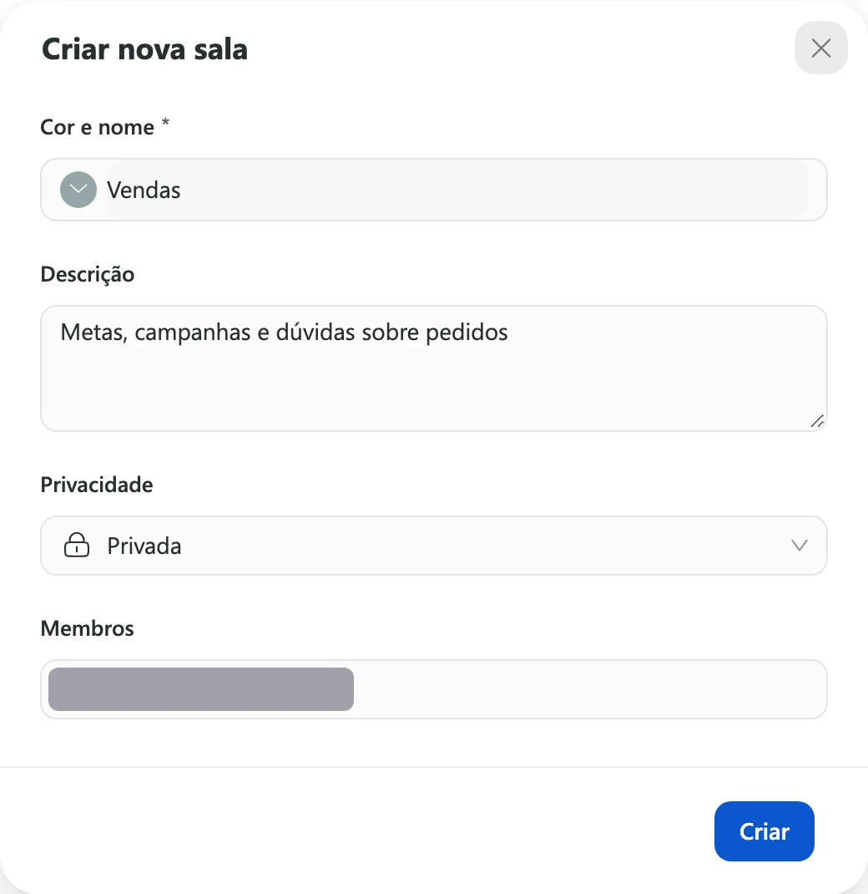
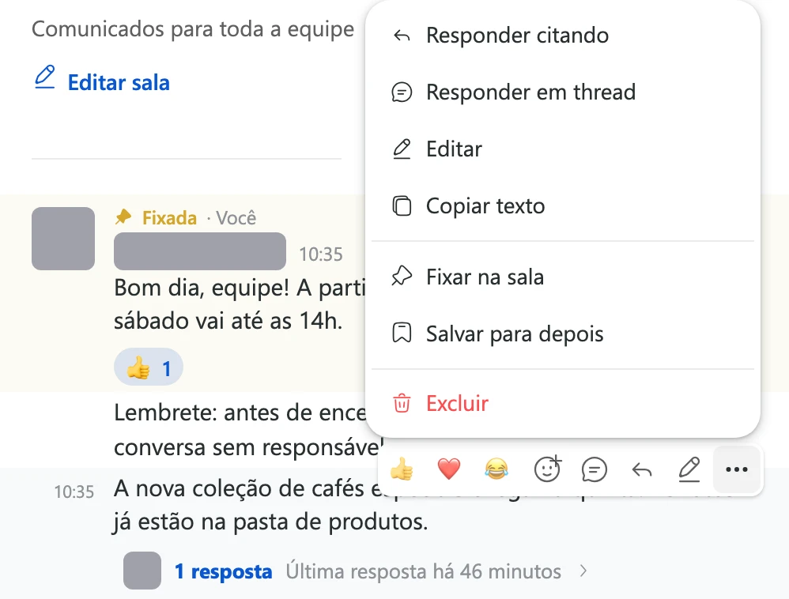

Crie e organize salas públicas ou privadas, envie mensagens, arquivos e áudios, mencione colegas com **@**, responda em thread, acompanhe **Menções** e **Salvos** e controle suas notificações nas **Salas** da Kinbox.

## Antes de começar

<Note>
  Quem pode no workspace (na tela, **ambiente**):

  - **Usar as salas:** todo membro, exceto quem tem a restrição **Não pode acessar as salas** no papel (quadro **Restrições** da seção **Outros**). O proprietário nunca é bloqueado. Se o botão **Salas** não aparecer no topo, peça a quem administra o workspace para tirar **Não pode acessar as salas** do seu papel.
  - **Criar, editar, clonar, ordenar e excluir salas:** quem tem a permissão **Salas** (seção **Gerenciamento do Ambiente**) ou o proprietário. Os papéis prontos **Atendente**, **Supervisor** e **Administrador** já trazem essa permissão. Mandar mensagem, reagir, responder, fixar, salvar e buscar não dependem dela.

  Veja [Criar papéis e permissões](/docs/configuracoes-no-workspace/configurar-permissoes-dos-usuarios) e [Referência de permissões](/docs/administracao/referencia-de-permissoes).
</Note>

## Criar uma sala

Para criar uma sala, você precisa da permissão **Salas** ou ser o proprietário. Se o lápis **Criar sala** não aparecer ao lado do título **Salas**, falta essa permissão.

<Steps>
  <Step title="Abra as Salas">
    Clique no botão **Salas** (ícone **@**) no topo da tela, à direita.
  </Step>
  <Step title="Abra a janela Criar nova sala">
    Clique no lápis **Criar sala** ao lado do título **Salas** (ou no **+** que aparece ao passar o mouse sobre a seção **Salas**).
  </Step>
  <Step title="Preencha os dados da sala">
    Defina os campos da janela **Criar nova sala**:

    - **Cor e nome** (obrigatório): clique na bolinha à esquerda para escolher a cor e digite o nome da sala (por exemplo, **Vendas**).
    - **Descrição** (opcional): informe sobre o que é a sala. O texto aparece abaixo do nome, no topo da sala.
    - **Privacidade**: escolha **Pública** (padrão; todos os membros do workspace com acesso às salas veem e participam) ou **Privada** (só os membros escolhidos veem, e o proprietário do workspace vê todas as salas, inclusive as privadas).
    - **Membros**: aparece apenas quando **Privacidade** está em **Privada**. Selecione os participantes; você já vem marcado e não pode se remover na criação.

    <Frame caption="Janela Criar nova sala com Privacidade em Privada e o campo Membros">
      
    </Frame>
  </Step>
  <Step title="Conclua a criação">
    Clique em **Criar**. A sala aparece na lista para quem tem acesso a ela.
  </Step>
</Steps>

## Editar, clonar, ordenar ou excluir uma sala

Passe o mouse sobre uma sala na lista e clique em **⋯** (ou clique com o botão direito nela). Dentro da sala aberta, o mesmo menu fica no **⋮** no canto superior direito.

- **Marcar como lida:** aparece apenas quando a sala tem mensagens não lidas.
- **Silenciar sala** / **Ativar notificações:** disponível para todos os membros.
- **Mover para cima** / **Mover para baixo:** aparece quando há mais de uma sala e fica apagado sem a permissão **Salas** ou nas pontas da lista.
- **Editar sala:** abre a janela com os dados da sala e o botão **Salvar**. Também pode ser aberta pelo link **Editar sala** abaixo das boas-vindas da sala e, em sala privada, pelo botão **Adicionar pessoas** no painel **Membros**.
- **Clonar:** abre a janela de criação já preenchida com a mesma cor, descrição, privacidade e membros, e o nome da sala original precedido de uma indicação de cópia. As mensagens não são copiadas.
- **Excluir sala:** pede a confirmação "Tem certeza que deseja excluir essa sala? Todas as mensagens serão perdidas."

Se **Editar sala**, **Clonar** e **Excluir sala** não aparecerem no menu da sala, falta a permissão **Salas**. Mensagens diretas não têm esse menu no navegador: não é possível editar, ordenar nem excluir uma mensagem direta.

<Warning>
  Ao excluir uma sala, ela desaparece para todos os membros, com as mensagens dela, e não dá para desfazer.
</Warning>

## Mandar mensagens, arquivos e áudios

Digite no campo no rodapé da sala ("Mensagem em #Avisos" em uma sala ou "Conversar com Carla" em uma mensagem direta) e pressione `Enter` para enviar. Use `Shift`+`Enter` para pular linha (no navegador do celular, `Enter` apenas pula linha). Dá para usar negrito, itálico e outros estilos na mensagem.

À direita do campo ficam o microfone (**Gravar áudio**, fora de threads), o botão de emoji, o clipe (**Anexar arquivo**) e o botão de enviar.

- **Arquivos:** envie até 10 arquivos por envio clicando em **Anexar arquivo**, colando no campo ou arrastando os arquivos para dentro da sala ("Solte para enviar"). Imagens aparecem em miniatura (clique para ampliar), vídeos e áudios abrem com player e outros arquivos aparecem em cartão com nome e tamanho.
- **Áudio:** clique no microfone **Gravar áudio**, grave e envie; o áudio aparece com player na sala. Dentro de threads não há gravação de áudio.

## Mencionar um colega

Digite `@` no campo de mensagem para abrir a lista **Mencionar**, com até 8 colegas que combinam com o que você digitou. Escolha com as setas e `Enter` ou `Tab`, ou clique no nome; `Esc` fecha a lista. Só aparecem membros ativos que já aceitaram o convite.

A menção aparece destacada no texto, e a mensagem que menciona você ganha destaque na sala. A pessoa mencionada vê a mensagem em **Menções** e recebe aviso no computador mesmo se tiver silenciado a sala. O push da menção chega quando a opção está ligada; no app para celular, sala silenciada não gera push.

A menção funciona para uma pessoa por vez: não há menção coletiva para todos nem para grupos.

## Ações numa mensagem

Passe o mouse sobre uma mensagem para abrir a barra de ações: ela traz as reações rápidas, atalhos para as ações mais usadas e o menu **⋯**, que reúne as ações abaixo. As ações ficam indisponíveis enquanto a mensagem está enviando ou com erro.

<Frame caption="Barra de ações sobre uma mensagem fixada">
  
</Frame>

- **Reagir:** clique em um emoji da barra ou em **Adicionar reação** para escolher outro. As reações aparecem embaixo da mensagem com a contagem; passar o mouse mostra quem reagiu, e clicar de novo no mesmo emoji tira a sua reação.
- **Responder citando:** a resposta entra na sala com a citação da mensagem original.
- **Responder em thread:** abre o painel **Thread** à direita com a mensagem original e o campo "Responder na thread…". Na sala, abaixo da mensagem original, aparece o link de respostas (como "1 resposta" e "Última resposta há…"); clique nele para abrir a thread. As respostas não aparecem soltas na sala, e dentro da thread não há **Responder citando**.
- **Editar:** só o autor pode editar, e só mensagens de texto (arquivos e áudios não são editáveis), sem prazo. Edite no próprio lugar e pressione `Enter` para salvar (`Shift`+`Enter` pula linha e `Esc` cancela). A mensagem ganha "(editado)".
- **Excluir:** o autor exclui as próprias mensagens e o proprietário exclui mensagens de qualquer pessoa (ter a permissão **Salas** não permite excluir mensagens dos outros). A Kinbox pede confirmação com "Tem certeza que deseja excluir essa mensagem?" — se a mensagem tiver thread, avisa também "As respostas da thread também serão excluídas."
- **Fixar na sala** / **Desafixar da sala:** qualquer membro com acesso à sala pode fixar ou desafixar. A mensagem ganha o selo **Fixada** com quem fixou, e o alfinete no topo da sala mostra quantas mensagens estão fixadas e abre o painel **Mensagens fixadas**. Também funciona em mensagens diretas.
- **Salvar para depois** / **Remover dos salvos:** guarda a mensagem só para você, na lista **Salvos**.

<Warning>
  Excluir uma mensagem a remove para todos os membros (inclusive dos **Salvos**) e não tem volta. Se ela tiver thread, todas as respostas também são excluídas.
</Warning>

## Mensagens diretas

Para começar uma mensagem direta, clique no nome do colega na seção **Mensagens diretas** da lista. A mensagem direta passa a existir no primeiro envio. Não é possível mandar mensagem direta para você mesmo.

A seção traz os colegas que já aceitaram o convite, e quem conversou com você por último aparece primeiro (membros inativos aparecem esmaecidos). Se o seu papel tiver a restrição **Só pode ver membros que sejam dos seus grupos nos DMs.**, você só vê e manda mensagem direta para colegas que têm algum grupo em comum com você (veja [Criar grupos de atendimento](/docs/configuracoes-no-workspace/criar-e-gerenciar-grupos)).

Embaixo da sua última mensagem aparece "Visto" quando a outra pessoa já leu — esse indicador existe apenas em mensagens diretas. Mensagens diretas permitem fixar e buscar mensagens, mas não têm painel **Membros** nem menu **⋮**.

Na lista, a mensagem direta aparece só para as duas pessoas, mas o proprietário e quem tem **Auditar mensagens diretas** podem lê-la em modo somente leitura, exceto as que envolvem o proprietário (veja [Auditar as mensagens diretas dos membros](/docs/salas/auditar-mensagens-diretas)).

## Menções, Salvos e busca

- **Menções:** atalho no topo da lista que mostra "Mensagens em que você foi mencionado" em todas as salas, com sala, autor, data e texto. Clique em um item para ir à mensagem (ou abrir a thread, se for resposta).
- **Salvos:** atalho no topo da lista com "Mensagens que você guardou para ver depois". Só você vê os seus salvos. Para remover, passe o mouse e clique em **Remover dos salvos** (sem confirmação).
- **Buscar mensagens:** clique na lupa no topo da sala para abrir **Buscar mensagens**, digite em "Buscar por texto…" e escolha **Nesta sala** (**Nesta conversa** em uma mensagem direta) ou **Todas as salas**. Clique em um resultado para ir até a mensagem. A lupa busca no texto das mensagens; já o campo "Ir para sala ou pessoa…", no topo da lista, encontra salas e colegas pelo nome.

## Não lidas e silenciar

Salas com mensagens não lidas aparecem em negrito com o número na lista. Ao abrir uma sala com mensagens não lidas, elas passam a contar como lidas (ou use **Marcar como lida** no menu da sala, se aparecer). Se você estiver lendo mensagens antigas, o botão no rodapé (**Ir para o fim** ou a contagem de novas mensagens) leva ao final.

Para silenciar uma sala, abra o menu dela e clique em **Silenciar sala** (para reativar, **Ativar notificações**). Silenciar vale por pessoa: você continua vendo as mensagens, mas a sala deixa de somar no número do botão **Salas**. No navegador, menções e respostas em threads de que você participa ainda avisam; no app para celular, sala silenciada não gera push. Mensagens diretas não têm opção de silenciar no navegador.

Com a Kinbox aberta no navegador, chega um aviso no canto da tela quando o painel **Salas** está fechado. Com o painel aberto, a mensagem comum não gera aviso visual, mas pode tocar som; se a sala estiver na tela, a mensagem já conta como lida. O som segue **Quando receber mensagem de time** em **Configurações** → **Notificações**, e o push (**Mensagem de time**) avisa menções e mensagens diretas — veja [Receber notificações no navegador e no celular](/docs/conta/notificacoes).

## Painel Membros

Em salas (não em mensagens diretas, nem no navegador do celular), o botão com o número de participantes no topo (dica "Membros") abre o painel **Membros** à direita. Em telas largas, ele abre sozinho até você fechar pelo **X**.

O painel mostra "Sala pública: todos do workspace" ou a contagem de membros da sala privada, o campo **Buscar membro** e os grupos **Online** e **Offline**. Em salas privadas, se você tiver a permissão **Salas** ou for o proprietário, aparece também **Adicionar pessoas** (se não aparecer, a sala é pública ou falta essa permissão). Se **Nota de avaliação pública** estiver ligada em **Configurações** → **Ambiente** → **Geral**, a nota com estrela aparece ao lado de cada membro (veja [Pedir avaliação no fim do atendimento](/docs/atendimento/pesquisa-de-satisfacao)).

## Problemas comuns

- **O botão Salas não aparece no topo.** O seu papel tem a restrição **Não pode acessar as salas**. Peça a quem administra o workspace para tirá-la do seu papel.
- **Não consigo criar, editar ou excluir uma sala.** Se o lápis **Criar sala** não aparecer ou se **Editar sala** e **Excluir sala** não aparecerem no menu da sala, falta a permissão **Salas** (seção **Gerenciamento do Ambiente**) no seu papel.
- **Não consigo mandar mensagem direta para um colega.** Confira se o colega já aceitou o convite para o workspace e se o seu papel não tem a restrição **Só pode ver membros que sejam dos seus grupos nos DMs.** (com ela, você só vê e manda mensagem direta para colegas que têm algum grupo em comum com você). Não é possível mandar mensagem direta para você mesmo.
- **Não consigo editar uma mensagem.** Apenas o autor pode editar, e apenas mensagens de texto (arquivos e áudios não podem ser editados).
- **Aparece o aviso "Envie no máximo 10 arquivos".** Cada envio aceita até 10 arquivos; separe os arquivos em mais de um envio.
- **Não recebo aviso das mensagens da sala.** Confira se a sala não está silenciada (sino cortado na lista e no topo) e verifique as opções de **Som** e **Push** em [Receber notificações no navegador e no celular](/docs/conta/notificacoes).

## No celular

No app da Kinbox para celular (iPhone e celular Android), a aba **Salas** traz a maior parte dessas ações (veja [App da Kinbox para celular: o que dá para fazer](/docs/app/visao-geral)). Reações, threads, edição de mensagem, fixar, salvar, busca de mensagens, **Menções**, **Salvos** e **Auditoria** não estão disponíveis no app. Pelo navegador do celular, sem o app, o painel **Salas** abre em tela cheia, uma coluna por vez.

## Veja também

- [Salas: o chat interno da equipe](/docs/salas/visao-geral)
- [Auditar as mensagens diretas dos membros](/docs/salas/auditar-mensagens-diretas)
- [Receber notificações no navegador e no celular](/docs/conta/notificacoes)
- [Atender uma conversa: responder, notas, resolver e reabrir](/docs/conversas/gerenciar-conversas)
- [Criar papéis e permissões](/docs/configuracoes-no-workspace/configurar-permissoes-dos-usuarios)
